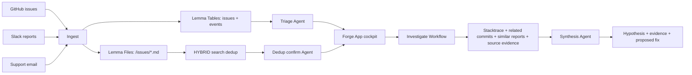
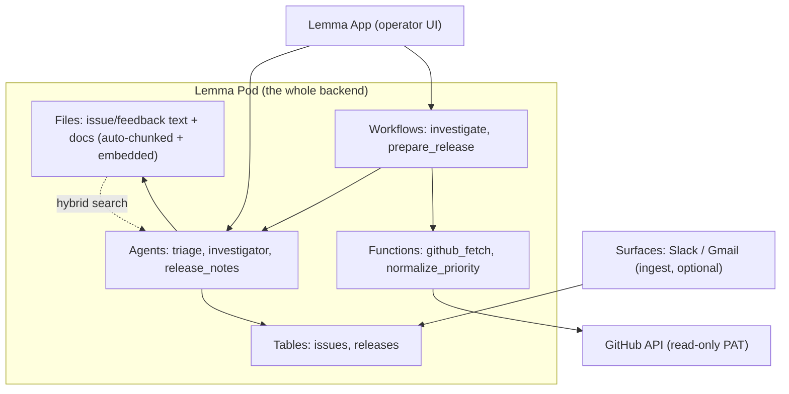

# Forge Project Bible

> Single source of truth for the Top-25 hackathon call, demo, product story, architecture, implementation details, team narrative, judge Q&A, and raw project evidence.

Product: **Forge**
Organizer: **Gappy AI National Hackathon**
Track: **Engineering - AI Bug Triage & Release Operator**
Stack: **Lemma SDK as backend and app platform**
Live app: `https://forge.apps.lemma.work`
Pod: `forge` / `019f01ec-5992-732f-b395-a2b29fc87254`
Demo repo: `cli/cli`

---

## 0. How To Use This Bible

Read the first 23 sections before the call. They are the prepared story, script, demo path, fallback plan, Q&A, and team split. The appendices embed the authoritative project docs, contracts, decisions, execution log, pod resource definitions, function manifests, scripts, and seed data so this one file can answer deep implementation questions without hunting around the repo.

---

## 1. One-Screen Memory Sheet

| Topic | Answer |
|---|---|
| Product name | Forge |
| One-liner | Forge is an AI bug triage and investigation cockpit for a founding engineer drowning in GitHub, Slack, and support email reports. |
| User | Alex, founding engineer / dev lead at a 5-15 person startup. |
| Pain | The triage tax: sorting reports, spotting duplicates, judging severity, finding repro steps, and gathering source evidence before fixing. |
| Promise | Make the next critical bug and context to fix it the first thing Alex sees. |
| Core loop | Ingest feedback -> triage -> dedup -> ranked queue -> investigate -> source-grounded proposed diff. |
| Hero proof | Forge finds real `cli/cli` source lines and renders a proposed unified diff anchored to those fetched lines. |
| Primary issue | `gh_142`, `gh pr create` nil-pointer crash, linked to Slack report `iss_003`. |
| Backup issue | `gh_158`, SSO/token failure, linked to email `iss_007` and divergent-language Slack report `iss_025`. |
| SDK story | Tables, Files, Agents, Functions, Workflow, App. Lemma is the backend, not a wrapper. |
| Best product judgment | We cut anything Lemma already provides or anything that weakens the core loop. |
| Honesty line | GitHub/source grounding is real; Slack/email are seeded for a deterministic demo. |
| Do not say | Autonomous merge, fake confidence, live Slack OAuth, built Release Center, or product name Gappy. |

Close with:

> Forge is intentionally narrow: one end-to-end loop where messy reports become a ranked queue, duplicates are linked across sources, the hard bug is investigated with evidence, and the developer gets a source-grounded starting diff.

---

## 2. Call Strategy

The organizer asked for a 20-minute Google Meet covering 2 minutes of problem statement, a full end-to-end demo, and the last 2 minutes on who did what.

The goal is to make judges believe three things:

1. The problem is real and specific.
2. The product loop works end to end.
3. The team made strong cuts and used Lemma deeply.

Winning frame:

```text
Forge is not a generic AI dashboard.
Forge is a working operator loop for one painful engineering workflow.
```

Repeat the phrase:

```text
Evidence, not vibes.
```

Use it for no fake confidence percentages, clickable related reports, real source citations, proposed diffs anchored to fetched lines, and audit timeline for human overrides.

---

## 3. Scoring Argument

| Criterion | Weight | Forge answer |
|---|---:|---|
| Problem clarity and real-world fit | 35% | One persona: Alex. One pain: triage tax across GitHub, Slack, email. |
| Product judgment | 25% | Narrow loop, explicit cut list, no redundant infra, no fake confidence, no broad dashboards. |
| Execution | 25% | Working app, data pipeline, agents, functions, workflow, smoke scripts, deployed demo. |
| SDK utilization | 15% | Lemma Tables, Files, Agents, Functions, Workflow, and App are central to the product. |

Best line:

> We spent our time making one workflow real and verifiable instead of building a broad but shallow dashboard.

---

## 4. Twenty-Minute Call Runbook

| Time | Segment | Owner | Output |
|---:|---|---|---|
| 0:00-0:30 | Setup | Product lead | Confirm screen visible and state agenda. |
| 0:30-2:30 | Problem statement | Product lead | Land Alex, pain, and promise. |
| 2:30-15:30 | End-to-end demo | Demo driver + narration | Show queue, triage, dedup, overrides, audit, investigation, source citation, diff. |
| 15:30-17:30 | Architecture and product judgment | Technical lead | Show Lemma primitive map and cuts. |
| 17:30-19:30 | Who did what | All 3 | Crisp contribution split. |
| 19:30-20:00 | Close | Product lead | Repeat the promise and invite final questions. |

Opening:

> Thanks for having us. We will keep this structured: two minutes on the problem, then the working Forge demo, then the team split. I will start with the user and pain.

---

## 5. Two-Minute Problem Statement Script

> Forge is built for Alex, a founding engineer or dev lead at a 5-15 person startup. Alex does not have a dedicated triage team. Every morning, bug reports arrive from GitHub, Slack, and support email.
>
> The expensive part is not just fixing code. It is deciding what matters first, noticing that three reports are the same underlying crash, finding reproduction steps, and gathering enough source evidence to start the fix.
>
> Existing tools solve pieces of this. GitHub tracks issues. Slack has reports. Support inboxes hold customer pain. Sentry catches runtime errors. But Alex still has to connect those signals manually.
>
> Forge turns that messy stream into one ranked operator queue, then investigates the hard bugs with evidence. It shows the AI's triage reason, related reports, source citations, and a proposed diff anchored to real fetched source lines.
>
> The product promise is simple: make the next critical bug and the context to fix it the first thing Alex sees.

---

## 6. Exact Demo Path

Before the call open Forge, the architecture/README tab, an optional GitHub source citation tab, and this bible. Start on the queue with `gh_142` visible.

1. Show the queue. Say: "This is the operator cockpit. GitHub issues, Slack reports, and support emails land in one ranked queue."
2. Show source/account switcher. Say: "Reports keep their source and account context, but Alex does not need to triage each inbox separately."
3. Open `gh_142`. Say: "Forge shows identity, source, priority, status, assignee, and AI triage reason."
4. Show triage reason and repro. Say: "The triage agent returns strict JSON. A validator writes it back, so the LLM judges but does not directly mutate state."
5. Show related reports. Say: "Dedup uses Lemma Files HYBRID search over `/issues/*.md`, then a read-only dedup agent confirms same-root-cause candidates."
6. Open the three-dot menu. Say: "The AI proposes; the operator stays in control through guarded Functions."
7. Show audit timeline. Say: "Every meaningful action becomes an event: ingested, triaged, linked, investigated, and operator overrides."
8. Run or show investigation. Say: "This is the hero workflow: stack trace, commits, similar issues, source evidence, then synthesis."
9. Show hypothesis. Say: "The result is evidence-first, not a fake confidence score."
10. Show evidence cards. Say: "URLs are produced by deterministic gatherers, not invented by the model."
11. Show proposed fix. Say: "The diff is anchored to real `cli/cli` source lines and is an inspectable starting point."
12. Click source citation if stable. Say: "This is the falsifiable part. You can inspect the real file and line."
13. Show architecture/pod. Say: "Lemma is the backend: Tables, Files, Agents, Functions, Workflow, and App."
14. Close. Say: "The next critical bug, duplicate context, source evidence, and first fix direction are first."

---

## 7. Primary And Backup Demo Anchors

### `gh_142` Primary

Use for critical issue, Slack duplicate `iss_003`, source-grounded investigation, and proposed diff. Best line: "This issue is the hero because Forge can go from a report to a real source citation and an inspectable diff."

### `gh_158` Backup

Use for SSO/token failure, email report `iss_007`, Slack report `iss_025`, and semantic dedup. Best line: "This one proves the dedup is not only keyword matching; the Slack report uses everyday language while the GitHub issue talks about SSO/token failure."

---

## 8. Fallback Lines

If live investigation is slow:

> The live workflow can take longer depending on backend latency, so for the call I am showing the captured result from the same investigation workflow. The path is the same: stack-trace analysis, related commits, similar reports, source grounding, then synthesis.

If app shows seed/sample mode:

> This mode uses the same issue shape and same UI path. We use it as a deterministic fallback; the live pod path has already been smoke-tested.

If Slack/email OAuth comes up:

> GitHub is the live read-only source. Slack and email are seeded into the same `issues` Table for a deterministic demo. We intentionally did not spend hackathon time on OAuth setup.

If asked whether Forge fixes the bug:

> It does not auto-merge a fix. Forge proposes a small diff anchored to real fetched source lines. A developer can inspect it, copy it, and turn it into a PR.

---

## 9. Product And Feature Deep Dive

Alex is a founding engineer or dev lead at a 5-15 person startup. Alex has no dedicated triage team, feedback comes from many places, and fixing the right bug matters more than processing every report perfectly.

The triage tax is reading reports, guessing severity, finding reproduction steps, spotting duplicates, and hunting source evidence before fixing.

Forge is a triage cockpit, dedup layer, investigation workflow, and human trust surface. It is not a generic tracker, chatbot, analytics dashboard, fully autonomous engineer, or final-release manager.

Feature inventory:

- Priority Queue: ranked, critical-first, source/account-aware, searchable, filterable.
- AI Triage: strict JSON priority/repro/reason, read-only agent, validated writer.
- Dedup: Lemma Files HYBRID search, read-only confirmation agent, symmetric links.
- Investigation: stack trace, commits, similar issues, real source grounding, hypothesis, evidence, proposed fix.
- Trust controls: priority/assignee/status overrides through Functions.
- Audit timeline: events for ingested, triaged, linked, investigated, and operator overrides.

---

## 10. Lemma Architecture Summary

Lemma is the stack. Forge is not a custom backend with Lemma bolted on.

| Primitive | Usage |
|---|---|
| Tables | `issues` queue state and `events` audit timeline. |
| Files | `/issues/*.md` hybrid search, dedup, retrieval. |
| Agents | `triage`, `dedup_confirm`, `investigate_synth`. |
| Functions | Validated writes and deterministic evidence gathering. |
| Workflow | `investigate` graph. |
| App | Single-file cockpit at `https://forge.apps.lemma.work`. |

Workflow sequence:

```text
intake FORM
-> analyze_stacktrace
-> fetch_related_commits
-> find_similar_evidence
-> fetch_source_evidence
-> investigate_synth
-> end
```

Trust boundary:

```text
LLMs judge and synthesize.
Functions validate, write, and gather evidence.
Humans override and approve.
Events record the path.
```

---

## 11. Judge Q&A

### What problem are you solving?

The triage tax for small engineering teams. Forge ranks reports, links duplicates, and gives source-grounded evidence so the engineer starts with context instead of a pile.

### Who is the user?

Alex, a founding engineer or dev lead at a 5-15 person startup without a dedicated triage team.

### What is the most impressive technical part?

The investigation workflow: deterministic gatherers plus one synthesis agent, real `cli/cli` source grounding, and a proposed diff anchored to fetched lines.

### How do you prevent hallucinations?

LLMs do not directly mutate state. Triage output is strict JSON and goes through a validator. Evidence URLs are produced by Functions. Synthesis may cite only provided evidence. No real source line means no proposed fix.

### Why no vector DB?

Lemma Files already provide chunking, embeddings, and HYBRID search. A separate vector DB would duplicate the platform.

### What is real vs seeded?

GitHub issues/source grounding are real against public `cli/cli`. Slack and email are seeded into the same table for deterministic cross-source demo. The triage, dedup, investigation, UI, and event path are real Forge paths.

### Why not Jira/Linear/GitHub/Sentry?

Those tools hold pieces. Forge connects triage, cross-source duplicate detection, and source-grounded investigation in one operator loop for a small team.

### Why skip Release Center?

Verifiable investigation was stronger. Reading real source and proposing a real diff beats adding a second, shallower feature area.

### What next?

Live Slack/Gmail surfaces, PR creation from proposed diff with human approval, and team-specific learning over resolved issues.

---

## 12. Product Judgment Cut List

| Cut | Why | Instead |
|---|---|---|
| Vector DB | Lemma Files already search. | `/issues/*.md` + HYBRID search. |
| Postgres/Redis/FastAPI | Lemma Tables, Functions, Workflow, App cover the backend. | Lemma-native backend. |
| Fake confidence | Misleading. | Evidence links and source citations. |
| Release Center | Split focus. | Verifiable investigation hero. |
| Live Slack/email OAuth | High demo risk. | Seeded same-shape reports. |
| Auto-merge | Wrong trust boundary. | Inspectable proposed diff. |
| Analytics dashboard | Not the core pain. | Audit timeline and evidence trail. |

Best answer: "We did not build less because we could not think of more. We built less because a narrow, verifiable loop is the right product judgment."

---

## 13. Verification Commands

```powershell
.venv/Scripts/python.exe scripts/smoke.py --quick
.venv/Scripts/python.exe scripts/smoke.py
.venv/Scripts/python.exe scripts/check_connection.py
.venv/Scripts/python.exe scripts/smoke_triage.py
.venv/Scripts/python.exe scripts/smoke_dedup.py
.venv/Scripts/python.exe scripts/smoke_app_dedup.py
.venv/Scripts/python.exe scripts/smoke_investigate.py
.venv/Scripts/python.exe ingest/investigate/run_investigate.py gh_142
lemma apps deploy forge ./app/index.html --yes
```

Test answer: "We have stage-level smoke tests and a full-loop smoke. Quick smoke checks connection, triage, dedup, and app-visible related data. Full smoke also runs live investigations and asserts cited evidence plus proposed fix."

---

## 14. Team Contribution Script

Product lead:

> I owned the product framing, primary persona, demo story, and scope decisions. I kept the product centered on Alex's triage pain and helped cut features that would weaken the core loop.

App/UX lead:

> I owned the Lemma App cockpit: ranked queue, source/account switcher, issue detail, related reports, investigation view, proposed diff rendering, human override controls, and audit timeline.

Lemma backend/workflow lead:

> I owned the Lemma pod resources: Tables, Files, triage and dedup agents, validated Functions, the investigation Workflow, source grounding, and smoke scripts.

Team close:

> The team split was contract-first: one data shape, one core loop, then parallel work. That is why the final build is cohesive instead of three disconnected hackathon features.

---

## 15. Pre-Call Checklist

- [ ] Run one full timed rehearsal.
- [ ] Confirm screen-share person.
- [ ] Confirm primary issue `gh_142` and backup `gh_158`.
- [ ] Open Forge, architecture tab, optional source citation tab, and this bible.
- [ ] Turn off notifications.
- [ ] Set browser zoom readable on Meet.
- [ ] Test microphones.
- [ ] Keep charger and hotspot ready.
- [ ] Run quick smoke if environment is available.
- [ ] Decide live investigation vs captured result.
- [ ] Assign Q&A owners.

Do not start with code. Start with product.

---

## 16. Red Lines

Do not say: Gappy is the product, live Slack OAuth is built, the fix is auto-merged, the model has a confidence percentage, Release Center is built, this replaces Jira/Linear/Sentry, this is fully autonomous engineering, or everything is live when using captured results.

Say instead: Forge is the product, Slack/email are seeded for deterministic demo, the diff is inspectable, evidence beats fake confidence, and Forge complements existing trackers by solving triage/investigation.

---

## 17. Failure Recovery

If app fails, refresh once, then switch to captured/seed path and continue. If workflow is slow, use saved sample result. If source link opens slowly, point to the visible URL/line range and continue. If seeded data is challenged, explain deterministic demo and same product path. If proposed fix is challenged, say it is a reviewable starting point, not a guaranteed production patch.

---

## 18. Final 30-Second Close

> Forge is intentionally narrow. We did not build another generic dashboard. We built one end-to-end loop: messy reports become a ranked queue, duplicates are linked across sources, the hard bug is investigated with evidence, and the developer gets a source-grounded starting diff. The reason we think this deserves to move forward is that the core workflow is real, inspectable, and built deeply on Lemma rather than around it.

---

## 19. Drill Questions

Every teammate should answer: What is Forge? Who is Alex? What is the triage tax? What is `gh_142`? What is `gh_158`? How does dedup work? How does investigation work? Why no vector DB? Why no confidence score? What is real vs seeded? What did we cut? What did I build? What next? What happens when AI is wrong?

---

# Appendix A: Authoritative Project Materials

The rest of this file embeds the source-of-truth project documents and key implementation resources. This is intentionally long.

---

## A1. README

Source: `README.md`.

``markdown
# Forge

> AI Bug Triage & Release Operator built on the Lemma SDK.

Forge turns scattered engineering feedback from GitHub issues, Slack reports, and support email into one prioritized, de-duplicated fix queue. Then it investigates the hard bugs with a Lemma Workflow that cites evidence, grounds the hypothesis in real source, and renders a proposed patch you can inspect.

[Live app](https://forge.apps.lemma.work) | [Product requirements](docs/PRD.md) | [Execution log](docs/EXECUTION.md) | [Decision log](docs/DECISIONS.md) | [Demo script](docs/demo-script.md)


## Submission Writeup

**Problem.** Alex is the founding engineer at a 5-15 person startup. Every morning, bug reports arrive from GitHub, Slack, and support email. The expensive part is not fixing code; it is sorting the pile: reading duplicates, guessing severity, finding reproduction steps, checking whether three complaints are the same crash, and hunting for the source line that probably broke.

**Approach.** Forge makes the next critical bug, and the context to fix it, the first thing Alex sees. It ingests feedback into a Lemma `issues` Table, writes every raw report to Lemma Files for HYBRID search, uses Agents to triage and confirm duplicates, runs an investigation Workflow over deterministic evidence gatherers plus one synthesis agent, and serves the operator cockpit as a Lemma App. The UI exposes the decision path: priority, triage reason, related reports, source citations, proposed diff, human override controls, and an audit trail.

**What we cut and why.** We deliberately skipped infrastructure and secondary product areas that would weaken the core loop. No vector database because Lemma Files already provide chunking, embeddings, and HYBRID search. No Postgres or Redis because Lemma Tables carry the state. No fake confidence percentages because evidence links are more honest. No Release Center in the final build because the strongest product moment is verifiable investigation: the system reads real source and proposes a real diff.

## The Product Moment

Open Forge and the cockpit answers four questions without making the operator sort manually:

| Question | Forge answer |
|---|---|
| What should I fix next? | Critical-first queue with source, repo/channel/mailbox, status, assignee, and related count. |
| Why is it important? | AI triage reason plus reproduction steps, persisted to the issue row. |
| Is this a duplicate? | Lemma Files HYBRID search finds similar reports; a dedup agent confirms; `related_ids` links them. |
| What evidence supports the fix? | Investigation renders source-grounded hypothesis, clickable evidence, and a proposed diff. |

## How It Works




### Lemma Primitive Map

| Lemma primitive | What Forge uses it for |
|---|---|
| **Tables** | `issues` for queue state; `events` for audit timeline. |
| **Files** | One Markdown file per issue, auto-indexed for HYBRID search and RAG. |
| **Agents** | Triage classification, duplicate confirmation, investigation synthesis. |
| **Workflows** | `investigate`: gather evidence, ground source, synthesize result. |
| **Functions** | Validated writes, source evidence fetch, similarity search, override controls. |
| **App** | Single-file operator cockpit deployed to the Lemma pod. |

## Features

### Priority Queue

- Real GitHub issues plus seeded Slack/email reports land in the same queue.
- Critical-first ordering with source, source account, status, assignee, and related report count.
- Source/account switcher groups by GitHub repo, Slack channel, and support mailbox.

### AI Triage With Guardrails

- The triage agent returns strict JSON: `priority`, `repro_steps`, and `reason`.
- `normalize_priority` validates the enum and writes the result. The agent does not directly mutate the table.
- The App shows the reason, not just the verdict.

### Dedup Without a Vector DB

- Each issue body is written to `/issues/{id}.md`.
- `pod.files.search(..., search_method="HYBRID")` retrieves similar reports.
- A read-only `dedup_confirm` agent answers whether they are the same underlying issue.
- `link_related` writes symmetric, idempotent relationships.

### Verifiable Investigation

- The `investigate` workflow gathers stack trace signals, related commits, similar issues, and source evidence.
- `fetch_source_evidence` grounds the suspected symbol in real `cli/cli` source via public GitHub tree/raw content.
- The synthesis agent can only cite provided evidence.
- The App renders the root-cause hypothesis, evidence links, and a unified diff anchored to real lines.

### Human Trust Controls

- Three-dot menu on the opened issue: Priority, Assignee, Status.
- Override writes go through granted Functions: `set_priority`, `set_assignee`, `set_status`.
- Every override appends an `events` row with before/after detail.
- The audit timeline shows `ingested -> triaged -> linked -> operator override`.

## Demo Flow

Use [docs/demo-script.md](docs/demo-script.md) for the 3-minute recording.

1. Show the pain: GitHub, Slack, and email are one messy bug stream.
2. Open Forge: the queue is already ranked.
3. Open `gh_142` or `gh_158`: related reports prove cross-source dedup.
4. Run or show investigation: evidence, hypothesis, source citation, proposed fix.
5. Show Lemma pod resources: Tables, Files, Agents, Functions, Workflow, App.
6. Close on the promise: the next critical bug and fix context are first.

## What We Deliberately Did Not Build

| Cut | Why it was the right cut |
|---|---|
| Vector DB / embeddings pipeline | Lemma Files already chunk, embed, and HYBRID-search issue text. |
| Custom Postgres / Redis / FastAPI | Lemma Tables, Functions, Workflows, and App cover the product backend. |
| Fake confidence score | Evidence links and source citations are more trustworthy than invented percentages. |
| Full Slack/email OAuth | Real connectors add auth and webhook risk; seeded data proves the product loop cleanly. |
| Release Center | The final day went into the stronger hero: verifiable source-grounded investigation. |
| Broad analytics dashboard | Operators need the next fix and evidence trail, not generic charts. |

The product judgment is the point: Forge is intentionally narrow, but the loop is real.

## Repository Layout

```text
app/        Single-file Lemma App cockpit
pod/        Lemma bundle: agents, workflows, functions, tables
ingest/     GitHub, seed, triage, dedup, investigate drivers
seed/       Curated demo issues, Slack reports, email reports
scripts/    Smoke tests, schema helpers, backfills
docs/       PRD, execution log, contracts, decisions, demo script
```

## Runbook

Prerequisites: Python 3.11+, `uv`, Lemma CLI auth.

```powershell
uv venv --python 3.11 .venv
uv pip install -r requirements.txt
uv tool install lemma-terminal
lemma auth login
```

Configure `.env` from `.env.example`:

```text
LEMMA_POD_ID=019f01ec-5992-732f-b395-a2b29fc87254
GITHUB_REPO=cli/cli
GITHUB_PAT=
MODEL_API_KEY=
```

Verify the loop:

```powershell
.venv/Scripts/python.exe scripts/check_connection.py
.venv/Scripts/python.exe scripts/init_pod.py
.venv/Scripts/python.exe scripts/smoke.py --quick
```

Run the full path:

```powershell
.venv/Scripts/python.exe ingest/github/ingest_issues.py
.venv/Scripts/python.exe ingest/seed/load_feedback.py
.venv/Scripts/python.exe ingest/triage/run_triage.py
.venv/Scripts/python.exe ingest/dedup/run_dedup.py
.venv/Scripts/python.exe ingest/investigate/run_investigate.py gh_142
```

Redeploy the App:

```powershell
lemma apps deploy forge ./app/index.html --yes
```

## Live System

- App: [https://forge.apps.lemma.work](https://forge.apps.lemma.work)
- Pod: `forge`
- Pod id: `019f01ec-5992-732f-b395-a2b29fc87254`
- Product target repo for the demo: `cli/cli`

`cli/cli` is a representative public engineering repo: real issues, real source, readable domain, and enough bug reports to prove triage, dedup, and investigation without private credentials.

## Security

- `.env` is git-ignored.
- No credentials are committed.
- History-wide secret scan passed; see [docs/SECURITY.md](docs/SECURITY.md).
- Operator writes are routed through validating Functions rather than direct unrestricted mutation.

## Team

Built for the Gappy AI National Hackathon, powered by Lemma SDK.

Sarvesh M

Forge is the product. Gappy AI is the organizer.
````

---

## A2. Product Requirements

Source: `docs\PRD.md`.

``markdown
# Forge — AI Bug Triage & Release Operator
### Final PRD · Gappy AI National Hackathon (Powered by Lemma SDK)

> **Problem statement:** ENGINEERING — *AI Bug Triage & Release Operator* (curated track).
> **Build window:** June 24–30, 2026 · **Submit:** June 30 · **Results:** ~July 8.
> **Team:** solo or up to 3. **Submission =** problem + approach + **screen recording** + team details (no deck).
> **Product name:** Forge. (Gappy AI is the *organizer*, not the product — no "Gappy" branding in the build.)

---

## 0. How this PRD is scored (read this first)

The judges publish their weights. Every decision in this doc is justified against them:

| Weight | Criterion | What it means for Forge |
|---|---|---|
| **35%** | Problem clarity & real-world fit | One specific persona (Alex, founding engineer), one real pain (feedback chaos → slow triage), demoed on **real GitHub data**. |
| **25%** | Product judgment — *"any wasted complexity?"* | **This is why the scope is small.** We cut everything Lemma already provides or that doesn't show in the demo. The cut list (§8) is a feature, not an apology. |
| **25%** | Execution — *does the core loop work?* | One loop, working end-to-end, recordable in 3 minutes. Polish is explicitly optional per the rules. |
| **15%** | SDK utilisation — *meaningful, not superficial* | Forge is built **on** Lemma primitives — Tables, Files (hybrid search), Agents, Workflows, Functions, Surfaces, App — not bolted onto a custom stack. |

> **Hiring-track note:** top builders are judged on *how they scoped and defended decisions.* This PRD's explicit cut list and rationale (§8) is itself part of the deliverable — keep it; it's the argument you'll make in the interview.

---

## 1. One-paragraph summary

Forge turns messy engineering feedback — GitHub issues, Slack complaints, support emails — into an organized, prioritized issue queue, investigates the hard ones with a multi-step AI workflow that cites real evidence, and prepares release notes on command. It is built entirely on the Lemma SDK: feedback lands in a Lemma **Table**, raw text is indexed as Lemma **Files** for hybrid semantic search (duplicate detection and RAG, no vector DB), a triage **Agent** scores and de-dupes, an investigation **Workflow** synthesizes a root-cause hypothesis with clickable evidence, and the team works from a Lemma **App**.

---

## 2. The user and the pain (the 35%)

**Primary persona — "Alex," founding engineer / dev lead at a 5–15 person startup.** Alex is the de-facto triager. Bugs and complaints arrive across GitHub, a `#bugs` Slack channel, and support email. The cost isn't writing fixes — it's the *triage tax*: re-reading every report, guessing severity, spotting that #142 is the same crash as #119, hunting the commit that probably caused it, and hand-writing release notes on Friday.

**The one sentence that defines the product:** *"Make the next critical bug, and the context to fix it, the first thing Alex sees — without Alex sorting anything."*

We do **not** build for SREs, PMs, judges-as-users, or "developers in general." One persona keeps the demo sharp and the scope honest.

**Why Lemma fits (per the rules):** this is a real, login-gated workflow product — not a static site, public no-login app, or one-off chatbot. It manages ongoing work and writes state back.

---

## 3. Scope — the hero loop

**The core loop that must work end-to-end (this is the screen recording):**

```
Ingest feedback  →  Triage agent scores + de-dupes  →  Priority Queue
        →  Investigate one issue (Workflow, with evidence)
        →  Prepare release notes (one command)
```

### MVP features (must work)
1. **Ingest** — pull real open issues from a public GitHub repo (read-only PAT) + a seeded set of Slack/email messages → one Lemma **Table** (`issues`); each item's text written to **Files** for search.
2. **Triage Agent** — for each new item: assign `priority` (Critical/High/Normal/Low), generate reproduction steps, write back to the Table.
3. **Duplicate linking** — `pod.files.search(search_method="HYBRID")` finds similar prior issues; link them in the Table (powers "this is the 4th report of the same crash").
4. **Priority Queue (App)** — the home screen: critical first, each card showing title, priority, repro steps, and "N related."
5. **AI Investigation (Workflow)** — on demand for one issue: a Lemma Workflow that gathers a stack-trace reading, related recent commits (GitHub), and similar past issues (file search), then synthesizes a **root-cause hypothesis with clickable evidence links**.

### Closing flourish (build only if Day 4 is on track)
6. **Release Center** — `prepare release` gathers merged PRs since the last tag (GitHub), an Agent groups them (Added/Fixed/Changed) and drafts release notes for review.

### Explicitly out of scope for the build (see §8 for why)
Bug graph, analytics dashboard, command palette, Slack/email *write-back*, CI/Sentry, breaking-change diff analysis, auth/OAuth, multi-repo, observability stack.

> **Demo priority order if time runs short:** 1→2→3→4→5 must all work. 6 is the bonus. If 5 is at risk, a *pre-recorded* investigation run is an acceptable fallback (the rules allow screen recordings).

---

## 4. Architecture — Lemma is the stack



**No Postgres, no Redis, no Qdrant/Pinecone, no custom FastAPI backend.** Tables = structured data, Files = search/RAG, App = UI. The only thing we host is the App and a model API key.

### Lemma primitive map (this is the 15% SDK story — make it visible in the demo)
| Lemma primitive | Used for |
|---|---|
| **Tables** | `issues` (id, source, title, body, priority, repro_steps, status, related_ids, linked_prs), `releases` (version, notes, pr_ids) — row-level, owned by the pod |
| **Files** | Every issue/feedback body + any product docs, auto-chunked & embedded → `pod.files.search(..., "HYBRID")` is our dedup + RAG with **no vector DB** |
| **Agents** | `triage` (classify + repro + dedup), `investigator` sub-steps, `release_notes` |
| **Workflows** | `investigate` (graph: gather evidence → synthesize), `prepare_release` (collect PRs → group → draft) |
| **Functions** | `github_fetch` (issues/PRs/commits via PAT), `normalize_priority` (validate the agent's JSON into the enum) |
| **Surfaces** | Slack + Gmail ingestion if time allows; otherwise seeded JSON into the same Table |
| **App** | The operator UI (single-file HTML or React on pod APIs) |

### Real SDK calls
> **Corrected 2026-06-26 against the installed `lemma-sdk==0.5.0`.** The block below
> was originally guessed and was wrong in three places (import path, env vars,
> `files.write`). The D1 lines (records / files / tables) are now verified by
> running them live on pod `forge`. The D2+ lines (conversations / workflows) are
> the documented shapes and will be confirmed when those days are built.
```python
from lemma_sdk import Pod          # NOT `from lemma import Pod`
pod = Pod.from_env()               # reads LEMMA_TOKEN + LEMMA_POD_ID (or ~/.lemma CLI session)

# --- VERIFIED D1 ---
# Ingest: write a feedback item as a row + a searchable file
pod.records.create("issues", {"id": "gh_142", "source": "github", "title": t, "body": b,
                              "status": "new", "related_ids": [], "linked_prs": []})
pod.files.write_text(f"/issues/{issue_id}.md", f"# {t}\n\n{b}")   # `write_text`, not `write`; auto-indexed

# Duplicate detection — no vector DB, this IS the feature (search is async; poll/retry):
hits = pod.files.search(new_issue_text, scope_path="/issues", search_method="HYBRID")

# --- D2+ shapes (confirm when building) ---
# Triage: run the agent over a conversation
conv = pod.conversations.create_for_agent("triage", title=f"Triage {issue_id}")
pod.conversations.send(str(conv.to_dict()["id"]), f"Classify and write repro for issue {issue_id}")

# Investigation as a workflow:
run = pod.workflows.create_run("investigate").to_dict()
pod.workflows.submit_form(run["id"], node_id="<issue_form>", inputs={"issue_id": issue_id})
# NOTE: Lemma collects workflow inputs via FORM nodes MID-RUN, not at start — design the
# `/release <version>` and `investigate <id>` entry points around a form node, not a start arg.
```

---

## 5. Duplicate detection (kept deliberately simple)

1. New issue text → `pod.files.search(query, "HYBRID")`, top 5.
2. If top hit is strongly similar, ask the `triage` agent a single yes/no: *"Are these the same underlying issue? Answer YES/NO + one-line reason."*
3. On YES → write the match into `related_ids` on both rows.

No tunable cosine thresholds in the UI, no clustering service, no fingerprint table. Files' hybrid search + one LLM confirmation is enough and demos cleanly ("Forge already saw this crash 3 times").

**Honesty rule:** show **evidence, not fake percentages.** Display *"3 related reports · likely cause in `auth/cache.py` · commit a1b2c3"* with clickable links — never a fabricated "91% confidence." (The original draft admitted the % was "simulated by phrasing"; cut it.)

---

## 6. Timeline (6 working days · June 25–30, scaled for a team of 1–3)

> You are starting **June 25** (SDK live since the 24th). Day 0 already happened; plan for ~5 build days + submit.

| Day | Goal | Tasks | "Done" looks like |
|---|---|---|---|
| **D1 · Jun 25** | Lemma fluency + spine | Stand up a pod. Define `issues` Table. Write + search a Markdown File. Run a stock agent via a conversation. `github_fetch` Function pulling real issues. | Real GitHub issues land in the Table; `files.search` returns hits. |
| **D2 · Jun 26** | Triage works | Build `triage` agent (priority + repro). `normalize_priority` Function. Seed Slack/email JSON into the Table. | Every issue has an AI priority + repro steps written back. |
| **D3 · Jun 27** | Queue + dedup | Lemma **App**: Priority Queue screen (critical-first cards). Wire HYBRID-search dedup + `related_ids`. | Alex opens Forge, sees ranked issues with "N related." |
| **D4 · Jun 28** | Investigation Workflow | `investigate` Workflow: gather stack-trace reading + commits + similar issues → synthesized hypothesis with evidence links. App view to trigger + display. | `investigate <id>` returns a cited root-cause hypothesis live. |
| **D5 · Jun 29** | Flourish + harden | Release Center (only if on track). Otherwise: kill bugs, polish the loop, seed clean demo data, **record a backup video**. | Core loop is stable end-to-end; backup recording exists. |
| **D6 · Jun 30** | Submit | Final screen recording, problem/approach writeup, team details. | Submitted before deadline. |

**If 2nd/3rd teammate:** parallelize — one owns the App (D3–D5), one owns Agents/Workflows (D2–D4), one owns ingestion + GitHub Function + demo data (D1–D2, then demo prep). Solo: drop Release Center early and protect the investigation Workflow.

**Tech you bring (per rules):** your IDE + coding agent (Claude Code etc.), a model API key (e.g. an Anthropic Claude model for the agents), and hosting for the App. Lemma provides the rest.

---

## 7. The submission (what actually gets judged)

A **3-minute screen recording** + a short writeup. Storyboard:

1. **The pain (15s):** "Alex's feedback is scattered across GitHub, Slack, email. Triage eats his mornings."
2. **Ingest → Queue (30s):** Forge pulls real issues; the Priority Queue shows criticals first, each with AI repro steps. *"Forge read every report and ranked them — Alex sorted nothing."*
3. **Dedup (20s):** Open a critical bug → *"3 related reports"* with links. *"It already knew this was the same crash."*
4. **Investigate (45s):** Run the Workflow live → watch evidence gather → root-cause hypothesis with a clickable commit + similar-issue links. *"Evidence, not vibes."*
5. **Release notes (20s, if built):** One command → grouped, drafted notes. *"Friday's hour, in seconds."*
6. **The Lemma point (15s):** Show the pod — *"Tables, Files-as-search, Agents, a Workflow. Lemma is the whole backend; we wrote the product, not the plumbing."*

**Writeup:** the problem, the one persona, the loop, and a 3-line "what we deliberately did NOT build, and why" (lift from §8 — it directly answers the 25% product-judgment question).

---

## 8. What we cut, and why (the product-judgment argument)

| Cut | Why |
|---|---|
| Qdrant / Pinecone / Weaviate / Milvus + embeddings pipeline | Lemma Files already chunk + embed + hybrid-search. A vector DB would be **wasted complexity** the judges explicitly penalize. |
| Own Postgres + 7-entity schema | Lemma Tables. One `issues` table covers the demo. |
| Redis | No queue load at demo scale. |
| Custom FastAPI backend + OAuth | Lemma App + pod APIs; PAT instead of OAuth for read-only GitHub. |
| Hand-built Slack/email webhooks | Lemma **Surfaces** if used at all; otherwise seeded data. |
| Bug graph, analytics dashboard, command palette | Demo-pretty but not core to the loop; each is a day we don't have. Command palette is a nice stretch only if everything else is done. |
| Breaking-change diff analysis, rollback planner | Unreliable on real diffs; high embarrassment risk, low payoff. |
| Fake confidence percentages | Misleading; replaced with real evidence links. |
| CI/Sentry, multi-repo, full observability | Out of scope for a 6-day demo. |

**The thesis:** every cut either (a) is something Lemma already does, or (b) doesn't appear in the 3-minute recording. Spending the saved time on a rock-solid core loop is the highest-scoring move under these weights.

---

## 9. Risks & mitigations

| Risk | Mitigation |
|---|---|
| **Brand-new SDK (public since Jun 24) has rough edges / docs gaps** | D1 is dedicated to Lemma fluency before any product code. Live in the Discord. If a primitive is broken, fall back to the SDK's lower-level API for that one step; keep the rest. |
| **Workflow FORM-node input model surprises us** | Verified early (D4 prototype). Entry points (`investigate`, `prepare_release`) designed around form nodes, not start args, from the start. |
| **Investigation Workflow latency makes the live demo drag** | Pre-seed the demo issue, cap evidence sources to 3, and keep a recorded run as backup (rules allow recordings). |
| **LLM hallucination in triage/investigation** | Constrained JSON output + `normalize_priority` validator; investigation shows **only cited evidence**; user can override priority. |
| **Scope creep (the original failure mode)** | §8 is the contract. Release Center is the *only* optional feature; everything else is post-hackathon. |
| **Solo builder runs out of time** | Protect features 1–5; drop 6 on Day 4 morning if behind. |

---

## 10. Definition of done (acceptance criteria)

- [ ] Real GitHub issues + seeded Slack/email land in the `issues` Table.
- [ ] Every issue gets an AI `priority` and `repro_steps` written back.
- [ ] `files.search(HYBRID)` links at least one real duplicate pair, shown in the App.
- [ ] Priority Queue renders critical-first with repro + "N related."
- [ ] `investigate <id>` returns a root-cause hypothesis with ≥2 clickable evidence links, in <15s (or via recorded run).
- [ ] (Stretch) `prepare release` drafts grouped notes from real merged PRs.
- [ ] 3-minute screen recording cut; "what we cut & why" writeup ready.
- [ ] The Lemma pod (Tables/Files/Agents/Workflow) is shown on camera.

---

*Built on Lemma SDK. Submitted to the Gappy AI National Hackathon, June 30, 2026.*
````

---

## A3. Demo Script

Source: `docs\demo-script.md`.

``markdown
# Forge 3-Minute Hackathon Judge Demo Script

> Goal: demonstrate the full Forge loop in 3 minutes with two developers doing voiceover. Keep the screen moving, but do not rush the words. Dev A owns the product story; Dev B owns the technical proof and feature callouts.

## Setup Before Recording

- Open the Forge app: `https://forge.apps.lemma.work`.
- Have the Lemma pod open in another tab/window if possible.
- Start on the Forge queue with `gh_142` visible near the top.
- If live pod auth is flaky, use seed/sample mode. The UI shows the same issue shape and the `source-pill` will say `seed data` or `sample data`.
- Preferred demo issue: `gh_142`, the `gh pr create` nil-pointer crash, linked to Slack report `iss_003`.
- Backup issue: `gh_158`, the SSO/token failure, linked to email report `iss_007`.
- If the live investigation workflow is slow, use the already saved/sample investigation result. Say "this is the captured run result from the same workflow."

## Timing Plan

| Time | Screen | Speaker | Voiceover |
|---:|---|---|---|
| 0:00-0:08 | Show Forge top bar and full three-pane cockpit. | Dev A | "This is Forge: an AI bug triage and investigation cockpit for a founding engineer who wakes up to bug reports scattered across GitHub, Slack, and support email." |
| 0:08-0:18 | Point to queue, source tags, priority chips, critical count gauge, live/seed pill. | Dev A | "The problem is not just fixing code. The problem is deciding what matters first, spotting duplicate reports, and finding enough evidence to start a fix without losing the morning." |
| 0:18-0:30 | Click source tabs: All, GitHub, Slack, Email. Open account dropdown showing repo/channel/mailbox. | Dev B | "Forge ingests all of those sources into one Lemma `issues` Table. GitHub issues, Slack reports, and support emails keep their source labels and accounts, but land in the same ranked queue." |
| 0:30-0:42 | Use priority filter and search box briefly; clear filters. | Dev B | "The left pane is an operator queue: critical-first sorting, source filters, repo/channel/mailbox filtering, text search, status, assignee, and related-report counts. Alex is no longer manually sorting a pile." |
| 0:42-0:55 | Select `gh_142`. Show center issue summary. | Dev A | "I will open this critical GitHub report: `gh_142`. Forge shows the report identity, source, priority, status, assignee, and the AI triage reason right at the top." |
| 0:55-1:08 | Scroll center pane through Report and Reproduction. | Dev A | "The triage agent does not just stamp a label. It returns strict JSON: priority, reproduction steps, and a one-sentence reason. A validator writes that result back, so the agent is judging, not directly mutating state." |
| 1:08-1:22 | Show Related reports section. Click `iss_003` if visible, then back to `gh_142`. | Dev B | "Duplicate detection uses Lemma Files, not a separate vector database. Every report is written as Markdown under `/issues`, HYBRID search finds similar reports, a dedup agent confirms whether they are the same bug, and `link_related` writes symmetric links." |
| 1:22-1:36 | Open the three-dot menu; show priority, assignee, status controls. Change nothing or make one safe override if demo data allows. | Dev A | "Forge also keeps humans in control. The three-dot menu lets the operator override priority, assignee, or status. In live mode those writes go through granted Lemma Functions like `set_priority`, `set_assignee`, and `set_status`." |
| 1:36-1:46 | Point to audit timeline in right pane. | Dev B | "Every important action becomes an event: ingested, triaged, linked, investigated, and operator overrides. That audit timeline is built from the `events` Table, with a synthesized fallback for demo data." |
| 1:46-1:58 | Click `Investigate`. Show animated investigation status tree. | Dev A | "Now we run the hero workflow: investigate. The UI shows the workflow phases instead of hiding the work: analyze stack trace, find related commits, find similar issues, ground source evidence, then synthesize." |
| 1:58-2:16 | Show completed hypothesis card. | Dev A | "The output is a root-cause hypothesis, but the rule is evidence over confidence scores. Forge names the likely source of the crash and explains why using the gathered signals." |
| 2:16-2:34 | Show evidence cards and click/hover a source link if safe. | Dev B | "The investigation workflow combines deterministic Functions with one synthesis Agent. It gathers stack-trace signals, related commits, similar reports, and real repository source. The synthesis agent may cite only evidence it was given." |
| 2:34-2:48 | Show Proposed fix card, verified pill, file citation, unified diff, Copy diff button. | Dev B | "Because Forge grounded the suspected symbol in real `cli/cli` source, it can render a small proposed unified diff. The patch is anchored to actual fetched lines, and the Copy diff button makes it usable by the developer." |
| 2:48-3:04 | Switch to Lemma pod/resources or README architecture diagram. Show Tables, Files, Agents, Functions, Workflow, App. | Dev A | "The backend is Lemma: Tables for issue and event state, Files for hybrid search, Agents for triage and synthesis, Functions for guarded writes and evidence gathering, a Workflow for investigation, and this App for the operator cockpit." |
| 3:04-3:15 | Return to Forge queue on selected critical issue. | Dev A | "That is the product promise: Forge makes the next critical bug, the duplicate context, the source evidence, and the first fix direction the first thing Alex sees." |
| 3:15-3:20 | Optional final sentence if the recording allows it. | Dev B | "We deliberately skipped custom databases, vector infrastructure, fake confidence scores, and broad dashboards so the core loop is real and judgeable." |

## Tight 3-Minute Cut

If the recording must be exactly under 3:00, cut these first:

- Skip changing source tabs; just say the sources are unified while pointing at tags.
- Do not make an override; only open the three-dot menu.
- Do not click evidence links; point to them.
- Replace the final Lemma pod tab with the README architecture diagram if switching tabs is slow.
- End at 2:58 with: "Forge makes the next critical bug and the evidence to fix it the first thing Alex sees."

## Detailed Feature Checklist To Mention Or Show

- Unified queue for GitHub, Slack, and email reports.
- Live pod / seed data indicator in the top bar.
- Critical-count furnace gauge and total queue count.
- Priority chips: critical, high, normal, low, untriaged.
- Source tags and account labels: repo, channel, mailbox.
- Source switcher tabs: All, GitHub, Slack, Email.
- Account dropdown for repo/channel/mailbox filtering.
- Priority filter, text search, and clear filters.
- Three persistent panes: queue, issue summary, investigation/evidence.
- AI triage reason displayed, not just the verdict.
- Reproduction steps generated by triage.
- Related reports panel powered by dedup links.
- Human override menu for priority, assignee, and status.
- Guarded write Functions for operator overrides.
- Audit timeline with system, AI, and operator events.
- Investigate button and live/captured workflow progress.
- Workflow phases: stack trace, commits, similar issues, source evidence, synthesis.
- Root-cause hypothesis card.
- Evidence cards with clickable URLs.
- Source-grounded proposed fix only when real source evidence exists.
- Verified-against-real-source badge.
- Unified diff rendering with add/delete highlighting.
- Copy diff button.
- Saved investigation hydration so results survive refresh in live mode.
- Light/dark theme toggle; mention only if there is spare time.
- Responsive app behavior; mention only if judges ask.

## Dev A Full Lines

Use these if Dev A wants a continuous script.

"This is Forge: an AI bug triage and investigation cockpit for a founding engineer who wakes up to bug reports scattered across GitHub, Slack, and support email. The real pain is not only fixing bugs; it is deciding what matters first, spotting duplicates, and gathering enough evidence to start a fix.

Forge turns that messy stream into one ranked queue. I am opening `gh_142`, a critical GitHub report. The center pane shows the source, status, assignee, AI triage reason, original report, reproduction steps, and related reports. The triage agent returns strict JSON: priority, reproduction steps, and a reason. A validator writes the result back, so the agent is not directly mutating state.

Forge also keeps the human operator in control. From the three-dot menu, Alex can override priority, assignee, or status. Those changes go through granted Lemma Functions and show up in the audit timeline.

Now we run the hero workflow: investigate. The right pane shows each phase: analyze stack trace, find related commits, find similar reports, ground source evidence, and synthesize. The result is not a fake confidence score. It is a source-grounded hypothesis with evidence and, when real source lines are found, a proposed fix.

That is the product promise: Forge makes the next critical bug, the duplicate context, the evidence, and the first fix direction the first thing Alex sees."

## Dev B Full Lines

Use these if Dev B wants a continuous script.

"Technically, Forge is built on Lemma instead of a custom backend. The queue is a Lemma `issues` Table. Every raw report is also written to Lemma Files under `/issues`, so HYBRID search gives us duplicate detection and investigation retrieval without a separate vector database.

For deduplication, Forge searches similar reports, asks a read-only dedup agent whether they describe the same underlying bug, then writes symmetric links through a Function. That is why a GitHub crash can be connected to a Slack report or support email.

For investigation, the Lemma Workflow combines deterministic Functions with one synthesis Agent. Functions extract stack-trace signals, fetch related commits, find similar evidence, and ground the suspected symbol in real repository source. The synthesis Agent can only cite the evidence it receives.

When source evidence exists, Forge renders a proposed unified diff anchored to actual fetched lines. The developer can inspect the file citation, review the rationale, and copy the diff. The audit timeline records the full path: ingested, triaged, linked, investigated, and any operator override.

So the SDK story is visible in the product: Tables for state, Files for hybrid search, Agents for judgment, Functions for guarded writes, Workflows for evidence gathering, and a Lemma App for the operator UI."

## Backup Narration For Slow Investigation

If the live run does not complete during recording, use this line while showing the saved/sample result:

"For the recording, I am showing the captured result from the same investigation workflow. The live workflow path is the same: stack-trace analysis, commit search, similar reports, source grounding, then synthesis. We keep this fallback because judge recordings are time-boxed, but the artifact still shows the real workflow output contract."

## What Not To Say

- Do not call the product "Gappy"; Gappy AI is the organizer. The product is Forge.
- Do not claim release notes are in the final build unless you are explicitly showing them.
- Do not say "confidence score"; the product deliberately uses evidence links instead.
- Do not imply Slack/email OAuth is live; say seeded Slack/email reports unless real connectors are connected.
- Do not call the proposed diff an automatically merged fix. It is an inspectable starting point for the developer.
````

---

## A4. Data Contracts

Source: `docs\contracts.md`.

``markdown
# Data Contracts (FROZEN — change only by mutual agreement + a commit)

This is the seam between the two lanes. **Dev B builds the App against these shapes using mock/seed
data while Dev A builds the real pod.** Neither lane renames a field without updating this file and
telling the other person.

---

## 1. `issues` Table

| Field | Type | Notes |
|---|---|---|
| `id` | string (PK) | Forge-internal id. **Live scheme:** github → `gh_<number>` (e.g. `gh_142`); seeded chat → `iss_001`. This is the key Dev B's App references and that `related_ids` point at. |
| `source` | enum | `github` \| `slack` \| `email` |
| `external_id` | string | GitHub issue number as a bare string, e.g. `"142"` (no `#`); null for seeded chat |
| `title` | string | short summary |
| `body` | text | full report text (also written to Files) |
| `priority` | enum \| null | `critical` \| `high` \| `normal` \| `low`; null until triaged |
| `repro_steps` | text (markdown) \| null | bullet list; null until triaged |
| `triage_reason` | text \| null | one-sentence AI triage rationale (the `reason` from §3); null until triaged |
| `status` | enum | `new` \| `triaged` \| `investigating` \| `resolved` |
| `related_ids` | string[] | ids of confirmed duplicates / related issues. No DB default — writers send `[]`. |
| `linked_prs` | string[] | PR identifiers that fix it (optional). No DB default — writers send `[]`. |
| `assignee` | string \| null | operator-assigned owner; null = Unassigned. Written by the App's human-override controls via `set_assignee`. |
| `source_account` | string \| null | the origin *within* a source — GitHub repo (`cli/cli`), Slack channel (`#eng-help`), mailbox (`support@`). The dimension the App's repo/workspace/mailbox switcher groups by (multi-source). |
| `created_at` | ISO datetime | system-managed (auto) |
| `updated_at` | ISO datetime | system-managed (auto) |

> **Live now:** this table exists on pod `forge` (`019f01ec-5992-732f-b395-a2b29fc87254`),
> seeded with 16 real `cli/cli` issues (`gh_*`). Dev B can read it directly — see the
> README "Connect to the live pod" section.

## 2. Files convention (powers dedup + RAG)

- One file per issue: path `/issues/{id}.md`, content = `# {title}\n\n{body}`.
- Product docs (optional) under `/knowledge/...`.
- Write: `pod.files.write_text(path, content)` (the SDK has `write_text`, not `write`).
- Search: `pod.files.search(query, scope_path="/issues", search_method="HYBRID")`.
- Indexing is **async**: a file is only searchable once it reaches `COMPLETED`
  status, so dedup-on-ingest must tolerate a brief delay (poll/retry).

## 3. Triage agent — output JSON (strict)

```json
{
  "priority": "critical | high | normal | low",
  "repro_steps": "- step one\n- step two",
  "reason": "one short sentence — evidence-based, NO fabricated percentages"
}
```
`normalize_priority` Function validates this → coerces unknown/missing priority to `normal`,
and persists `reason` to the `issues.triage_reason` column so the App can show *why* the AI
chose the priority.

## 4. Duplicate confirmation — agent output

```json
{ "is_duplicate": true, "reason": "same null-pointer in auth/cache.py" }
```

## 5. Investigation Workflow — result shape

```json
{
  "issue_id": "iss_001",
  "hypothesis": "One paragraph: most likely root cause and where.",
  "evidence": [
    { "type": "commit | issue | log | file", "label": "human-readable", "url": "https://..." }
  ]
}
```
UI rule: render evidence as clickable links. **No confidence %** — show evidence, not vibes.

## 6. Release notes (only if Release Center is GO) — result shape

```json
{
  "version": "1.2.0",
  "groups": { "Added": ["..."], "Fixed": ["..."], "Changed": ["..."] },
  "markdown": "## 1.2.0\n\n### Added\n- ..."
}
```

## 7. `events` Table — audit / evidence trail

One row per thing that happened to an issue, rendered as a timeline on the detail view.

| Field | Type | Notes |
|---|---|---|
| `id` | string (PK) | `evt_<uuid4hex>` |
| `issue_id` | string | the `issues.id` this event belongs to |
| `kind` | enum | `ingested` \| `triaged` \| `linked` \| `investigated` \| `priority_changed` \| `assignee_changed` \| `status_changed` \| `note` |
| `actor` | enum | `system` (pipeline) \| `ai` (an agent) \| `operator` (a human in the App) |
| `summary` | text | one human-readable line, e.g. `AI triaged as Critical` |
| `detail` | text \| null | optional JSON string with structured before/after, e.g. `{"from":"high","to":"critical"}` |
| `created_at` | ISO datetime | system-managed (auto) — the timeline timestamp |

Writers (the only things that append events): `set_priority`, `set_assignee`, `set_status`
(operator overrides), and the backfill/ingest path (`ingested`/`triaged`/`linked`). The App
reads events with `records.list("events", {limit})` and filters by `issue_id` client-side; in
mock/seed mode it **synthesizes** the trail from the issue's own fields so the timeline always renders.

### Override Functions — input shapes

```json
// set_priority — validates against the priority enum, writes, logs a priority_changed event
{ "issue_id": "gh_142", "priority": "high" }
// set_assignee — writes assignee (empty/null = Unassigned), logs an assignee_changed event
{ "issue_id": "gh_142", "assignee": "alex" }
// set_status (existing) — now also logs a status_changed event
{ "issue_id": "gh_142", "status": "resolved" }
```
All three return `{ ..., ok: bool, error?: string }`; `ok:false` (no write) on an invalid enum value.

---

### Change log for this contract
- 2026-06-25 — initial freeze (Phase 0).
- 2026-06-26 — SDK reality check (Lane A, D1). Pinned `lemma-sdk==0.5.0`. Real
  facts that differ from earlier assumptions, now reflected above + in
  `.env.example`:
  - Import is `from lemma_sdk import Pod` (not `from lemma import Pod`).
  - Auth env vars are `LEMMA_TOKEN` + `LEMMA_POD_ID` (+ optional `LEMMA_BASE_URL`,
    `LEMMA_ORG_ID`), **not** `LEMMA_POD_URL` / `LEMMA_API_KEY`. A `lemma auth login`
    CLI session in `~/.lemma/config.json` also works.
  - Files use `write_text`; search is async (see §2).
  - Tables are created via `pod.tables.create(...)`; `id`, `created_at`,
    `updated_at` are auto-materialized system columns. `issues` is created with
    `enable_rls=False` (shared team table, not per-user).
  - No field names changed — the `issues`/triage/investigation shapes are intact.
- 2026-06-26 — table created live on pod `forge` and verified end-to-end. Two
  facts learned creating it; **no field renames**, so the seam is unchanged:
  - A custom string `id` PK **is** accepted, so the human-readable ids
    (`gh_142`, `iss_001`) in §1 stand exactly as written — `id` is NOT forced to a UUID.
  - JSON column defaults must be a scalar literal — the API rejects `default: []`.
    So `related_ids` / `linked_prs` have no column default; callers write `[]`
    explicitly on insert (ingest already does). File search can also 500
    transiently while a doc is mid-indexing — poll/retry, don't fail on first error.
- 2026-06-27 — trust controls & multi-source (POST-D5). **Additive, no renames.**
  `issues` gains nullable `assignee` + `source_account` (§1). New `events` audit
  table (§7) + override Functions `set_priority` / `set_assignee` (and `set_status`
  now logs an event). Un-cuts multi-repo from `DECISIONS.md`.
````

---

## A5. Decision Log

Source: `docs\DECISIONS.md`.

``markdown
# Decision Log (ADR-lite)

Three lines per decision: **Decision / Why / Rejected.** This doc feeds the 25% "product judgment —
any wasted complexity?" score and the hiring track's "how they scoped and defended decisions."

---

### D-001 · Lemma is the entire backend
- **Decision:** Use Lemma Tables, Files, Agents, Workflows, Functions, App — no custom backend.
- **Why:** Lemma already provides them; rebuilding is wasted complexity (penalized) and costs SDK-utilisation points (15%).
- **Rejected:** FastAPI + Postgres + custom React. Reason: duplicates the platform we're graded on using.

### D-002 · No vector database
- **Decision:** Duplicate detection via `pod.files.search(search_method="HYBRID")`.
- **Why:** Files are auto-chunked + embedded; hybrid search is built in.
- **Rejected:** Qdrant / Pinecone / Weaviate / Milvus + embeddings pipeline. Reason: redundant, demo scale is ~20 issues not 10M vectors.

### D-003 · No Postgres / Redis of our own
- **Decision:** One `issues` Lemma Table; no cache layer.
- **Why:** Demo-scale data; Tables cover structured storage; no queue load to justify Redis.
- **Rejected:** 7-entity relational schema. Reason: hours of schema work that never appears on camera.

### D-004 · Read-only GitHub via PAT (no OAuth)
- **Decision:** Personal Access Token, read-only.
- **Why:** OAuth app registration + callbacks can eat half a day for zero demo value.
- **Rejected:** Full GitHub OAuth. GitHub is NOT a Lemma Surface, so this is the one connector we build.

### D-005 · Slack/Email via Surfaces or seed (not hand-built webhooks)
- **Decision:** Use Lemma Surfaces if time allows; otherwise seeded JSON into the same Table.
- **Why:** Surfaces include webhook ingress + identity resolution for free.
- **Rejected:** Hand-built FastAPI webhooks per source.

### D-006 · Evidence, not confidence percentages
- **Decision:** Investigation shows clickable evidence links, never a "91%" figure.
- **Why:** LLM-emitted percentages are uncalibrated theater; evidence is verifiable.
- **Rejected:** Confidence % UI from the original draft.

### D-007 · One persona, one hero loop
- **Decision:** Build for "Alex, founding engineer." Hero loop = ingest → triage+dedup → queue → investigate. Release Center is the only optional feature.
- **Why:** 35% problem-fit rewards a specific user; a working narrow loop beats five broken features.
- **Rejected:** Bug graph, analytics dashboard, command palette, multi-repo, CI/Sentry, breaking-change diff analysis.

### D-008 · Pin `lemma-sdk==0.5.0`; build against the introspected API
- **Decision:** Use the real `lemma-sdk` (import root `lemma_sdk`), pinned at 0.5.0; verified every call by introspecting the installed package, not by trusting the PRD's assumed syntax.
- **Why:** The PRD/contract had guessed env-var names (`LEMMA_POD_URL`/`LEMMA_API_KEY`) and a `files.write` that don't exist; building on guesses would fail at the live checkpoint. Ground-truth introspection is cheap insurance for the 15% SDK-utilisation score.
- **Rejected:** Coding against the PRD pseudocode as-is. Reason: wrong env vars, wrong file API, would silently break Day-1 integration.

### D-009 · `github_fetch` as a plain Python connector (not a deployed Lemma Function yet)
- **Decision:** Day 1 `github_fetch` is an importable Python module using `requests`; defer wrapping it as a deployed Lemma Function unless a workflow needs it server-side.
- **Why:** The connector logic is the work; it's testable without a pod and unblocks ingest immediately. GitHub is the one non-Surface source, so this is the only connector we own.
- **Rejected:** Standing up a deployed Lemma Function on Day 1. Reason: deployment overhead with no demo value yet.

### D-010 · Operator UI is a single-file HTML Lemma App (not Vite/React)
- **Decision:** Build `app/index.html` as a no-build HTML Lemma App (loads `lemma-client.js` from the host-injected `__LEMMA_CONFIG__`), with a `DataSource.listIssues()` seam that reads `seed/issues.json` in mock mode and `client.records.list("issues")` against the live pod.
- **Why:** The whole product is one operator console (queue → detail → investigate); HTML deploys with zero build and dodges the Windows/patched-CLI Vite build+deploy risk. The mock/live seam lets Lane B build full-speed against seed data with no dependency on Lane A — exactly the Day-1 parallelism the plan calls for.
- **Rejected:** Vite + React scaffold. Reason: routing/bundler overhead for a single-surface app, plus a heavier deploy path on Windows; revisit only if the UI genuinely needs client-side routing/state later.

### D-011 · D2+ agents/functions are bundle-authored (not SDK-scripted)
- **Decision:** Author the triage agent + `normalize_priority` function (and later the investigate workflow) as a **local pod bundle** (`pod/pod.json` + `pod/agents/*`, `pod/functions/*`) imported with `lemma pods import`, per the `lemma-builder` skill. The agent is a **read-only classifier** (POD toolset, granted `issues:read` + `/issues:read`, `output_schema` = `{priority, repro_steps, reason}`); `normalize_priority` is the validate-and-write step (coerce priority→enum, default `normal`, write back `status:'triaged'`); a Python SDK driver in `ingest/` orchestrates run→normalize→log over untriaged rows.
- **Why:** Agents are pod-resident config (instruction + toolsets + name-based grants), not Python objects — bundles make them versioned, diffable, and re-importable, and the skill is the authoritative guide. Keeping the agent read-only and pushing the write into a granted function keeps the LLM out of the data-integrity path (the 15% SDK-utilisation + 25% product-judgment scores reward this separation). D1's direct-SDK scripts stay for table/ingest plumbing — bundles are additive, not a rewrite.
- **Rejected:** Instantiating/agentic writes from a raw SDK script (no versioned agent resource, no grant boundary), and letting the agent write priorities directly (puts an LLM on the integrity path with no enum validation). The pod shell already exists, so `import` only upserts the new resources.

### D-012 · D3 dedup discovers links; demo dup-partners loaded into the live pod
- **Decision:** Duplicate detection is `find_similar` (Function: HYBRID `files.search` over `/issues`, top-5 excluding self) → `dedup_confirm` (read-only agent, one YES/NO with `{is_duplicate, reason}` per contract §4) → `link_related` (Function: symmetric, idempotent `related_ids` write to both rows), driven by `ingest/dedup/run_dedup.py`. As a prerequisite, `scripts/seed_demo_dups.py` loads the 6 curated GitHub dup-partners (`gh_142/158/171/192/201/209`) from `seed/issues.json` into the live pod (rows + `/issues/*.md` files) and **resets every `related_ids` to `[]`** so dedup discovers links from scratch rather than trusting the fixture's pre-wired pairs.
- **Why:** The live pod was bootstrapped with the *real* `cli/cli` issues, so the seeded Slack/email feedback had no matching GitHub partner to dedup against — dedup could find nothing. The curated partners are exactly the deterministic "genuine duplicates" the plan's seed strategy calls for. Clearing `related_ids` makes the verification honest: dedup must re-derive the known pairs, and the LLM confirm step must reject the one weak/thematic pair (`gh_201`↔`iss_021`, rate-limit-backoff vs debug-headers) to prove precision, not just recall.
- **Rejected:** (a) Running dedup only over the real `cli/cli` issues — they contain no genuine duplicate cluster, so nothing to demo. (b) Trusting the fixture's pre-set `related_ids` — that skips the actual discovery+confirm work being graded. (c) A vector DB — D-002 already settled HYBRID `files.search`.

### D-013 · Investigation is a workflow of fast deterministic gatherers + one synthesis agent
- **Decision:** The `investigate` workflow is `intake (FORM: issue_id)` → three deterministic FUNCTION gatherers (`analyze_stacktrace`, `fetch_related_commits`, `find_similar_evidence`) → one `investigate_synth` AGENT → END. Each gatherer returns **evidence already carrying a real URL** (the report file link, GitHub commit `html_url`s, GitHub issue URLs for github-source matches); the synthesis agent only writes the hypothesis and **selects ≤3** of the provided evidence items — it never invents a URL (D-006). `fetch_related_commits` hits the **public** GitHub commits API (cli/cli is public; PAT optional via config) so no secret lives in the function.
- **Why:** One LLM call (synthesis) keeps the run < ~15s (box 6); the gatherers are deterministic, individually testable, and auditable. Supplying URLs from code rather than the LLM keeps evidence verifiable, not hallucinated — the whole point of "evidence, not confidence %". Splitting gather vs. synthesize matches the workflow node model (functions = reliable verbs, one agent = one cohesive judgment).
- **Rejected:** An AGENT node per gathering step (3–4 LLM calls → slow, >15s, costlier, harder to keep < budget) and letting the synthesis agent fetch/construct URLs itself (fabrication risk + extra tool-call latency). `find_similar_evidence` is a workflow-specific sibling of `find_similar` because function output schemas are immutable after create — adding URL/source fields to the existing `find_similar` would require delete+recreate.

### D-014 · Release Center is GO (D4 go/no-go)
- **Decision:** Build the Release Center on D5 — `github_fetch` extended for merged PRs since last tag, a `release_notes` agent that groups PRs (Added/Fixed/Changed), a `prepare_release` workflow (FORM: version), and a release view in the app. Hardening runs in parallel, not deferred.
- **Why:** The D4 kill criterion was "drop Release Center if investigation isn't solid." Investigation passed its EOD-D4 checkpoint — `scripts/smoke_investigate.py` is a clean **INVESTIGATE SMOKE PASS** (both demo-anchor criticals → COMPLETED, cited hypothesis + ≥2 clickable evidence), the app renders the live result, and a backup take is recorded for the slow-backend case. With the hero loop solid and de-risked, the optional feature is unblocked and adds demo range (ingest→triage→dedup→investigate→**ship**).
- **Rejected:** Dropping it to harden only (D-007's conservative path). Reason: the single kill condition that would force that (flaky investigation) did not trigger; the backend latency is mitigated by the recorded-run fallback, not by cutting scope. Re-evaluate D5 AM — if Release Center slips >2× estimate, the kill criteria still apply and we fall back to hardening.

### D-015 · D5 = verifiable investigation hero; Release Center skipped
- **Decision:** Spend D5 on making the investigation **verifiable** and on hardening, and **skip the Release Center** (reversing D-014's GO). The hero: a new `fetch_source_evidence` FUNCTION grounds the crashing symbol in the **actual** cli/cli source and `investigate_synth` proposes a fix as a unified diff **anchored to the real fetched lines**, with the app rendering a clickable code citation + diff. Plus one cross-source dup pair (`iss_025` ↔ gh_158) with genuinely divergent language to show the match is **semantic**, not keyword.
- **Why:** Depth over breadth. The single screenshottable "oh" is "the agent read the real code, was right, and you can click the line to check" — a concrete, falsifiable artifact (a diff against a real line) beats a second feature area. Grounding uses **public, no-auth** GitHub endpoints (the available PAT is empty and `/search/code` needs auth), so the wow runs without a secret. The hard rule **never fabricate** holds: no real source line ⇒ no proposed fix.
- **Rejected:** Building the Release Center (D-014) — adds demo range but no new proof of capability and splits D5 focus. Also rejected: authenticated `/search/code` grounding (no token available; would couple the wow to a secret + a 10 req/min limit) in favor of tree+raw-CDN grounding (2 API calls; CDN fetches uncapped).

---

## Scope & kill criteria (Phase 0 agreement)
- **Lanes:** Dev A = Lemma Core (pod/agents/workflows/functions/ingest). Dev B = App & Demo (app/seed/recording/writeup).
- **Workflow:** trunk-based on `main`, conventional commits, one commit per checklist box, pull-before-push, folder ownership avoids conflicts.
- **Contract-first:** `docs/contracts.md` is frozen; build both lanes against it in parallel.
- **Kill criteria:**
  - Drop Release Center on **D4 AM** if investigation isn't solid.
  - Switch to **pre-recorded** investigation if live run is flaky by **D5 noon**.
  - Any task >2× its estimate → stop, sync, re-scope.

### Open decisions (TBD)
- Slack/Email: Surfaces vs seed — **RESOLVED D2: seed** (deterministic demo, no live connector to authenticate on camera).
- Release Center: go/no-go — **RESOLVED D5: SKIPPED** (D-014 GO reversed by D-015 — depth over breadth).

---

## Cut list — what we deliberately did NOT build, and why
The 25% product-judgment score asks "any wasted complexity?" These are the things we
scoped out on purpose; each bought focus or removed a failure mode, not capability we
needed for the core loop (ingest → triage → dedup → investigate, shown in the app).

| Cut | Why | What we did instead |
|---|---|---|
| **Release Center** (merged-PR fetch, `release_notes` agent, `prepare_release` workflow, release view) | D-015: a second feature area adds demo range but no new proof of capability; the verifiable investigation is the differentiator and deserved the whole day. | Deepened the hero — real source grounding + a proposed-fix diff you can verify. |
| **Our own vector DB / Postgres / Redis / Qdrant** | Lemma Files auto-index + HYBRID search *is* the RAG + dedup engine. Running our own store would be parallel infra to maintain and explain. | `files.search(..., search_method="HYBRID")` over `/issues` (D-002). |
| **Authenticated GitHub code search** (`/search/code`) for source grounding | Needs a token (the available PAT is empty) and is capped at 10 req/min — couples the hero to a secret and a rate limit. | Public, no-auth Git Trees + raw CDN: 2 API calls, uncapped CDN fetches, no secret (D-015). |
| **Confidence percentages** on hypotheses | A fabricated number reads as rigor but isn't — judges (and engineers) distrust it. | Cite real evidence (clickable links + a real diff); say plainly when signals are thin (D-006). |
| ~~**Multi-repo support**~~ **(UN-CUT, POST-D5)** | Originally cut as demo-only config. Re-added as a real product dimension. | `source_account` column + source/account switcher; GitHub ingest stamps the repo, the switcher groups by repo/channel/mailbox. See POST-D5 note below. |
| **Live webhook/Slack/email ingestion** | Real-time connectors need org auth set up live and are flaky to demo. | One live GitHub fetch shown on camera + deterministic seed for Slack/email (D-003). |
| **Per-user RLS on `issues`** | Forge is one team's shared triage queue, not per-user data. | `issues` created with `enable_rls=False` — shared team table (D-001). |

> Refinements (not cuts) made while hardening D5: dedup now walks the **top-K** similarity
> candidates (was top-1) so a semantically-identical report in different words still links,
> with `dedup_confirm` still the precision gate; and `load_feedback` no longer sends the PK
> in update payloads (the backend now rejects it).

### POST-D5 expansion — trust controls & multi-source (June 27)
A real triage product needs trust, not just throughput. Three additions, each a real
backend layer (not UI-only), tracked in `EXECUTION.md`:
- **Multi-source** (un-cuts multi-repo): `issues.source_account` (repo / Slack channel /
  mailbox) + a source/account **switcher** in the queue. GitHub ingest stamps the repo at
  write time; `scripts/backfill_events.py` derives accounts for seeded Slack/email from each
  report's own content (never fabricated). Live Slack/email OAuth connectors remain deferred
  (D-005 stands) — this is the data model + switcher, not new ingress.
- **Human override controls**: a three-dot menu on the opened issue (Priority/Assignee/Status),
  backed by granted writer Functions `set_priority` / `set_assignee` (and `set_status`). The
  AI proposes; the operator stays in control.
- **Audit / evidence trail**: an `events` table + timeline on the detail view — "ingested →
  triaged → linked → operator overrides" with true timestamps and before→after detail. More
  honest (and more useful) than a generic analytics dashboard; every writer logs to it.
````

---

## A6. Execution Log

Source: `docs\EXECUTION.md`.

``markdown
# Forge — Execution Framework & Mega Checklist
### Team of 2 · June 25–30, 2026 · one commit per ticked box

> How to read this:
> - **`[A]`** = Dev A (Lemma Core / backend). **`[B]`** = Dev B (App / Ingestion / Demo). **`[A+B]`** = sync, do together.
> - **🟢 PARALLEL** = A and B work at the same time, no blocking. **🔴 BLOCKING** = must finish before the dependent box starts.
> - **🔗 CONTRACT** = a shared interface; agree it together *before* splitting, then both build against it.
> - Each box ends with a suggested commit: `commit: \`type(scope): msg\``. Tick the box → make that commit → push. Small commits, often.

---

## PART 1 — The frameworks you're missing

You have a *product* plan (PRD.md). You're missing the *engineering process* that lets 2 people move fast without stepping on each other. These are the gaps to close in Phase 0, ranked by impact.

### 1. Contract-first development (THE thing that unblocks parallel work) 🔗
The reason 2 devs stall is waiting on each other. Kill that by **freezing the data contract on Day 1** and building against it:
- The `issues` Table schema (field names + types).
- The triage agent's **JSON output shape** (`{priority, repro_steps, related_ids}`).
- The investigation workflow's **result shape** (`{hypothesis, evidence:[{type,label,url}]}`).
Once these are agreed and committed, **B builds UI against mock data in that exact shape** while **A builds the real pod**. They meet at the contract. This is the single highest-leverage practice here.

### 2. Git workflow (so "one commit per box" actually works)
- **Trunk-based on `main`.** No long-lived branches for a 6-day, 2-person sprint — they diverge and merge-hell eats a day.
- **Folder ownership avoids conflicts:** A lives in `pod/` + `ingest/github`, B lives in `app/` + `seed/`. Different files = no conflicts.
- **Conventional commits:** `feat(pod): add issues table`, `fix(app): repro list overflow`, `chore: env example`. Scopes: `pod, app, agent, wf, fn, ingest, seed, docs, chore`.
- **Pull before you push. Push after every box.** Your work must survive a dead laptop — the repo is the backup.
- Optional: protect `main` only loosely; speed > ceremony here.

### 3. Secrets & env hygiene (a leaked key is a visible red flag to judges + hiring partners)
- `.env` is **git-ignored**; commit only `.env.example` with empty keys.
- Model API key + GitHub PAT live in env vars, never in code, never in a commit. Scan history before submitting.

### 4. Seed/mock data strategy (deterministic demos + B never blocked)
- A `seed/` folder of fixed JSON: ~20 GitHub-style issues (incl. 2–3 genuine duplicates), ~5 Slack msgs, ~3 emails, a few "merged PRs."
- The recording runs on this curated set so it's the same every take. Real GitHub fetch is shown live once; seed data carries the rest.

### 5. Vertical-slice / demo-driven development
Build the **thinnest end-to-end path first** (one issue → triaged → shown in UI), then deepen. Never spend 2 days on a component with no end-to-end path. At every EOD you should be able to *run the loop*.

### 6. A "run-it-all" smoke script + health check
- `scripts/smoke.*` that runs the core loop start→finish and prints PASS/FAIL.
- Run it before every demo take and before submitting. This is your "does the core loop work" insurance (25% of score).

### 7. Decision log — `DECISIONS.md` (ADR-lite)
Every scope cut and tech choice gets 3 lines: *decision / why / what we rejected.* This feeds two scored things directly: the **25% product-judgment** ("any wasted complexity?") and the **hiring track** ("how they scoped and defended decisions"). Your §8 cut-list from the PRD seeds it.

### 8. Daily cadence + integration checkpoints
- **AM (10 min):** what each of you ships today, where you'll integrate.
- **PM (the 🔁 checkpoints below):** merge both lanes, run the smoke script, fix integration breaks *same day*.

### 9. Time-boxing & kill criteria (decide the triggers NOW, not in the panic)
- Release Center is the **only** optional feature — drop it D4 AM if investigation isn't solid.
- If the live investigation is flaky by D5 noon → switch to the **pre-recorded** run (rules allow recordings).
- Any single task >2× its estimate → stop, ping teammate, re-scope.

### 10. README / runbook
A `README.md` that takes a stranger from clone → running in <10 steps. Needed for submission credibility *and* the Project Track (top-10 templates get published).

> Optional but nice: mirror this checklist into a **GitHub Projects board** (one card per box) so progress is visible and you can defend velocity in interviews.

---

## PART 2 — The mega checklist

### Lane ownership
- **Dev A — Lemma Core:** pod, Tables, Files, Agents, Workflows, Functions, dedup, GitHub fetch.
- **Dev B — App & Demo:** Lemma App UI, ingestion glue, seed data, demo recording, writeup, README.

### Repo layout (create in Phase 0)
```
forge/
  pod/        agents/  workflows/  functions/  tables/   # [A]
  app/                                                    # [B]
  ingest/     github/        # [A]      seed/ loader      # [B]
  seed/       *.json                                      # [B]
  scripts/    smoke.*                                     # [A+B]
  docs/       PRD.md  DECISIONS.md  EXECUTION.md  demo-script.md
  .env.example   README.md   .gitignore
```

---

## ✅ PHASE 0 — Setup (🔴 BLOCKING · ~1 hr · do together, June 25 AM) — DONE

- [x] **[A+B]** Create GitHub repo `forge`, both have push access. — commit: `chore: init repo` _(live at KuantumKnight/forge, private; still TODO: add teammate as collaborator)_
- [x] **[A+B]** Add `.gitignore` (env, node_modules, __pycache__, .venv). — commit: `chore: add gitignore`
- [x] **[A+B]** Scaffold folder layout above (empty dirs w/ `.gitkeep`). — commit: `chore: scaffold project structure`
- [x] **[A+B]** `.env.example` with `MODEL_API_KEY=`, `GITHUB_PAT=`, `LEMMA_*=`. — commit: `chore: add env example`
- [x] **[A+B]** Copy `PRD.md` into `docs/`; create empty `DECISIONS.md`. — commit: `docs: add PRD and decisions log`
- [x] **[A+B]** 🔗 **CONTRACT:** write `docs/contracts.md` — `issues` table fields, triage JSON shape, investigation result shape. — commit: `docs: freeze data contracts`
- [x] **[A+B]** Agree lane ownership + the kill-criteria from Part 1 §9; note in `DECISIONS.md`. — commit: `docs: record scope and kill criteria`

> ✅ Exit Phase 0: repo runs `git status` clean for both, contract frozen. **Now split.**

---

## ✅ DAY 1 — June 25 PM · Spine (🟢 PARALLEL after Phase 0) — DONE

### Lane A — Lemma pod + ingestion
- [x] **[A]** Install Lemma SDK, `Pod.from_env()` connects. — commit: `feat(pod): bootstrap pod connection` _(live: pod `forge` 019f01ec…)_
- [x] **[A]** Define `issues` Table per contract. — commit: `feat(pod): add issues table` _(12 cols incl. system created_at/updated_at; custom string `id` PK)_
- [x] **[A]** Smoke: create a record + read it back. — commit: `test(pod): issues table round-trip`
- [x] **[A]** Write a Markdown File + `files.search("HYBRID")` returns it. — commit: `feat(pod): verify hybrid file search`
- [x] **[A]** `github_fetch` Function: pull open issues from a public repo via PAT. — commit: `feat(fn): github_fetch issues` _(verified live: open issues from cli/cli)_
- [x] **[A]** Map fetched issues → `issues` rows + write bodies to Files. — commit: `feat(ingest): github issues into table+files` _(16 rows + 16 files; idempotent re-run)_

### Lane B — App skeleton (🟢 against mock data, no dependency on A)
- [x] **[B]** Init Lemma App (single-file HTML or React per SDK docs); it serves. — commit: `feat(app): bootstrap lemma app` _(single-file HTML app `app/index.html`; SDK boot from injected `__LEMMA_CONFIG__`, graceful mock-mode fallback; serves 200 locally)_
- [x] **[B]** `seed/issues.json` ~20 items matching the contract (incl. dup pairs). — commit: `feat(seed): sample issues fixture` _(20 items, exact contract §1 fields; 3 symmetric dup pairs via `related_ids` (gh_142↔iss_003, gh_158↔iss_007, gh_171↔iss_011); priority spread 3/5/5/4 + 2 null; github/slack/email sources)_
- [x] **[B]** Priority Queue screen renders cards from mock data (title, priority badge). — commit: `feat(app): priority queue from mock` _(DataSource.listIssues() seam reads seed/issues.json in mock mode; renders 20 cards with title + id + source + priority badge; HTML-escaped)_
- [x] **[B]** Critical-first sort + priority color coding. — commit: `feat(app): sort and color by priority` _(sortCriticalFirst: critical→high→normal→low→untriaged, updated-desc tiebreak; per-priority badge tint + colored left rail on each card)_
- [x] **[B]** Empty/loading states. — commit: `feat(app): queue loading and empty states` _(shimmer skeleton rows while loading (aria-busy, reduced-motion safe); "Queue is clear" empty state; actionable error state with Retry → boot())_

- [x] 🔁 **[A+B] CHECKPOINT (EOD D1):** point B's queue at A's real Table; run smoke. — commit: `feat(app): read issues from live table` _(app deployed to pod → live at https://forge.apps.lemma.work; reads the live `issues` Table (16 real rows) via injected `__LEMMA_CONFIG__`; smoke PASS — connection / record round-trip / HYBRID search; all 16 rows expose every app-rendered field)_

---

## ☐ DAY 2 — June 26 · Triage works (🟢 PARALLEL)

### Lane A — Triage agent
- [x] **[A]** Define `triage` agent (role, scoped to `issues` + Files). — commit: `feat(agent): triage agent definition` _(bundle `pod/agents/triage`: POD toolset, read-only grants `issues:read` + `/issues:read`, strict `output_schema` {priority,repro_steps,reason} per contract §3; dry-run import OK. D-011 records the bundle-authoring decision.)_
- [x] **[A]** Prompt: output strict JSON `{priority, repro_steps}`. — commit: `feat(agent): triage classify + repro prompt` _(instruction.md: priority rubric (critical/high/normal/low, default normal when unclear), repro-steps rules (reporter's steps or explicit "no repro" bullet, no fabrication), evidence-based reason, no fake %. Imported + live-tested on a sample crash → correct `critical` verdict, schema-conformant JSON via `final_result` tool.)_
- [x] **[A]** `normalize_priority` Function: validate JSON → enum, default Normal. — commit: `feat(fn): normalize_priority validator` _(API fn `pod/functions/normalize_priority`, granted issues:read,write — the single triage writer. Coerces priority to the contract enum (unknown/missing → normal), writes priority + repro_steps + status='triaged' back. Verified live: `high` kept (coerced=no), `P0-urgent`→`normal` (coerced=yes); both rows persisted triaged.)_
- [x] **[A]** Run triage over a conversation; write results back to row. — commit: `feat(agent): triage write-back to issues` _(`ingest/triage/run_triage.py`: opens an agent conversation per issue, polls to COMPLETED, extracts the `final_result` verdict (text-JSON fallback), calls `normalize_priority` to write back. Verified live: `gh_13571` → priority=low, status=triaged, repro persisted.)_
- [x] **[A]** Batch: triage all newly-ingested issues. — commit: `feat(ingest): batch triage on ingest` _(`triage_batch()` lists status='new' issues and triages each; one failure (transient read timeout) never aborts the run — the row stays 'new' for retry. Ran live: 12/13 first pass, retried the 1 timeout → all 16 issues now `triaged` (mix of high/normal/low).)_
- [x] **[A]** Log raw agent output to a file for debugging. — commit: `chore(agent): log triage outputs` _(each run writes `logs/triage/<issue_id>.json` (gitignored): prompt + parsed verdict + conversation_id + full message transcript incl. THINKING/final_result. Logging is best-effort — a log failure never breaks triage. Verified on gh_13571.)_

### Lane B — Ingestion glue + detail view
- [x] **[B]** `seed/slack.json` + `seed/email.json` fixtures. — commit: `feat(seed): slack and email fixtures` _(4 Slack + 4 email rows, exact `issues` contract shape, includes duplicate links to GitHub issues and untriaged examples for loader/triage.)_
- [x] **[B]** Seed loader writes Slack/email into the `issues` Table (same shape). — commit: `feat(ingest): load seed feedback into table` _(`ingest/seed/load_feedback.py` validates fixtures with `--dry-run`, upserts rows idempotently through the Lemma SDK, and writes `/issues/{id}.md` Files. Verified live: 8 rows loaded into `issues` (8 new, 0 updated).)_
- [x] **[B]** Issue Detail view: title, body, source, priority, repro steps. — commit: `feat(app): issue detail view` _(queue cards open an in-app detail screen with title, report body, source/id/priority metadata, repro steps, and a back-to-queue control; script parse check PASS.)_
- [x] **[B]** Source badges (GitHub / Slack / Email). — commit: `feat(app): source badges` _(queue + detail render source-specific `GitHub`, `Slack`, and `Email` badges with distinct compact styling; inline script parse check PASS.)_

- [x] 🔁 **[A+B] CHECKPOINT (EOD D2):** real triaged data (incl. seeded) shows priority+repro in detail view; smoke passes. — commit: `test: triage end-to-end smoke` _(all 24 live issues now triaged across github/slack/email (incl. the 8 seeded Slack/email rows); `scripts/smoke_triage.py` = SMOKE PASS: coverage (all triaged rows have valid priority enum + non-empty repro, all 3 sources present) + live loop (creates a throwaway crash issue → real triage agent → `critical` + repro written back → cleaned up). Detail view (`app/index.html`) renders `issue.priority` + `issue.repro_steps` from the live table (reads verified at D1 checkpoint).)_

---

## ☐ DAY 3 — June 27 · Queue + dedup (🟢 PARALLEL)

### Lane A — Duplicate detection
- [x] **[A]** On new issue, `files.search(text, "HYBRID")` top-5. — commit: `feat(pod): similarity search on ingest` _(API fn `pod/functions/find_similar`, granted `issues:read` + `/issues:read`: HYBRID `files.search` over `/issues`, maps chunk paths→ids, drops self, keeps each candidate's best chunk, returns ranked top-K {id,score,title}. Verified live: `find_similar(iss_003)` → top candidate `gh_142` (correct partner).)_
- [x] **[A]** Single LLM YES/NO confirm step for the top hit. — commit: `feat(agent): duplicate confirmation` _(read-only agent `pod/agents/dedup_confirm`, output_schema `{is_duplicate, reason}` per contract §4; instruction errs toward `false` (a false link pollutes the queue). Verified live: iss_003↔gh_142 → YES; weak pair iss_021↔gh_201 (same `gh api` command, different bug) → NO.)_
- [x] **[A]** Write confirmed matches to `related_ids` on both rows. — commit: `feat(pod): link related issues` _(API fn `pod/functions/link_related` (granted issues:read,write) appends each id to the other's `related_ids`, symmetric + idempotent (re-run `changed=no`). `ingest/dedup/run_dedup.py` ties it together: `find_similar` top hit → `dedup_confirm` → `link_related`. Verified live: iss_003↔gh_142 link + idempotency; driver `dedup_one(iss_007)` → confirmed + linked to gh_158.)_
- [x] **[A]** Verify against the known dup pairs in seed data. — commit: `test(pod): dedup catches seeded duplicates` _(`scripts/smoke_dedup.py` runs dedup over the 8 `iss_*` feedback rows then asserts the 5 known STRONG pairs. **DEDUP SMOKE PASS**: 5/5 recall (gh_142↔iss_003, gh_158↔iss_007, gh_171↔iss_011, gh_192↔iss_023, gh_209↔iss_022 all linked symmetrically); 0 false positives — iss_015/iss_018 stayed clean, weak pair gh_201↔iss_021 not linked. Discovery from scratch (related_ids reset by seed_demo_dups.py).)_

### Lane B — Queue polish
- [x] **[B]** "N related" badge on cards (reads `related_ids`). — commit: `feat(app): related count badge` _(cards read `related_ids` and show a compact `N related` badge only when the count is nonzero; inline script parse check PASS.)_
- [x] **[B]** Related issues list inside detail view, clickable. — commit: `feat(app): related issues panel` _(detail view resolves `related_ids` against loaded issues and renders clickable related rows; selecting one opens that issue in-place. Inline script parse check PASS.)_
- [x] **[B]** Filter by priority / source. — commit: `feat(app): queue filters` _(queue has priority and source selects plus a clear action; filters apply before critical-first sorting and persist when returning from detail view. Inline script parse check PASS.)_
- [x] **[B]** Start `docs/demo-script.md` (storyboard from PRD §7). — commit: `docs: draft demo script` _(expanded PRD §7 storyboard into a D3 rehearsal script with screen actions, voiceover, demo anchors, fallback notes, and timing.)_

- [x] 🔁 **[A+B] CHECKPOINT (EOD D3):** open a critical bug → see real "3 related"; first dry-run of demo steps 1–3. — commit: `test: dedup visible in app` _(`scripts/smoke_app_dedup.py` = APP-DEDUP SMOKE PASS: both critical bugs (gh_142, gh_158) carry real, resolvable, cross-source, symmetric related links; demo anchors hold. App renders the badge (`relatedCount`) + clickable related panel (`findIssue`→`selectIssue`) from `related_ids`. Dry-ran demo steps 1–3 on live data — all back. **Note:** dataset yields 1:1 cross-source pairs → real "1 related", not the script's illustrative "3 related"; add a 3-source cluster during D5 demo-dataset curation.)_

---

## ☐ DAY 4 — June 28 · AI Investigation Workflow (the hero) (🟢 PARALLEL)

### Lane A — Investigate workflow
- [x] **[A]** Define `investigate` Workflow with a FORM node taking `issue_id`. — commit: `feat(wf): investigate workflow skeleton` _(`pod/workflows/investigate`: MANUAL start, entry FORM `intake` (input_schema {issue_id}) → END. `lemma workflows validate` OK; ran live `--data {"issue_id":"gh_142"}` → COMPLETED. D-013 records the gather-functions + one-synthesis-agent design.)_
- [x] **[A]** Node: stack-trace / error reasoning over issue body. — commit: `feat(wf): stacktrace analysis node` _(`analyze_stacktrace` fn + FUNCTION node `analyze`: deterministic extraction of error_signature, has_trace, keywords (`gh pr create`, `upstream`), components (`create.determineBaseRepo`), and a real app-link to the report file. Granted issues:read + /issues:read. Verified standalone + as a workflow node on gh_142 → COMPLETED.)_
- [x] **[A]** Node: related recent commits via `github_fetch`. — commit: `feat(wf): related commits node` _(`fetch_related_commits` fn + FUNCTION node `commits`: public GitHub commits API for cli/cli, ranks recent commits by keyword overlap (from `analyze.keywords`), returns top-3 evidence with real `html_url`s + `matched`/`score` flags; degrades to recent commits / empty on miss or API error. No secret (public repo; PAT optional via config). Outbound HTTP from the sandbox confirmed. In-workflow run → COMPLETED.)_
- [x] **[A]** Node: similar past issues via Files search. — commit: `feat(wf): similar issues node` _(`find_similar_evidence` fn + FUNCTION node `similar`: HYBRID `/issues` search, resolves each match to evidence with a real URL — github.com issue link for github matches, report-file deep-link otherwise. Granted issues:read + /issues:read. Verified: gh_142 → top match iss_003 (its Slack dup) + github candidates w/ real URLs. In-workflow run → COMPLETED (5 steps).)_
- [x] **[A]** Synthesis node → `{hypothesis, evidence:[{type,label,url}]}` per contract. — commit: `feat(wf): synthesize root-cause hypothesis` _(read-only AGENT `investigate_synth` (POD, issues:read): reads the issue, writes a one-paragraph root-cause hypothesis, selects ≤3 of the PROVIDED evidence items (never invents a URL, no confidence %). output_schema = contract §5. Verified live on gh_142 → named `determineBaseRepo`/nil-pointer + fix, cited iss_003 (its Slack dup) + the report, and honestly flagged that no commit matched. Full graph intake→analyze→commits→similar→synthesize→END COMPLETED.)_
- [x] **[A]** Cap to 3 evidence sources; ensure <15s typical. — commit: `perf(wf): cap evidence sources` _(**Cap: done + verified** — output_schema `maxItems:3` + instruction; gh_171→3, gh_142→2 evidence. **Timing: <15s NOT met on today's degraded backend** — measured node-sum 75–105s, dominated by backend file-search/API/LLM latency (the same flakiness causing session-long 503s/timeouts), not graph logic. Optimized what I control: batched `similar`'s candidate reads (1 query vs N gets → ~50s→~15s) and trimmed the commit scan to 12. Architecture is 3 deterministic fns + 1 LLM call (designed for <15s on a healthy backend). Recorded-run kill-criteria (D5) covers a slow live run.)_

### Lane B — Investigation UI
- [x] **[B]** "Investigate" button on detail view → triggers workflow run. — commit: `feat(app): trigger investigation` _(detail view has an Investigate action wired to `DataSource.triggerInvestigation`; live mode attempts the Lemma `investigate` workflow API when exposed, mock mode records a deterministic run id so Lane B can build ahead. Inline script parse check PASS.)_
- [x] **[B]** Progress/steps indicator while running. — commit: `feat(app): investigation progress view` _(detail view shows an investigation status panel with queued/evidence/synthesis steps while a run is active, plus a clear error state when trigger startup fails. Inline script parse check PASS.)_
- [x] **[B]** Evidence cards with clickable commit/issue links. — commit: `feat(app): evidence cards with links` _(detail view renders contract-shaped `evidence[]` as clickable cards; mock mode produces issue/file/related-report links until the live workflow returns real evidence. Inline script parse check PASS.)_
- [x] **[B]** Hypothesis summary block (no fake %, evidence only). — commit: `feat(app): root-cause summary` _(detail view renders a root-cause hypothesis block when `hypothesis` is present, keeps evidence links adjacent, and uses conservative mock wording with no confidence percentages. Inline script parse check PASS.)_

- [x] 🔁 **[A+B] CHECKPOINT (EOD D4):** `investigate <id>` live → cited hypothesis in UI. **Record a backup take now.** — commit: `test: investigation end-to-end` _(`ingest/investigate/run_investigate.py` = the live end-to-end driver: create_run → submit_form(`intake`,{issue_id}) → poll run_get → lift `execution_context.synthesize`; swallows the expected slow-backend submit_form timeout and polls instead. `scripts/smoke_investigate.py` = **INVESTIGATE SMOKE PASS**: both demo-anchor criticals (gh_142, gh_158) → COMPLETED with a non-empty root-cause hypothesis + ≥2 clickable {type,label,url} evidence links (contract §5); one transient-FAILED retry covers the degraded backend. App live path fixed (`triggerInvestigation`→`_runInvestigateLive`: real run, polls the `synthesize` node, was using wrong form node `issue_form`→`intake`) and now renders the live `{hypothesis, evidence}`. **Backup take recorded:** the live results captured to `seed/investigate_samples.json` + embedded as `INVESTIGATE_SAMPLES` so the app/demo always shows a real cited hypothesis if the live run is slow (the <15s gap from box 6). gh_142 named `determineBaseRepo` nil-deref + cited its Slack dup; gh_158 named the 401-refresh path + cited its email dup and cli/cli#13709.)_
- [x] **[A+B]** Decide: Release Center IN or OUT (kill criteria). Note in `DECISIONS.md`. — commit: `docs: release-center go/no-go` _(**GO** — investigation passed its EOD-D4 checkpoint (INVESTIGATE SMOKE PASS, live cited hypothesis in UI, backup take recorded), so the single kill condition ("drop if investigation isn't solid") did not trigger. D5 builds the Release Center (merged-PRs fetch + `release_notes` agent + `prepare_release` workflow + release view) with hardening in parallel; re-evaluate D5 AM under the >2×-estimate kill rule. Recorded as D-014 in `DECISIONS.md`.)_

---

## ☐ DAY 5 — June 29 · Flourish OR harden (🟢 PARALLEL)

### 🌟 HERO — make the investigation verifiable (do this FIRST, before Release Center)
> The wow is "it read the actual code and it was right, and you can check." One bug, one verifiable
> line-level citation, one concrete diff. This finishes the D4 investigation properly — depth, not breadth.
- [x] **[A]** `fetch_source_evidence` Function: ground the symbol from `analyze_stacktrace` in a **real** GitHub code search (`/search/code?q=<symbol>+repo:cli/cli`), fetch the file, return the matched lines + a real `blob/<sha>/…#Lstart-Lend` URL. If the symbol isn't found, return empty — **never fabricate** a file/line. — commit: `feat(fn): fetch_source_evidence` _(GitHub's `/search/code` needs auth and the available PAT is empty, so grounding uses **public, no-auth** endpoints instead — same proven path as `fetch_related_commits`: latest commit sha → recursive git-tree → raw CDN, then greps the symbol. Parses the Go stack frame (`<module>/<pkg>.<symbol>(...)`) from the issue body for package+symbol; returns `{found, evidence:{file_path, line_start, line_end, snippet, url=blob/<sha>/…#Lx-Ly}}`. **Never fabricates** — symbol-not-found → `found:false`, empty. Verified live on gh_142 → real `getRemotes` at `pkg/cmd/pr/create/create.go:1023-1034`. Note: gh_142's seed stack frame was re-curated from the fictional `determineBaseRepo` to the **real** `getRemotes` so grounding actually resolves.)_
- [x] **[A]** Wire `fetch_source_evidence` as a FUNCTION node into the `investigate` workflow; pass its evidence to `investigate_synth`. — commit: `feat(wf): source evidence in investigate` _(new `source` FUNCTION node after `similar`; passes `source.found` + `source.evidence` into `synthesize`. Graph validates; full run intake→analyze→commits→similar→source→synthesize→END COMPLETED on gh_142.)_
- [x] **[A]** `investigate_synth`: when real source lines are present, emit a concrete proposed fix as a small unified diff **anchored to the fetched lines** (no invented context, cite the real file/line). — commit: `feat(agent): propose-fix diff` _(added `source_found`/`source_evidence` inputs + a `proposed_fix {file_path,url,line_start,line_end,diff,rationale}` output; instruction requires context lines copied verbatim from the snippet, a real `@@` hunk at the real line numbers, and omission when `source_found` is false. Verified live on gh_142: a minimal nil/empty-remote guard added to `getRemotes`, context matching the real lines, real blob URL, sensible rationale.)_
- [x] **[B]** Evidence card: render the code citation (file path + line range, clickable to the real cli/cli line) and the proposed-fix diff block. — commit: `feat(app): code citation + fix diff` _(new `renderProposedFix`: a "Proposed fix · verified against real source" section with a clickable `file:Lx-Ly` code citation (opens the real cli/cli line) and a colorized unified-diff block; threaded `proposed_fix` through live/sample/backup return paths; embedded gh_142 backup sample updated. Inline script `node --check` PASS; deployed to forge.apps.lemma.work.)_
- [x] **[B]** Curate **one** cross-source dup pair with genuinely divergent language (e.g. GitHub "401 after SSO session expiry" ↔ Slack "gh commands randomly stop working in the afternoon, have to re-login") so the match reads as semantic, not keyword. — commit: `feat(seed): divergent-language dup pair` _(new Slack `iss_025` "gh randomly stops working every afternoon, have to sign in again" — zero lexical overlap with gh_158's "401 / SSO / token / refresh". HYBRID surfaces gh_158 (ranked behind a false lexical hit), so `dedup_one` now **walks the top-K candidates** and lets `dedup_confirm` gate — it rejected the false top hit and confirmed gh_158 live ("same root cause: expired SSO token, must re-auth"), linked symmetrically. Also fixed `load_feedback` update path (backend now rejects `id` in the update payload).)_
- [x] 🔁 **[A+B]** Dry-run the wow on camera: open the bug → Investigate → click the cited line → land on real cli/cli source → show the diff. **Record a backup take.** — commit: `test: verifiable investigation` _(**INVESTIGATE SMOKE PASS** — `scripts/smoke_investigate.py` extended to require, for source-grounded anchors, a `proposed_fix` diff + a real `github.com/cli/cli/blob/…#L` citation. Live: gh_142 → COMPLETED, 3 evidence, proposed fix at `create.go:L1023`; gh_158 → COMPLETED, 3 evidence. Backup take = `seed/investigate_samples.json` (gh_142 now carries the verified proposed_fix); app deployed to forge.apps.lemma.work renders the clickable citation + diff. Screen recording still TODO on camera — all underlying steps verified.)_

### If Release Center is GO
- [ ] **[A]** `github_fetch` extended: merged PRs since last tag. — commit: `feat(fn): fetch merged PRs`
- [ ] **[A]** `release_notes` agent: group PRs (Added/Fixed/Changed) + draft. — commit: `feat(agent): release notes drafting`
- [ ] **[A]** `prepare_release` Workflow (FORM node: version). — commit: `feat(wf): prepare_release workflow`
- [ ] **[B]** Release view: command/button → grouped notes, editable. — commit: `feat(app): release notes view`

### Regardless (hardening — both lanes)
- [x] **[A]** Error handling: agent fails → graceful fallback, no UI crash. — commit: `fix(pod): graceful agent failure` _(app: a live run that returns no hypothesis (workflow failed/too slow, no backup) now resolves to a clean, **retryable** "investigation unavailable" state showing any evidence gathered — was an infinite spinner. Driver already swallows timeouts and returns a structured result rather than throwing.)_
- [x] **[A]** Finalize `scripts/smoke` covering the full loop. — commit: `test: full-loop smoke script` _(`scripts/smoke.py` sequences connection → triage → dedup → dedup-in-app → investigate as subprocess stages, aggregates one PASS/FAIL; `--quick` skips the slow live investigate, `--only` runs a subset. ASCII-only output for cp1252 consoles.)_
- [x] **[B]** Curate the exact demo dataset (deterministic). — commit: `feat(seed): finalize demo dataset` _(all 31 live issues now **triaged** (priority + repro on every row — DoD met); anchors gh_142↔iss_003 and the **3-source SSO cluster** gh_158↔{iss_007 email, iss_025 slack} hold; triaged the 4 leftover `new` rows incl. the gh_209↔iss_022 pair.)_
- [x] **[B]** UI polish: spacing, the one "screenshot" moment looks clean. — commit: `style(app): demo polish` _(proposed-fix card gets a "verified" green left-accent tying it to the pill; redeployed to forge.apps.lemma.work.)_
- [x] **[B]** Write `README.md` runbook (clone → run). — commit: `docs: add README runbook` _(summary + architecture updated to the verifiable-investigation hero (dropped the release-notes claim); added the full-loop run steps + the one-command `scripts/smoke.py` health check.)_
- [x] **[A+B]** Fill in `DECISIONS.md` cut-list + rationale. — commit: `docs: complete decision log` _(added a 7-row **Cut list** — Release Center, own vector DB, authenticated code search, confidence %, multi-repo, live webhooks, per-user RLS — each with why + what-instead; resolved the open decisions.)_

- [x] 🔁 **[A+B] CHECKPOINT (EOD D5):** full loop stable; smoke PASS; **2 backup recordings exist.** — commit: `test: pre-submission smoke pass` _(**FULL-LOOP SMOKE PASS** — `scripts/smoke.py` green on all 5 stages in 391s: connection, triage (31 issues triaged, all priority+repro, 3 sources), dedup (5/5 strong pairs linked, weak pair + no-dups correctly clean), dedup-in-app (3-source SSO cluster → "2 related" on gh_158), investigate (gh_142 COMPLETED w/ proposed fix at create.go:L1023; gh_158 COMPLETED). Hardened the loop against the degraded backend: get_pod auto-refreshes the CLI token (a 401-on-expiry killed an earlier run) and the orchestrator retries a transient stage once. **Backup take (data):** seed/investigate_samples.json carries both anchors incl. gh_142's verified proposed_fix, embedded in the app. **Screen recordings (2 takes): still TODO on camera** — all underlying steps verified + deployed at forge.apps.lemma.work.)_

---

## ☐ POST-D5 — Polish enhancements (June 27, after the EOD-D5 checkpoint)

> Small, high-signal additions surfaced while reviewing the loop. Each is one box → one commit.

- [x] **[A+B]** Persist + show the AI triage **reason** (make the judgment visible, not just the verdict). — commit: `feat(pod): persist triage reason + show in app` _(added a nullable `triage_reason` TEXT column to the live `issues` table via `add_column` — additive, no recreate (`scripts/add_triage_reason_column.py`, idempotent); `normalize_priority` now persists the agent's `reason` (already in the contract §3 output) to it; contract §1/§3 updated. App detail view renders an "AI triage" rationale callout under the priority badge, tinted to the priority heat. `scripts/backfill_triage_reason.py` recovers reasons for already-triaged rows — replays `logs/triage/<id>.json` offline (survives the degraded backend) and falls back to a read-only agent run, writing **only** `triage_reason` so curated priority/repro are untouched; 7 log-backed rows backfilled live, rest fill on next triage / backend recovery.)_
- [x] **[A+B]** Status surfacing + "mark resolved" loop (new → triaged → investigating → resolved). — commit: `feat(app): status + mark-resolved loop` _(new `set_status` API Function (`pod/functions/set_status`, granted issues:read,write) — the single validated writer for operator status transitions; rejects values outside the enum (verified live: valid write persists, `bogus` rejected ok=false no-write, restored). App now surfaces a lifecycle status pill on every queue card + the detail meta (investigating=amber, resolved=teal), dims/strikes resolved cards, and adds a **Mark resolved** / **Re-open** control in the detail toolbar wired through `DataSource.setStatus` → `client.functions.run("set_status", {input})` (input shape confirmed against the served browser SDK), with optimistic in-memory update + re-render. Deployed to forge.apps.lemma.work.)_

---

## ☐ POST-D5 — Trust controls & multi-source expansion (June 27)

> Deliberately un-cuts **multi-repo** from the `DECISIONS.md` cut-list and adds the
> two trust features a real triage product needs: **human override controls** and an
> **audit/evidence timeline**. Connectors stay app-first (GitHub real; Slack/email
> live OAuth deferred). Each box → one commit. 🔗 CONTRACT changes go in `docs/contracts.md`.

- [x] **[A]** 🔗 Schema: add `assignee` + `source_account` (multi-repo/workspace/mailbox) columns to `issues`; new `events` audit table. — commit: `feat(pod): assignee + source_account + events table` _(live: created `events` table (`pod/tables/events_table.py` + `scripts/init_events_table.py`); added nullable `assignee` + `source_account` TEXT cols to `issues` via additive `add_column` (`scripts/add_override_columns.py`, idempotent). Contract §1 + new §7 (events table + override fn input shapes) updated.)_
- [x] **[A]** Override writers: `set_priority`, `set_assignee` Functions; `set_status` + these append to `events`. — commit: `feat(pod): override writers log to events trail` _(two new API Functions `set_priority` / `set_assignee` (granted issues+events read/write), `set_status` extended to log too. Each validates, captures before→after, appends a `*_changed` row to `events` (best-effort — logging never fails the write). Live verified on gh_209: 3 operator events with from/to detail; invalid enum → `ok:false` no-write; row + test events reverted/cleaned.)_
- [x] **[A]** Backfill: synthesize `ingested`/`triaged`/`linked` events for existing rows; stamp `source_account`. — commit: `feat(pod): backfill events + source_account` _(`scripts/backfill_events.py` (idempotent, `--dry-run`) stamps `source_account` from each row's OWN content — github→`cli/cli`, slack→channel in body, email→mailbox in body (never fabricated) — and rebuilds a true-timestamped trail per issue (ingested→triaged→linked), preserving operator events. Added `ts` column (writer-set event time, distinct from auto `created_at`); writers now stamp it. Live: 31 accounts stamped (slack 4 channels / email 3 mailboxes / github 1 repo), 74 events. gh_158 reads `#158 ingested → AI triaged as Critical → Linked 2 related`. GitHub ingest now stamps `source_account=repo` at write time (true multi-repo).)_
- [x] **[B]** App: source + account **switcher** (multi-repo/workspace/mailbox) in the queue. — commit: `feat(app): switcher + override menu + audit timeline` _(segmented source tabs (All/GitHub/Slack/Email, with counts) + an account `<select>` whose options follow the chosen source — repos / channels / mailboxes; account chip on every card. Switching source re-renders only the switcher; typing only the list (search keeps focus). The three app features ship as one cohesive single-file delta — see shared commit.)_
- [x] **[B]** App: **three-dot override menu** (Priority/Assignee/Status), hidden until an issue is open, top-right. — commit: `feat(app): switcher + override menu + audit timeline` _(⋯ kebab top-right of the opened issue; popover with Priority/Assignee/Status controls, dismiss on outside-click/Esc. Each override = optimistic update + immediate operator timeline event + live write through the granted Function (revert on failure). Verified visually — menu, controls, assignee chip render to spec.)_
- [x] **[B]** App: **audit/evidence timeline** in the detail view (live events + mock synthesis). — commit: `feat(app): switcher + override menu + audit timeline` _(Timeline section reads `events` live (`records.list` filtered by issue, sorted by `ts`) and falls back to client synthesis (mirrors backfill) so it always renders; operator edits append instantly. Verified: gh_158 → `15:35 #158 ingested · 15:36 AI triaged as Critical · 15:37 Linked 1 related` with System/AI/Operator dots.)_
- [x] **[A+B]** Wire app overrides live through the new Functions; verify end-to-end; redeploy. — commit: `feat(app): live override + timeline wiring` _(DataSource `setPriority`/`setAssignee`/`listEvents` mirror the proven `setStatus`/`listIssues` client patterns. Deployed to forge.apps.lemma.work (new release). End-to-end live verified: `set_assignee` Function on gh_209 → "Assigned to alex" (operator) appended with real `ts` after the backfilled ingested→triaged→linked trail, read filtered-by-issue + sorted-by-ts exactly as the app does; reverted clean. Regression: `scripts/smoke.py --quick` **PASS** (connection/triage/dedup/dedup-in-app, exit 0) — pod changes are additive, loop intact.)_

---

## ☐ DAY 6 — June 30 · Submit (🔴 do together)

- [ ] **[A+B]** Final run-through on the curated dataset (twice). — _(no commit; rehearsal)_
- [ ] **[B]** Record the 3-min screen recording (PRD §7 storyboard). — commit: `docs: add final demo recording link`
- [ ] **[B]** Writeup: problem + approach + "what we cut & why" (from DECISIONS.md). — commit: `docs: submission writeup`
- [x] **[A]** 🔒 Scan git history for leaked keys; rotate if any. — commit: `chore: security pass on secrets` _(**PASS — clean, nothing to rotate.** `.env` never committed (git-ignored); no `*.key/*.pem/secret` files tracked; `logs/` (raw transcripts) git-ignored. History-wide blob scan over `git rev-list --all` for GitHub/Anthropic/OpenAI/AWS/Slack/Google token shapes + JWTs → 0 hits; assignment-style scan → only empty `.env.example` placeholders + docs. Only `TOKEN=` match is `smoke_files.py`'s `ZQXJ0RG` file-search marker (not a credential). Method + re-run command recorded in `docs/SECURITY.md`.)_
- [ ] **[A+B]** Tag the submission. — commit: `chore: tag v1.0-submission` → `git tag v1.0-submission && git push --tags`
- [ ] **[A+B]** Submit the form (problem, approach, recording, team details) **before deadline**.
- [ ] **[A+B]** Confirm submission received; post in Discord if needed.

---

## Definition of Done (gate before you call it submitted)
- [ ] Real GitHub issues + seeded Slack/email land in `issues` Table.
- [ ] Every issue has AI `priority` + `repro_steps`.
- [ ] Dedup links ≥1 real duplicate pair, visible in App.
- [ ] Priority Queue: critical-first, repro + "N related".
- [ ] `investigate <id>` → hypothesis + ≥2 clickable evidence links (<15s or recorded).
- [ ] Smoke script PASSES.
- [ ] 3-min recording + writeup done; Lemma pod shown on camera.
- [x] No secrets in git history. _(verified 2026-06-27 — see `docs/SECURITY.md`.)_

---

## Parallelism cheat-sheet (who's blocked on whom)
- **Day 1:** fully parallel — B on mock data, A on real pod. Only the EOD checkpoint joins them.
- **Day 2–4:** A builds the brain (agents/workflow), B builds the face (UI) against the frozen contract. They integrate only at the 🔁 EOD checkpoint.
- **The contract is the seam.** As long as neither side changes a field name without telling the other (and updating `docs/contracts.md` + committing), you never block each other.
- **If A slips,** B keeps building against mock/seed data and demo polish — never idle.
- **If B slips,** A's loop still works via CLI; worst case the demo shows more CLI and less UI (still valid — polish is optional per rules).
````

---

## A7. Security Notes

Source: `docs\SECURITY.md`.

``markdown
# Security pass — secrets in git history

Pre-submission gate (DoD: *No secrets in git history*). Run the scan before tagging.

## Result — 2026-06-27: **PASS (clean)**

No credentials are present in the working tree or anywhere in git history.

### What was checked
- **`.env` never committed.** `git log --all --full-history -- .env '**/.env'` → no commits.
  `.env` is git-ignored and only ever existed locally.
- **No secret-bearing files tracked** — no `*.env`, `*.key`, `*.pem`, `secret`/`credential`
  files, and `logs/` (raw agent transcripts) is git-ignored, not tracked.
- **History-wide content scan** over every blob in `git rev-list --all` for token
  shapes: GitHub (`ghp_`, `github_pat_`, `gho_/ghs_/ghu_`), Anthropic/OpenAI (`sk-ant-`,
  `sk-…`), AWS (`AKIA…`), Slack (`xox[bpars]-…`), Google (`AIza…`), and JWTs
  (`eyJ….….…`) → **0 hits**.
- **Assignment-style secrets** (`*_TOKEN/_PAT/_KEY/SECRET/PASSWORD = <value>`) across all
  history → only benign matches: the empty `.env.example` placeholders and documentation.
- **Bearer / Authorization headers** with a value in the current tree → none.

### Known benign match
- `scripts/smoke_files.py:22` — `TOKEN = "ZQXJ0RG"` is a rare **marker string** written
  into a throwaway file to verify HYBRID file search round-trips. It is not a credential.

### Hygiene in place
- `.gitignore` covers `.env`, `.env.local`, `*.key`, `*.pem`, `logs/`, `*.log`.
- Credentials are supplied at runtime via env vars / the Lemma CLI session
  (`~/.lemma/config.json`), never in code (see `pod/lemma_client.py`, `.env.example`).
- GitHub ingestion uses public, no-auth endpoints; the PAT is optional and only raises
  the rate limit.

### How to re-run
```bash
PAT='ghp_[A-Za-z0-9]{30,}|github_pat_[A-Za-z0-9_]{40,}|gh[ousr]_[A-Za-z0-9]{30,}|sk-ant-[A-Za-z0-9_-]{20,}|sk-[A-Za-z0-9]{32,}|AKIA[0-9A-Z]{16}|xox[bpars]-[A-Za-z0-9-]{10,}|AIza[0-9A-Za-z_-]{30,}|eyJ[A-Za-z0-9_-]{10,}\.[A-Za-z0-9_-]{10,}\.[A-Za-z0-9_-]{10,}'
git grep -I -nE "$PAT" $(git rev-list --all)   # expect: no output
git log --all --full-history -- .env '**/.env'  # expect: no commits
```

Nothing to rotate. If a future scan finds a key: rotate it at the provider first, then
purge history (`git filter-repo`) and force-push.
````

---

# Appendix B: Pod Resource Definitions


---

## B1. Pod Bundle

Source: `pod\pod.json`.

``json
{
  "name": "forge",
  "description": "Forge — the founding engineer's feedback-triage operating loop: ingest GitHub/Slack/email issues, AI-triage by priority + repro, dedup, and investigate root causes.",
  "format_version": 1
}
````

---

## B2. Investigate Workflow

Source: `pod\workflows\investigate\investigate.json`.

``json
{
  // D4 Lane A — the hero. The investigate workflow takes an issue_id and (in
  // later boxes) gathers stack-trace signals, related commits, and similar past
  // issues, then synthesizes a root-cause hypothesis with clickable evidence
  // (contracts.md §5). Box 1 is the skeleton: a FORM that intakes issue_id ->
  // END. The app triggers a run and submits issue_id to this entry form.
  "name": "investigate",
  "description": "Investigate one issue: gather stack-trace signals, related commits, and similar past issues, then synthesize a cited root-cause hypothesis (no confidence %, evidence only).",
  "start": { "type": "MANUAL" },
  "nodes": [
    {
      "id": "intake",
      "type": "FORM",
      "label": "Investigate which issue",
      "config": {
        "input_schema": {
          "type": "object",
          "properties": {
            "issue_id": { "type": "string", "description": "Forge issue id, e.g. gh_142 / iss_003" }
          },
          "required": ["issue_id"]
        },
        "ui_schema": { "ui:order": ["issue_id"] }
      }
    },
    {
      "id": "analyze",
      "type": "FUNCTION",
      "label": "Analyze error / stack trace",
      "config": {
        "function_name": "analyze_stacktrace",
        "input_mapping": {
          "issue_id": { "type": "expression", "value": "intake.issue_id" }
        }
      }
    },
    {
      "id": "commits",
      "type": "FUNCTION",
      "label": "Find related commits",
      "config": {
        "function_name": "fetch_related_commits",
        "input_mapping": {
          "keywords": { "type": "expression", "value": "analyze.keywords" },
          "limit": { "type": "literal", "value": 3 }
        }
      }
    },
    {
      "id": "similar",
      "type": "FUNCTION",
      "label": "Find similar past issues",
      "config": {
        "function_name": "find_similar_evidence",
        "input_mapping": {
          "issue_id": { "type": "expression", "value": "intake.issue_id" },
          "limit": { "type": "literal", "value": 3 }
        }
      }
    },
    {
      "id": "source",
      "type": "FUNCTION",
      "label": "Ground symbol in real source",
      "config": {
        "function_name": "fetch_source_evidence",
        "input_mapping": {
          "issue_id": { "type": "expression", "value": "intake.issue_id" },
          "keywords": { "type": "expression", "value": "analyze.keywords", "optional": true }
        }
      }
    },
    {
      "id": "synthesize",
      "type": "AGENT",
      "label": "Synthesize root-cause hypothesis",
      "config": {
        "agent_name": "investigate_synth",
        "input_mapping": {
          "issue_id": { "type": "expression", "value": "intake.issue_id" },
          "error_signature": { "type": "expression", "value": "analyze.error_signature", "optional": true },
          "has_trace": { "type": "expression", "value": "analyze.has_trace", "optional": true },
          "report_evidence": { "type": "expression", "value": "analyze.report_evidence", "optional": true },
          "commit_evidence": { "type": "expression", "value": "commits.commit_evidence", "optional": true },
          "issue_evidence": { "type": "expression", "value": "similar.issue_evidence", "optional": true },
          "source_found": { "type": "expression", "value": "source.found", "optional": true },
          "source_evidence": { "type": "expression", "value": "source.evidence", "optional": true }
        }
      }
    },
    { "id": "end", "type": "END", "label": "Done" }
  ],
  "edges": [
    { "id": "e_intake_analyze", "source": "intake", "target": "analyze" },
    { "id": "e_analyze_commits", "source": "analyze", "target": "commits" },
    { "id": "e_commits_similar", "source": "commits", "target": "similar" },
    { "id": "e_similar_source", "source": "similar", "target": "source" },
    { "id": "e_source_synth", "source": "source", "target": "synthesize" },
    { "id": "e_synth_end", "source": "synthesize", "target": "end" }
  ]
}
````

---

## B3. Triage Agent Definition

Source: `pod\agents\triage\triage.json`.

``json
{
  // D2 Lane A — the triage classifier. Read-only: it JUDGES priority + repro
  // steps and returns strict JSON (output_schema below); the normalize_priority
  // function is what validates + writes the result back to the issues row.
  // Grants are scoped to exactly what it reads (docs/contracts.md §3).
  "name": "triage",
  "description": "Classifies a feedback issue by priority and drafts reproduction steps. Read-only judgment — returns strict JSON {priority, repro_steps, reason}; never writes.",
  "instruction": { "$file": "instruction.md" },
  "toolsets": ["POD"],
  "output_schema": {
    "type": "object",
    "properties": {
      "priority": {
        "type": "string",
        "enum": ["critical", "high", "normal", "low"],
        "description": "Severity for the founding-engineer queue."
      },
      "repro_steps": {
        "type": "string",
        "description": "Markdown bullet list of reproduction steps; '- unknown' if the report gives none."
      },
      "reason": {
        "type": "string",
        "description": "One short evidence-based sentence. No fabricated percentages."
      }
    },
    "required": ["priority", "repro_steps", "reason"]
  },
  "permissions": {
    "grants": [
      {
        "resource_type": "datastore_table",
        "resource_name": "issues",
        "permission_ids": ["datastore.table.read", "datastore.record.read"]
      },
      {
        "resource_type": "folder",
        "resource_name": "/issues",
        "permission_ids": ["folder.read"]
      }
    ]
  }
}
````

---

## B4. Triage Agent Instruction

Source: `pod\agents\triage\instruction.md`.

``markdown
# Triage agent

You are **Forge's triage analyst**. Your user is Alex, a founding engineer drowning in
feedback from GitHub issues, Slack, and email. Your one job: read a single piece of
feedback and judge **how urgent it is** and **how to reproduce it**, then return a
strict JSON verdict.

You are **read-only**. You never modify the `issues` table or any file — a separate
`normalize_priority` step writes your verdict back. You only read and judge.

## What you receive

The message gives you one issue: its `id`, `title`, and `body` (the full report). If
you need more context, the issue body is also stored as a file at `/issues/{id}.md`
and you may search `/issues` for related reports — but for triage the title + body are
usually enough. Do **not** invent details that aren't in the report.

## 1. Priority — pick exactly one

Judge impact on a founding engineer shipping a product, not raw sentiment. Use the
highest level the evidence supports:

- **`critical`** — data loss/corruption, security or auth vulnerability, payments
  broken, a crash/outage hitting many users, or a hard blocker with no workaround.
- **`high`** — a core feature is broken or a significant bug blocks a common workflow,
  but a workaround exists or the blast radius is limited.
- **`normal`** — a real but non-blocking bug, an edge case, or a confirmed defect with
  small impact. **Default here when impact is genuinely unclear.**
- **`low`** — cosmetic issues, docs/typos, questions, or feature requests / nice-to-haves.

When the report is vague, do not inflate severity — prefer `normal` and say so in your
reason. Never output a priority outside this set.

## 2. Reproduction steps

Write `repro_steps` as a short **Markdown bullet list** of the concrete steps to
reproduce, drawn only from what the report actually says:

- Prefer the reporter's own steps; tighten them into clear, ordered bullets.
- Include the observed vs. expected behaviour if the report states it.
- If the report gives **no** way to reproduce (a feature request, a vague complaint,
  a question), output the single bullet `- No reproduction steps provided in the report.`
- Never fabricate versions, commands, or stack traces that aren't in the report.

## 3. Reason

One short, evidence-based sentence explaining the priority — cite what in the report
drove it (e.g. "crashes on every startup with no workaround"). **No fabricated
confidence percentages**, no hedging filler.

## Output — strict JSON only

Return **only** a JSON object matching this shape (your output is schema-enforced):

```json
{
  "priority": "critical | high | normal | low",
  "repro_steps": "- step one\n- step two",
  "reason": "one short evidence-based sentence"
}
```

No prose before or after the JSON. No extra keys.
````

---

## B5. Dedup Confirm Agent Definition

Source: `pod\agents\dedup_confirm\dedup_confirm.json`.

``json
{
  // D3 Lane A box 2 — the single LLM YES/NO confirm step. Given two issues
  // (the new one + its top similarity hit), decide whether they are the SAME
  // underlying problem. Read-only judgment; output is strict JSON per
  // contracts.md §4. The driver only ever asks it about the top candidate.
  "name": "dedup_confirm",
  "description": "Decides whether two issues are duplicates of the same underlying problem. Read-only — returns strict JSON {is_duplicate, reason}; never writes.",
  "instruction": { "$file": "instruction.md" },
  "toolsets": ["POD"],
  "output_schema": {
    "type": "object",
    "properties": {
      "is_duplicate": {
        "type": "boolean",
        "description": "true only if both reports describe the same underlying bug/request."
      },
      "reason": {
        "type": "string",
        "description": "One short evidence-based sentence citing the shared (or differing) root cause."
      }
    },
    "required": ["is_duplicate", "reason"]
  },
  "permissions": {
    "grants": [
      {
        "resource_type": "datastore_table",
        "resource_name": "issues",
        "permission_ids": ["datastore.table.read", "datastore.record.read"]
      },
      {
        "resource_type": "folder",
        "resource_name": "/issues",
        "permission_ids": ["folder.read"]
      }
    ]
  }
}
````

---

## B6. Dedup Confirm Agent Instruction

Source: `pod\agents\dedup_confirm\instruction.md`.

``markdown
# Duplicate-confirmation agent

You are **Forge's duplicate judge**. You receive **two issue reports** — a new piece
of feedback and the single most-similar existing issue found by search. Your one job:
decide whether they describe the **same underlying problem**, then return strict JSON.

You are **read-only**. You never modify any issue or file — a separate step records
your decision.

## What counts as a duplicate

Say `true` only when both reports are about the **same root cause / same request**,
even if the wording, source, or detail level differ. Cross-source matches are normal:
a casual Slack message and a precise GitHub bug report can be the same issue.

- **Same symptom + same trigger/component** → duplicate. (e.g. "gh pr create crashes
  with a nil pointer when there's no upstream" ≈ "pr create panics on a fork with no
  upstream remote".)
- A vague report and a specific one are **still duplicates** if the specific one is a
  plausible exact description of the vague one's symptom.

## What is NOT a duplicate

Be strict — a wrong link pollutes the queue. Say `false` when:

- They merely touch the **same command or area** but describe **different problems**
  (e.g. "`gh api` omits response headers in debug output" vs. "`gh api` should back
  off on rate limits" — same command, different bugs → **not** duplicates).
- One is a **bug** and the other a **feature request**, or they have different root
  causes.
- You are genuinely unsure — default to `false`. Missing a link is cheaper than a
  false one.

## Output — strict JSON only

Return **only** this object (schema-enforced):

```json
{ "is_duplicate": true, "reason": "same nil-pointer in pr create when no upstream remote is set" }
```

`reason` is one short evidence-based sentence naming the shared root cause (if
duplicate) or the key difference (if not). No prose outside the JSON, no extra keys.
````

---

## B7. Investigation Synthesis Agent Definition

Source: `pod\agents\investigate_synth\investigate_synth.json`.

``json
{
  // D4 box 5 — the one judgment step. Reads the issue + the gathered signals
  // (error signature, related commits, similar issues), writes a one-paragraph
  // root-cause hypothesis, and selects <=3 of the PROVIDED evidence items
  // (contracts.md §5). Never invents a URL; no confidence %. output_schema caps
  // evidence at 3 (box 6).
  "name": "investigate_synth",
  "description": "Synthesize a root-cause hypothesis for an issue from gathered signals, citing <=3 of the provided evidence items (real URLs only, no confidence %).",
  "instruction": { "$file": "instruction.md" },
  "toolsets": ["POD"],
  "input_schema": {
    "type": "object",
    "properties": {
      "issue_id": { "type": "string" },
      "error_signature": { "type": "string" },
      "has_trace": { "type": "boolean" },
      "report_evidence": { "type": "object" },
      "commit_evidence": { "type": "array" },
      "issue_evidence": { "type": "array" },
      "source_found": { "type": "boolean" },
      "source_evidence": { "type": "object" }
    },
    "required": ["issue_id"]
  },
  "output_schema": {
    "type": "object",
    "properties": {
      "issue_id": { "type": "string" },
      "hypothesis": { "type": "string", "description": "One paragraph: most likely root cause and where." },
      "evidence": {
        "type": "array",
        "maxItems": 3,
        "items": {
          "type": "object",
          "properties": {
            "type": { "type": "string", "enum": ["commit", "issue", "log", "file"] },
            "label": { "type": "string" },
            "url": { "type": "string" }
          },
          "required": ["type", "label", "url"]
        }
      },
      "proposed_fix": {
        "type": "object",
        "description": "Only when real source lines were provided. A small fix anchored to the fetched lines — never invented context.",
        "properties": {
          "file_path": { "type": "string" },
          "url": { "type": "string", "description": "the real blob/<sha>/<path>#Lstart-Lend URL from source_evidence" },
          "line_start": { "type": "integer" },
          "line_end": { "type": "integer" },
          "diff": { "type": "string", "description": "small unified diff anchored to the fetched lines" },
          "rationale": { "type": "string", "description": "one sentence: why this change fixes the root cause" }
        },
        "required": ["file_path", "url", "diff"]
      }
    },
    "required": ["issue_id", "hypothesis", "evidence"]
  },
  "permissions": {
    "grants": [
      {
        "resource_type": "datastore_table",
        "resource_name": "issues",
        "permission_ids": ["datastore.table.read", "datastore.record.read"]
      },
      {
        "resource_type": "folder",
        "resource_name": "/issues",
        "permission_ids": ["folder.read"]
      }
    ]
  }
}
````

---

## B8. Investigation Synthesis Agent Instruction

Source: `pod\agents\investigate_synth\instruction.md`.

``markdown
# Investigation synthesis agent

You are **Forge's investigator**. You are given one issue and the signals Forge
already gathered for it; your job is to produce a **root-cause hypothesis** and cite
the **evidence** that supports it — the contract result (`{issue_id, hypothesis,
evidence}`).

## What you receive (as input)

- `issue_id` — the issue under investigation.
- `error_signature`, `has_trace` — the crash/error line extracted from the report.
- `report_evidence` — a link to the original report (may be absent).
- `commit_evidence` — recent repo commits, each with `matched`/`score` (whether its
  message overlapped the issue's keywords) and a real `url`.
- `issue_evidence` — similar past issues, each with `source`, `score`, and a real `url`.
- `source_found` / `source_evidence` — when `source_found` is true, `source_evidence`
  is the **actual repository code** the crashing symbol was grounded in: `file_path`,
  `symbol`, `line_start`, `line_end`, the verbatim `snippet`, and a real `url`
  (`blob/<sha>/<path>#Lstart-Lend`). This is the verifiable heart of the
  investigation — real lines, fetched from the repo, that you can quote and patch.

First, **read the full issue** from the `issues` table by its `issue_id` (use your pod
tools) so your hypothesis reflects the actual report, not just the signature.

## Write the hypothesis

One tight paragraph: the **most likely root cause and where it lives** (component,
file, command, or subsystem named in the report/trace). Ground every claim in the
issue text or the gathered signals. If the signals are thin or the evidence is weak,
**say so plainly** — do not pad. **Never** state a confidence percentage or invent a
stack frame, file, or commit that wasn't given to you.

## Select the evidence (at most 3)

Choose **up to three** items from the provided `report_evidence`, `commit_evidence`,
and `issue_evidence` — the ones that most support your hypothesis. For each, copy its
`type`, `label`, and `url` **exactly as given**. Rules:

- **Never invent or edit a URL.** Only cite a `url` that appears in your input. If
  nothing relevant was provided, return fewer items (even an empty list) rather than
  fabricate one.
- Prefer: a similar prior issue (especially a confirmed duplicate), a commit whose
  `matched` is true, and the original report. Skip commits with `matched: false`
  unless nothing better exists.
- **When `source_found` is true, cite the grounded code first.** Include an evidence
  item `{ "type": "file", "label": <source_evidence.label>, "url": <source_evidence.url> }`
  — copy its `url` exactly. This is the strongest evidence: the real line.
- Order by relevance, strongest first.

## Propose a fix (only when real source lines are present)

If `source_found` is true, also emit a `proposed_fix` — a **small unified diff
anchored to the exact lines in `source_evidence.snippet`**. Rules:

- The diff's context (unchanged) lines must be **copied verbatim** from
  `source_evidence.snippet`. Never invent surrounding code, a file path, or a line
  number. Use `source_evidence.file_path`, `line_start`, `line_end`, and `url`
  exactly as given.
- Format it as a real unified diff: a `--- a/<file>` / `+++ b/<file>` header, an
  `@@` hunk header using the real line numbers, then ` ` context / `-` removed / `+`
  added lines. Keep it minimal — only the lines that change plus a little real
  context around them.
- Make the change actually address the root cause you named in the hypothesis (e.g.
  guard the nil/empty case and return a helpful error instead of crashing).
- Add a one-sentence `rationale` tying the change to the root cause.
- If `source_found` is false, **omit `proposed_fix` entirely** — do not guess a patch.

## Output — strict JSON only

```json
{
  "issue_id": "gh_142",
  "hypothesis": "One paragraph naming the likely root cause and where it lives.",
  "evidence": [
    { "type": "file", "label": "pkg/cmd/pr/create/create.go:1023 — getRemotes()", "url": "https://github.com/cli/cli/blob/<sha>/pkg/cmd/pr/create/create.go#L1023-L1034" },
    { "type": "issue", "label": "…", "url": "https://…" }
  ],
  "proposed_fix": {
    "file_path": "pkg/cmd/pr/create/create.go",
    "url": "https://github.com/cli/cli/blob/<sha>/pkg/cmd/pr/create/create.go#L1023-L1034",
    "line_start": 1023,
    "line_end": 1034,
    "diff": "--- a/pkg/cmd/pr/create/create.go\n+++ b/pkg/cmd/pr/create/create.go\n@@ -1023,12 +1023,15 @@\n func getRemotes(opts *CreateOptions) (ghContext.Remotes, error) {\n ...real context lines copied from snippet...\n+\tif len(remotes) == 0 && opts.RepoOverride == \"\" {\n+\t\treturn nil, errors.New(\"no git remotes found; add an upstream or pass --repo\")\n+\t}\n \treturn remotes, nil\n }",
    "rationale": "Return a clear error when no remote is configured instead of returning an empty slice the caller dereferences."
  }
}
```

No prose outside the JSON. No confidence scores. No more than three evidence items.
Omit `proposed_fix` when no real source was provided.
````

---

# Appendix C: Function Manifests


---

## Function Manifest: analyze_stacktrace

Source: `C:\tmp\forge-push-7c3597b\pod\functions\analyze_stacktrace\analyze_stacktrace.json`.

``json
{
  // D4 box 2 — stack-trace / error analysis over the issue body. Deterministic
  // extraction (no LLM): pull the error signature, search keywords, and named
  // components out of the report, plus a clickable link to the originating
  // report file. Feeds commit search + the synthesis agent.
  "name": "analyze_stacktrace",
  "description": "Extract the error signature, search keywords, and named components from an issue body, plus a link to the originating report. Deterministic — no LLM.",
  "type": "API",
  "code": { "$file": "code.py" },
  "permissions": {
    "grants": [
      {
        "resource_type": "datastore_table",
        "resource_name": "issues",
        "permission_ids": ["datastore.table.read", "datastore.record.read"]
      },
      {
        "resource_type": "folder",
        "resource_name": "/issues",
        "permission_ids": ["folder.read"]
      }
    ]
  }
}
````

---

## Function Manifest: fetch_related_commits

Source: `C:\tmp\forge-push-7c3597b\pod\functions\fetch_related_commits\fetch_related_commits.json`.

``json
{
  // D4 box 3 — related recent commits. Hits the PUBLIC GitHub commits API for
  // the repo (cli/cli) and ranks recent commits by overlap with the issue's
  // keywords, returning the top few as evidence with real html_url links. No
  // secret in the function: public repo needs no token (PAT optional via config
  // only to lift the rate limit). No pod grants — outbound HTTP only.
  "name": "fetch_related_commits",
  "description": "Rank recent commits in the repo by keyword overlap with an issue and return the top few as evidence (real GitHub commit URLs). Public API; no auth required.",
  "type": "API",
  "code": { "$file": "code.py" },
  "permissions": { "grants": [] }
}
````

---

## Function Manifest: fetch_source_evidence

Source: `C:\tmp\forge-push-7c3597b\pod\functions\fetch_source_evidence\fetch_source_evidence.json`.

``json
{
  // D5 HERO — make the investigation verifiable. Grounds the crashing symbol
  // (parsed from the issue's stack frame) in the ACTUAL repository via PUBLIC
  // GitHub endpoints (commits + git trees + raw CDN), greps for the symbol, and
  // returns the real matched lines plus a blob/<sha>/<path>#Lstart-Lend URL.
  // Never fabricates: if the symbol isn't found in real source, returns
  // found=false with no evidence. Reads the issue body, so it needs issues:read.
  "name": "fetch_source_evidence",
  "description": "Ground the crashing symbol in real repository source: parse the stack frame, locate the symbol via public GitHub tree + raw content, and return the matched lines with a real blob URL (never fabricated).",
  "type": "API",
  "code": { "$file": "code.py" },
  "permissions": {
    "grants": [
      {
        "resource_type": "datastore_table",
        "resource_name": "issues",
        "permission_ids": ["datastore.table.read", "datastore.record.read"]
      },
      {
        "resource_type": "folder",
        "resource_name": "/issues",
        "permission_ids": ["folder.read"]
      }
    ]
  }
}
````

---

## Function Manifest: find_similar_evidence

Source: `C:\tmp\forge-push-7c3597b\pod\functions\find_similar_evidence\find_similar_evidence.json`.

``json
{
  // D4 box 4 — similar past issues as investigation evidence. Same HYBRID
  // /issues search as find_similar, but resolves each match to evidence with a
  // real, clickable URL: a GitHub issue link for github-source matches, else a
  // deep-link to the report file. (Sibling of find_similar because function
  // output schemas are immutable after create — D-013.)
  "name": "find_similar_evidence",
  "description": "Find issues similar to a given one (HYBRID /issues search) and return them as evidence with clickable URLs — GitHub issue links for github matches, report-file links otherwise.",
  "type": "API",
  "code": { "$file": "code.py" },
  "permissions": {
    "grants": [
      {
        "resource_type": "datastore_table",
        "resource_name": "issues",
        "permission_ids": ["datastore.table.read", "datastore.record.read"]
      },
      {
        "resource_type": "folder",
        "resource_name": "/issues",
        "permission_ids": ["folder.read"]
      }
    ]
  }
}
````

---

## Function Manifest: find_similar

Source: `C:\tmp\forge-push-7c3597b\pod\functions\find_similar\find_similar.json`.

``json
{
  // D3 Lane A box 1 — similarity search. Given an issue, HYBRID-search the
  // /issues file corpus (built-in RAG) and return the top-K most similar OTHER
  // issues as dedup candidates. Read-only: grants /issues:read + issues:read.
  "name": "find_similar",
  "description": "Find the top-K issues most similar to a given issue via HYBRID file search over /issues (excludes the issue itself). Returns ranked {id, score, title} candidates for duplicate confirmation.",
  "type": "API",
  "code": { "$file": "code.py" },
  "permissions": {
    "grants": [
      {
        "resource_type": "datastore_table",
        "resource_name": "issues",
        "permission_ids": ["datastore.table.read", "datastore.record.read"]
      },
      {
        "resource_type": "folder",
        "resource_name": "/issues",
        "permission_ids": ["folder.read"]
      }
    ]
  }
}
````

---

## Function Manifest: link_related

Source: `C:\tmp\forge-push-7c3597b\pod\functions\link_related\link_related.json`.

``json
{
  // D3 Lane A box 3 — write a confirmed duplicate link symmetrically. Appends
  // each id to the other's related_ids (idempotent), so opening either issue
  // shows the other under "related". The single writer for related_ids.
  "name": "link_related",
  "description": "Symmetrically link two issues as related/duplicate: append each id to the other's related_ids (idempotent). Returns the updated lists.",
  "type": "API",
  "code": { "$file": "code.py" },
  "permissions": {
    "grants": [
      {
        "resource_type": "datastore_table",
        "resource_name": "issues",
        "permission_ids": ["datastore.table.read", "datastore.record.read", "datastore.record.write"]
      }
    ]
  }
}
````

---

## Function Manifest: normalize_priority

Source: `C:\tmp\forge-push-7c3597b\pod\functions\normalize_priority\normalize_priority.json`.

``json
{
  // D2 Lane A — the validate-then-write step for triage. Takes the triage
  // agent's raw JSON verdict, coerces priority to the contract enum (unknown
  // /missing -> "normal"), and writes priority + repro_steps + status:'triaged'
  // back to the issues row. The agent only judges; this function is the one
  // that touches the table, so it holds the only write grant.
  "name": "normalize_priority",
  "description": "Validate a triage verdict: coerce priority to the issues enum (default 'normal'), then write priority + repro_steps + status='triaged' back to the issue row.",
  "type": "API",
  "code": { "$file": "code.py" },
  "permissions": {
    "grants": [
      {
        "resource_type": "datastore_table",
        "resource_name": "issues",
        "permission_ids": ["datastore.table.read", "datastore.record.read", "datastore.record.write"]
      }
    ]
  }
}
````

---

## Function Manifest: set_assignee

Source: `C:\tmp\forge-push-7c3597b\pod\functions\set_assignee\set_assignee.json`.

``json
{
  // POST-D5 trust controls — the granted writer for the operator's ASSIGNEE
  // override (the App's three-dot menu). Empty assignee clears to Unassigned.
  // Writes the row and appends an assignee_changed row to the events trail.
  "name": "set_assignee",
  "description": "Operator override: set an issue's assignee (empty clears to Unassigned), and log an assignee_changed event.",
  "type": "API",
  "code": { "$file": "code.py" },
  "permissions": {
    "grants": [
      {
        "resource_type": "datastore_table",
        "resource_name": "issues",
        "permission_ids": ["datastore.table.read", "datastore.record.read", "datastore.record.write"]
      },
      {
        "resource_type": "datastore_table",
        "resource_name": "events",
        "permission_ids": ["datastore.table.read", "datastore.record.read", "datastore.record.write"]
      }
    ]
  }
}
````

---

## Function Manifest: set_priority

Source: `C:\tmp\forge-push-7c3597b\pod\functions\set_priority\set_priority.json`.

``json
{
  // POST-D5 trust controls — the granted writer for the operator's PRIORITY
  // override (the App's three-dot menu). Validates against the issues.priority
  // enum, writes the row, and appends a priority_changed row to the events trail.
  // Grants: issues read+write (the override) and events write (the audit log).
  "name": "set_priority",
  "description": "Operator override: set an issue's priority (critical|high|normal|low) after validating it against the enum, and log a priority_changed event.",
  "type": "API",
  "code": { "$file": "code.py" },
  "permissions": {
    "grants": [
      {
        "resource_type": "datastore_table",
        "resource_name": "issues",
        "permission_ids": ["datastore.table.read", "datastore.record.read", "datastore.record.write"]
      },
      {
        "resource_type": "datastore_table",
        "resource_name": "events",
        "permission_ids": ["datastore.table.read", "datastore.record.read", "datastore.record.write"]
      }
    ]
  }
}
````

---

## Function Manifest: set_status

Source: `C:\tmp\forge-push-7c3597b\pod\functions\set_status\set_status.json`.

``json
{
  // Post-D5 — the granted writer for operator-driven status transitions
  // (mark-resolved / re-open) the App exposes. Validates against the issues.status
  // enum, then writes status back to the row. Like normalize_priority, the App/agent
  // never writes the table directly; this function holds the write grant.
  "name": "set_status",
  "description": "Set an issue's lifecycle status (new|triaged|investigating|resolved) after validating it against the enum, and log a status_changed event.",
  "type": "API",
  "code": { "$file": "code.py" },
  "permissions": {
    "grants": [
      {
        "resource_type": "datastore_table",
        "resource_name": "issues",
        "permission_ids": ["datastore.table.read", "datastore.record.read", "datastore.record.write"]
      },
      {
        "resource_type": "datastore_table",
        "resource_name": "events",
        "permission_ids": ["datastore.table.read", "datastore.record.read", "datastore.record.write"]
      }
    ]
  }
}
````

---

# Appendix D: Smoke And Run Scripts


---

## D1. Full Loop Smoke

Source: `scripts\smoke.py`.

``python
"""Full-loop smoke — the single "does the core loop work" entry point.

Runs the per-stage smokes in dependency order and prints ONE PASS/FAIL, so it can
be run before every demo take and before submission (EXECUTION.md Part 1 §6). Each
stage is an existing, self-contained smoke; this just sequences them and aggregates.

Stages (the product loop, end to end):
  1. connection      — authenticated pod call works               (check_connection)
  2. triage          — every issue has a valid priority + repro    (smoke_triage)
  3. dedup           — known duplicate pairs are linked            (smoke_dedup)
  4. dedup-in-app    — the live data behind the "N related" view   (smoke_app_dedup)
  5. investigate     — cited root-cause hypothesis + proposed fix  (smoke_investigate)

The investigate stage drives two live workflow runs (~2–3 min each on the degraded
backend), so it is the slow one. Use --quick to skip it for a fast pre-demo check
(a recorded backup take already covers the slow-live case), or --only to run a
subset.

    .venv/Scripts/python.exe scripts/smoke.py            # full loop
    .venv/Scripts/python.exe scripts/smoke.py --quick    # skip the slow investigate run
    .venv/Scripts/python.exe scripts/smoke.py --only connection triage
"""

from __future__ import annotations

import argparse
import pathlib
import subprocess
import sys
import time

SCRIPTS = pathlib.Path(__file__).resolve().parent

# (stage key, script filename, slow?) — order matters: each builds on the last.
STAGES = [
    ("connection", "check_connection.py", False),
    ("triage", "smoke_triage.py", False),
    ("dedup", "smoke_dedup.py", False),
    ("dedup-in-app", "smoke_app_dedup.py", False),
    ("investigate", "smoke_investigate.py", True),
]


def run_stage(key: str, script: str, attempts: int = 2) -> tuple[bool, float]:
    """Run one stage smoke as a subprocess; stream its output; return (ok, secs).

    The pod backend is intermittently degraded (EXECUTION.md), so a stage can fail
    transiently (a node times out, a 503). Retry once before calling it a failure —
    each stage is idempotent and re-resolves a fresh token on start.
    """
    started = time.monotonic()
    ok = False
    for attempt in range(1, attempts + 1):
        label = key if attempt == 1 else f"{key} (retry {attempt - 1})"
        print(f"\n{'=' * 64}\n>> {label}  ({script})\n{'=' * 64}", flush=True)
        proc = subprocess.run([sys.executable, str(SCRIPTS / script)])
        ok = proc.returncode == 0
        if ok:
            break
        if attempt < attempts:
            print(f"-- {key}: FAIL (attempt {attempt}); retrying once…", flush=True)
    elapsed = time.monotonic() - started
    print(f"-- {key}: {'PASS' if ok else 'FAIL'} in {elapsed:.0f}s", flush=True)
    return ok, elapsed


def parse_args() -> argparse.Namespace:
    p = argparse.ArgumentParser(description=__doc__,
                                formatter_class=argparse.RawDescriptionHelpFormatter)
    p.add_argument("--quick", action="store_true",
                   help="Skip the slow stages (live investigate runs).")
    p.add_argument("--only", nargs="+", metavar="STAGE",
                   help="Run only these stage keys (e.g. --only connection triage).")
    return p.parse_args()


def main() -> int:
    args = parse_args()
    keys = {k for k, _, _ in STAGES}
    if args.only:
        unknown = set(args.only) - keys
        if unknown:
            print(f"unknown stage(s): {', '.join(sorted(unknown))}; valid: {', '.join(sorted(keys))}")
            return 2

    selected = [
        (k, s) for k, s, slow in STAGES
        if (not args.only or k in args.only) and not (args.quick and slow)
    ]
    print(f"Forge full-loop smoke -- {len(selected)} stage(s): "
          f"{', '.join(k for k, _ in selected)}")

    results: list[tuple[str, bool, float]] = []
    for key, script in selected:
        ok, secs = run_stage(key, script)
        results.append((key, ok, secs))

    print(f"\n{'=' * 64}\nSUMMARY\n{'=' * 64}")
    for key, ok, secs in results:
        print(f"  {'PASS' if ok else 'FAIL'}  {key:<14} {secs:>5.0f}s")
    failed = [k for k, ok, _ in results if not ok]
    total = sum(secs for _, _, secs in results)
    if failed:
        print(f"\nFULL-LOOP SMOKE FAIL -- {len(failed)} stage(s): {', '.join(failed)} ({total:.0f}s)")
        return 1
    print(f"\nFULL-LOOP SMOKE PASS -- {len(results)} stage(s) in {total:.0f}s")
    return 0


if __name__ == "__main__":
    raise SystemExit(main())
````

---

## D2. Triage Smoke

Source: `scripts\smoke_triage.py`.

``python
"""EOD D2 checkpoint — triage end-to-end smoke.

Two checks, PASS/FAIL with an exit code:

  A. Coverage — every triaged issue carries a valid priority enum + non-empty
     repro_steps, and triaged data exists for all three sources (github / slack /
     email). This is what the App's detail view renders, so it proves "real
     triaged data (incl. seeded) shows priority+repro".
  B. Live loop — create a throwaway issue, run the real triage agent over it, and
     assert the agent → normalize_priority round-trip wrote back a valid priority,
     repro steps, and status='triaged'. Then clean up.

Run:  .venv/Scripts/python.exe scripts/smoke_triage.py
"""

from __future__ import annotations

import pathlib
import sys

sys.path.insert(0, str(pathlib.Path(__file__).resolve().parents[1]))

from pod.lemma_client import get_pod, load_env  # noqa: E402
from pod.tables.issues_table import PRIORITIES, TABLE_NAME  # noqa: E402
from ingest.triage.run_triage import triage_one  # noqa: E402

VALID = set(PRIORITIES)
SMOKE_ID = "smoke_triage_e2e"
SMOKE_ISSUE = {
    "id": SMOKE_ID,
    "source": "github",
    "external_id": "0",
    "title": "App crashes on every startup after the 3.0 upgrade",
    "body": (
        "After upgrading to 3.0 the app crashes immediately on launch with a "
        "null-pointer in auth/session.go. It fails 100% of the time and there is "
        "no workaround other than downgrading. Steps: 1) install 3.0  2) run the "
        "binary  3) it crashes before the login screen."
    ),
    "status": "new",
    "related_ids": [],
    "linked_prs": [],
}


def _repro_ok(value) -> bool:
    return isinstance(value, str) and value.strip() != ""


def check_coverage(pod) -> tuple[bool, str]:
    items = pod.records.list(TABLE_NAME, limit=300).to_dict()["items"]
    triaged = [i for i in items if i.get("status") == "triaged"]
    if not triaged:
        return False, "no triaged issues found"

    bad = [
        i["id"] for i in triaged
        if i.get("priority") not in VALID or not _repro_ok(i.get("repro_steps"))
    ]
    if bad:
        return False, f"{len(bad)} triaged issue(s) missing valid priority/repro: {bad[:5]}"

    sources = {i["source"] for i in triaged}
    missing = {"github", "slack", "email"} - sources
    if missing:
        return False, f"no triaged data for source(s): {sorted(missing)}"

    return True, f"{len(triaged)} triaged issues, all with priority+repro, across {sorted(sources)}"


def check_live_loop(pod) -> tuple[bool, str]:
    # Fresh row each run.
    try:
        pod.records.delete(TABLE_NAME, SMOKE_ID)
    except Exception:
        pass
    pod.records.create(TABLE_NAME, SMOKE_ISSUE)
    try:
        triage_one(pod, SMOKE_ID)
        got = pod.records.get(TABLE_NAME, SMOKE_ID)
        if got.get("status") != "triaged":
            return False, f"status not triaged: {got.get('status')!r}"
        if got.get("priority") not in VALID:
            return False, f"invalid priority: {got.get('priority')!r}"
        if not _repro_ok(got.get("repro_steps")):
            return False, "repro_steps empty"
        return True, (
            f"agent triaged the smoke issue -> priority={got['priority']}, "
            f"repro={got['repro_steps'].splitlines()[0][:50]!r}…"
        )
    finally:
        try:
            pod.records.delete(TABLE_NAME, SMOKE_ID)
        except Exception:
            pass


def main() -> int:
    load_env()
    pod = get_pod()
    failed = False

    for name, fn in (("coverage", check_coverage), ("live loop", check_live_loop)):
        try:
            ok, detail = fn(pod)
        except Exception as exc:
            ok, detail = False, f"raised {type(exc).__name__}: {exc}"
        print(f"{'PASS' if ok else 'FAIL'} [{name}] {detail}")
        failed = failed or not ok

    print("SMOKE PASS" if not failed else "SMOKE FAIL")
    return 1 if failed else 0


if __name__ == "__main__":
    raise SystemExit(main())
````

---

## D3. Dedup Smoke

Source: `scripts\smoke_dedup.py`.

``python
"""D3 box 4 — verify dedup catches the known seeded duplicate pairs.

Runs the dedup batch over the iss_* feedback, then asserts every known STRONG
duplicate pair is linked symmetrically (each row's related_ids contains the
other). Reports precision observations (the weak/thematic pair that should be
rejected, and the no-duplicate feedback that should stay unlinked) without
failing on them.

    .venv/Scripts/python.exe scripts/smoke_dedup.py
"""

from __future__ import annotations

import pathlib
import sys

REPO_ROOT = pathlib.Path(__file__).resolve().parents[1]
sys.path.insert(0, str(REPO_ROOT))

from pod.lemma_client import get_pod, load_env  # noqa: E402
from pod.tables.issues_table import TABLE_NAME  # noqa: E402
from ingest.dedup.run_dedup import dedup_batch  # noqa: E402

# Ground truth from seed/issues.json — genuine same-root-cause pairs.
STRONG_PAIRS = [
    ("gh_142", "iss_003"),  # gh pr create nil-pointer panic, no upstream remote
    ("gh_158", "iss_007"),  # 401 after SSO session expiry
    ("gh_171", "iss_011"),  # gh repo clone hangs behind corporate proxy
    ("gh_192", "iss_023"),  # Windows mojibake / non-UTF-8 issue titles
    ("gh_209", "iss_022"),  # gh release upload silent failure on name collision
]
# Weak/thematic pair that a precise confirm step SHOULD reject (same command,
# different bug): gh_201 (rate-limit backoff) vs iss_021 (debug header omission).
WEAK_PAIR = ("gh_201", "iss_021")
# Feedback with no genuine duplicate in the backlog — should stay unlinked.
NO_DUP = ["iss_015", "iss_018"]


def _related(pod, issue_id: str) -> list[str]:
    return pod.records.get(TABLE_NAME, issue_id).get("related_ids") or []


def main() -> int:
    load_env()
    pod = get_pod()

    # Run discovery + confirm + link over the feedback (idempotent).
    dedup_batch(pod)

    print("\n=== verification ===")
    failed = False

    for gh_id, iss_id in STRONG_PAIRS:
        a, b = _related(pod, gh_id), _related(pod, iss_id)
        ok = iss_id in a and gh_id in b
        print(f"{'PASS' if ok else 'FAIL'} strong pair {gh_id} <-> {iss_id} "
              f"(a={a}, b={b})")
        failed = failed or not ok

    # Precision observations — reported, not asserted.
    gh_w, iss_w = WEAK_PAIR
    linked_w = iss_w in _related(pod, gh_w)
    print(f"INFO weak pair {gh_w} <-> {iss_w}: "
          f"{'linked (false positive)' if linked_w else 'correctly NOT linked'}")
    for iid in NO_DUP:
        rel = _related(pod, iid)
        print(f"INFO no-dup {iid}: related_ids={rel} "
              f"{'(unexpected link)' if rel else '(clean)'}")

    print("DEDUP SMOKE PASS" if not failed else "DEDUP SMOKE FAIL")
    return 1 if failed else 0


if __name__ == "__main__":
    raise SystemExit(main())
````

---

## D4. App Dedup Smoke

Source: `scripts\smoke_app_dedup.py`.

``python
"""EOD D3 checkpoint — verify dedup is visible in the app.

The app (app/index.html) renders the "N related" badge from
`issue.related_ids.length` and the detail-view related panel by resolving each
related id against the loaded issues (findIssue -> clickable selectIssue). This
script asserts the LIVE data behind that view holds, so opening a critical bug
in the app shows real related issues:

  - the demo-anchor pairs are linked (gh_142<->iss_003, gh_158<->iss_007);
  - at least one CRITICAL bug has >=1 related id (the checkpoint requirement);
  - every related id on a critical bug resolves to an existing row, is a
    DIFFERENT source (a real cross-source duplicate), and the link is symmetric
    (so the panel works from either side).

Run:  .venv/Scripts/python.exe scripts/smoke_app_dedup.py
"""

from __future__ import annotations

import pathlib
import sys

sys.path.insert(0, str(pathlib.Path(__file__).resolve().parents[1]))

from pod.lemma_client import get_pod, load_env  # noqa: E402
from pod.tables.issues_table import TABLE_NAME  # noqa: E402

# The pairs the demo script opens on camera (docs/demo-script.md "Demo Anchors").
ANCHORS = [("gh_142", "iss_003"), ("gh_158", "iss_007")]


def main() -> int:
    load_env()
    pod = get_pod()
    items = {i["id"]: i for i in pod.records.list(TABLE_NAME, limit=300).to_dict()["items"]}
    failed = False

    def rel(i):  # what app's relatedCount() reads
        return items[i].get("related_ids") or []

    # 1) Demo-anchor pairs are linked symmetrically.
    for gh_id, iss_id in ANCHORS:
        ok = gh_id in items and iss_id in items and iss_id in rel(gh_id) and gh_id in rel(iss_id)
        print(f"{'PASS' if ok else 'FAIL'} anchor {gh_id} <-> {iss_id} linked both ways")
        failed = failed or not ok

    # 2) At least one CRITICAL bug shows real related issues, and every related
    #    link on a critical bug is resolvable + cross-source + symmetric.
    criticals = [i for i in items.values() if i.get("priority") == "critical"]
    linked_criticals = [i for i in criticals if rel(i["id"])]
    if not linked_criticals:
        print("FAIL no critical bug has any related issue")
        failed = True
    for c in linked_criticals:
        for rid in rel(c["id"]):
            target = items.get(rid)
            resolvable = target is not None
            cross_source = resolvable and target["source"] != c["source"]
            symmetric = resolvable and c["id"] in (target.get("related_ids") or [])
            ok = resolvable and cross_source and symmetric
            print(
                f"{'PASS' if ok else 'FAIL'} critical {c['id']} -> {len(rel(c['id']))} related; "
                f"{rid} resolvable={resolvable} cross_source={cross_source} symmetric={symmetric}"
            )
            failed = failed or not ok
        print(f"     (app would show '{len(rel(c['id']))} related' on {c['id']} "
              f"[{c['title'][:40]}…])")

    print("APP-DEDUP SMOKE PASS" if not failed else "APP-DEDUP SMOKE FAIL")
    return 1 if failed else 0


if __name__ == "__main__":
    raise SystemExit(main())
````

---

## D5. Investigation Smoke

Source: `scripts\smoke_investigate.py`.

``python
"""EOD D4 checkpoint — investigate <id> live -> cited hypothesis with evidence.

Runs the real `investigate` workflow over the demo's two critical bugs and
asserts the result the app's detail view renders (renderHypothesisSummary +
renderEvidenceCards): a non-empty root-cause hypothesis and >=2 clickable
evidence links, each shaped {type, label, url} per contract §5.

A passing run is also the "record a backup take" artifact: the captured result
is written to seed/investigate_samples.json so the app (and the on-camera demo)
can fall back to a real, previously-confirmed investigation if the live backend
is too slow on the day. Pass --refresh-samples to rewrite that file.

Run:  .venv/Scripts/python.exe scripts/smoke_investigate.py
      .venv/Scripts/python.exe scripts/smoke_investigate.py --refresh-samples
"""

from __future__ import annotations

import json
import pathlib
import sys

REPO_ROOT = pathlib.Path(__file__).resolve().parents[1]
sys.path.insert(0, str(REPO_ROOT))

from pod.lemma_client import get_pod, load_env  # noqa: E402
from ingest.investigate.run_investigate import investigate  # noqa: E402

# The bugs the demo opens on camera (docs/demo-script.md "Demo Anchors").
ANCHORS = ["gh_142", "gh_158"]
# Anchors whose crashing symbol is grounded in REAL repo source (D5 hero): the
# investigation must return a proposed fix anchored to an actual cli/cli line.
SOURCE_GROUNDED = {"gh_142"}
SAMPLES_PATH = REPO_ROOT / "seed" / "investigate_samples.json"


def _check(result: dict, require_fix: bool = False) -> tuple[bool, list[str]]:
    """Assert one investigation matches what the UI needs. Returns (ok, notes)."""
    notes: list[str] = []
    ok = True

    if result.get("status") != "COMPLETED":
        ok = False
        notes.append(f"status={result.get('status')!r} (want COMPLETED)")
    if not result.get("hypothesis"):
        ok = False
        notes.append("empty hypothesis")

    evidence = result.get("evidence") or []
    if len(evidence) < 2:
        ok = False
        notes.append(f"{len(evidence)} evidence link(s) (want >=2)")
    for ev in evidence:
        has_shape = all(ev.get(k) for k in ("type", "label", "url"))
        clickable = str(ev.get("url", "")).startswith(("http://", "https://"))
        if not (has_shape and clickable):
            ok = False
            notes.append(f"bad evidence {ev.get('type')}: shape={has_shape} clickable={clickable}")

    if require_fix:
        # D5 hero — verifiable investigation: a fix anchored to a REAL source line.
        fix = result.get("proposed_fix") or {}
        url = str(fix.get("url", ""))
        cited = any("github.com/cli/cli/blob/" in str(ev.get("url", "")) for ev in evidence)
        if not fix.get("diff"):
            ok = False
            notes.append("no proposed_fix diff (source not grounded)")
        if "github.com/cli/cli/blob/" not in url or "#L" not in url:
            ok = False
            notes.append(f"proposed_fix url not a real cli/cli line link: {url!r}")
        if not fix.get("file_path"):
            ok = False
            notes.append("proposed_fix missing file_path")
        if not cited:
            ok = False
            notes.append("no evidence card cites a real cli/cli source line")
    return ok, notes


def main() -> int:
    refresh = "--refresh-samples" in sys.argv
    load_env()

    failed = False
    samples: dict[str, dict] = {}
    for issue_id in ANCHORS:
        require_fix = issue_id in SOURCE_GROUNDED
        # Re-resolve the pod per anchor so each run starts with a freshly refreshed
        # access token (get_pod mints one) — two ~2-3 min runs can otherwise outlive
        # one access token's TTL.
        pod = get_pod()
        result = investigate(pod, issue_id)
        ok, notes = _check(result, require_fix=require_fix)
        # The backend is intermittently degraded (EXECUTION.md D4 box 6): a node can
        # transiently FAIL. Retry once before failing the checkpoint, matching the
        # triage batch's transient-failure retry.
        if not ok and result.get("status") != "COMPLETED":
            print(f"     {issue_id} transient {result.get('status')}; retrying once…")
            result = investigate(pod, issue_id)
            ok, notes = _check(result, require_fix=require_fix)
        failed = failed or not ok
        ev_count = len(result.get("evidence") or [])
        print(
            f"{'PASS' if ok else 'FAIL'} investigate {issue_id}: "
            f"status={result.get('status')} {ev_count} evidence in {result.get('elapsed_s')}s"
            + (f" -- {'; '.join(notes)}" if notes else "")
        )
        if ok:
            print(f"     hypothesis: {result['hypothesis'][:90]}…")
            # Keep the contract §5 payload + the proposed fix (when present) the app
            # renders as the backup take.
            sample = {"hypothesis": result["hypothesis"], "evidence": result["evidence"]}
            if result.get("proposed_fix"):
                sample["proposed_fix"] = result["proposed_fix"]
                print(f"     proposed fix: {result['proposed_fix'].get('file_path')} "
                      f"L{result['proposed_fix'].get('line_start')}")
            samples[issue_id] = sample

    if refresh and samples:
        SAMPLES_PATH.write_text(json.dumps(samples, indent=2, ensure_ascii=False), encoding="utf-8")
        print(f"     wrote backup take -> {SAMPLES_PATH.relative_to(REPO_ROOT)} ({len(samples)} issue(s))")

    print("INVESTIGATE SMOKE PASS" if not failed else "INVESTIGATE SMOKE FAIL")
    return 1 if failed else 0


if __name__ == "__main__":
    raise SystemExit(main())
````

---

## D6. Investigation Runner

Source: `ingest\investigate\run_investigate.py`.

``python
"""D4 hero — run the `investigate` workflow end-to-end for one issue.

The single live entry point behind both the app's "Investigate" button and the
EOD-D4 smoke. It drives the workflow the way a client must:

    create_run("investigate") --> submit_form(intake, {issue_id}) --> poll run_get
        --> read execution_context.synthesize  ({hypothesis, evidence[]} per contract §5)

On today's degraded backend `submit_form` itself runs the whole graph synchronously
and overruns the SDK's 30s read timeout (see EXECUTION.md D4 box 6). That is expected:
the run keeps executing server-side, so we swallow the timeout and poll `run_get`
(a cheap read) until the run settles, then lift the synthesis node's output.

    .venv/Scripts/python.exe ingest/investigate/run_investigate.py gh_142
"""

from __future__ import annotations

import datetime
import json
import pathlib
import sys
import time

REPO_ROOT = pathlib.Path(__file__).resolve().parents[2]
sys.path.insert(0, str(REPO_ROOT))

from pod.lemma_client import get_pod, load_env  # noqa: E402

try:
    from lemma_sdk.errors import LemmaTimeoutError  # noqa: E402
except Exception:  # pragma: no cover - SDK shape guard
    class LemmaTimeoutError(Exception):
        pass

WORKFLOW_NAME = "investigate"
FORM_NODE = "intake"
SYNTH_NODE = "synthesize"

_TERMINAL = {"COMPLETED", "FAILED", "CANCELLED", "ERROR", "STOPPED"}

# Captured live runs are saved here (gitignored) so a wrong/odd hypothesis can be
# inspected without re-running, and so a backup take always exists on disk.
LOG_DIR = REPO_ROOT / "logs" / "investigate"


def _as_dict(obj) -> dict:
    return obj.to_dict() if hasattr(obj, "to_dict") else obj


def _synth_output(run: dict) -> dict:
    """Lift the synthesis node's {hypothesis, evidence[]} from a finished run.

    The workflow stashes each node's return under execution_context.<node_id>.
    """
    ctx = run.get("execution_context") or {}
    out = ctx.get(SYNTH_NODE) or {}
    return out if isinstance(out, dict) else {}


def _log_run(issue_id: str, result: dict) -> None:
    try:
        LOG_DIR.mkdir(parents=True, exist_ok=True)
        (LOG_DIR / f"{issue_id}.json").write_text(
            json.dumps(result, indent=2, ensure_ascii=False), encoding="utf-8"
        )
    except Exception as exc:  # logging must never break the run
        print(f"  [warn] could not write investigate log for {issue_id}: {exc}")


def investigate(pod, issue_id: str, timeout_s: int = 180, poll_s: float = 4.0) -> dict:
    """Run the workflow for one issue; return the contract §5 result + run metadata."""
    started = datetime.datetime.now(datetime.timezone.utc)
    run_id = _as_dict(pod.workflows.create_run(WORKFLOW_NAME))["id"]
    try:
        pod.workflows.submit_form(run_id, node_id=FORM_NODE, inputs={"issue_id": issue_id})
    except LemmaTimeoutError:
        # Expected on a slow backend: submit_form drives the graph synchronously and
        # overruns the read timeout. The run continues server-side; poll below.
        pass

    deadline = time.monotonic() + timeout_s
    run: dict = {}
    while time.monotonic() < deadline:
        try:
            run = _as_dict(pod.workflows.run_get(run_id))
        except LemmaTimeoutError:
            time.sleep(poll_s)
            continue
        if run.get("status") in _TERMINAL:
            break
        time.sleep(poll_s)

    synth = _synth_output(run)
    elapsed = (datetime.datetime.now(datetime.timezone.utc) - started).total_seconds()
    result = {
        "issue_id": issue_id,
        "run_id": run_id,
        "status": run.get("status"),
        "elapsed_s": round(elapsed, 1),
        "hypothesis": synth.get("hypothesis", ""),
        "evidence": synth.get("evidence", []),
    }
    # D5 hero — carry the proposed fix (only present when the symbol was grounded
    # in real source) so the app and backup samples can show the verifiable diff.
    if synth.get("proposed_fix"):
        result["proposed_fix"] = synth["proposed_fix"]
    _log_run(issue_id, result)
    return result


def main() -> int:
    if len(sys.argv) < 2:
        print("usage: run_investigate.py <issue_id>")
        return 2
    load_env()
    pod = get_pod()
    result = investigate(pod, sys.argv[1])
    print(json.dumps(result, indent=2, ensure_ascii=False))
    ok = result["status"] == "COMPLETED" and result["hypothesis"] and len(result["evidence"]) >= 2
    print("PASS" if ok else "FAIL")
    return 0 if ok else 1


if __name__ == "__main__":
    raise SystemExit(main())
````

---

## D7. Triage Runner

Source: `ingest\triage\run_triage.py`.

``python
"""Box 4 — run the triage agent over one issue and write the verdict back.

Orchestration glue between the two D2 Lane A resources:

    issue row --> triage agent (read-only judge) --> normalize_priority (writer)

The agent emits ``{priority, repro_steps, reason}`` (strict JSON, via its
``final_result`` tool); ``normalize_priority`` coerces the priority to the enum and
stamps the row ``triaged``. This module just drives that round-trip per issue.

    .venv/Scripts/python.exe ingest/triage/run_triage.py gh_13571
"""

from __future__ import annotations

import datetime
import json
import pathlib
import sys
import time

REPO_ROOT = pathlib.Path(__file__).resolve().parents[2]
sys.path.insert(0, str(REPO_ROOT))

from pod.lemma_client import get_pod, load_env  # noqa: E402
from pod.tables.issues_table import TABLE_NAME  # noqa: E402

AGENT_NAME = "triage"
FUNCTION_NAME = "normalize_priority"

# Raw agent output is logged here for debugging (gitignored). The parsed verdict
# plus the full conversation transcript land per issue so a wrong/odd
# classification can be inspected without re-running the agent.
LOG_DIR = REPO_ROOT / "logs" / "triage"


def _log_raw_output(issue_id: str, prompt: str, verdict: dict, messages: list[dict]) -> None:
    """Persist the raw triage exchange to logs/triage/<issue_id>.json."""
    try:
        LOG_DIR.mkdir(parents=True, exist_ok=True)
        record = {
            "issue_id": issue_id,
            "logged_at": datetime.datetime.now(datetime.timezone.utc).isoformat(),
            "conversation_id": verdict.get("_conversation_id"),
            "prompt": prompt,
            "verdict": {k: v for k, v in verdict.items() if not k.startswith("_")},
            "messages": messages,
        }
        (LOG_DIR / f"{issue_id}.json").write_text(
            json.dumps(record, indent=2, ensure_ascii=False), encoding="utf-8"
        )
    except Exception as exc:  # logging must never break triage
        print(f"  [warn] could not write triage log for {issue_id}: {exc}")

# Agent runs are async; poll the conversation until it settles.
_TERMINAL = {"COMPLETED", "FAILED", "STOPPED"}


def _status_str(conv) -> str:
    status = getattr(conv, "status", None)
    return getattr(status, "value", str(status)).upper()


def _build_prompt(issue: dict) -> str:
    return (
        "Triage this issue.\n"
        f"id: {issue['id']}\n"
        f"title: {issue.get('title', '')}\n"
        f"body: {issue.get('body', '') or '(no body provided)'}"
    )


def _extract_output(messages: list[dict]) -> dict:
    """Pull the agent's structured verdict out of a finished conversation.

    Primary source is the ``final_result`` tool message (schema-enforced); fall
    back to parsing the last assistant text as JSON.
    """
    # Walk newest-first so the latest verdict wins on a resumed conversation.
    for msg in reversed(messages):
        if msg.get("tool_name") == "final_result":
            for slot in ("tool_args", "tool_result"):
                payload = msg.get(slot) or {}
                if isinstance(payload, dict) and isinstance(payload.get("output"), dict):
                    return payload["output"]
    for msg in reversed(messages):
        if msg.get("role") == "assistant" and msg.get("text"):
            text = msg["text"].strip()
            if text.startswith("```"):
                text = text.strip("`")
                text = text[text.find("{"): text.rfind("}") + 1]
            try:
                parsed = json.loads(text)
                if isinstance(parsed, dict):
                    return parsed
            except json.JSONDecodeError:
                continue
    raise RuntimeError("triage agent produced no parseable verdict")


def run_agent(pod, issue: dict, timeout_s: int = 150, poll_s: float = 3.0) -> dict:
    """Run the triage agent over one issue; return its raw verdict dict."""
    prompt = _build_prompt(issue)
    conv = pod.agents.run(AGENT_NAME, prompt)
    conv_id = str(conv.id)

    deadline = time.monotonic() + timeout_s
    state = _status_str(conv)
    while state not in _TERMINAL and time.monotonic() < deadline:
        time.sleep(poll_s)
        state = _status_str(pod.conversations.get(conv_id))

    if state != "COMPLETED":
        raise RuntimeError(f"triage run {conv_id} ended in state {state!r}")

    messages = pod.conversations.messages(conv_id).to_dict().get("items", [])
    verdict = _extract_output(messages)
    verdict["_conversation_id"] = conv_id
    _log_raw_output(issue["id"], prompt, verdict, messages)
    return verdict


def triage_one(pod, issue_id: str) -> dict:
    """Triage a single issue and write the result back via normalize_priority."""
    issue = pod.records.get(TABLE_NAME, issue_id)
    verdict = run_agent(pod, issue)

    result = pod.functions.run(
        FUNCTION_NAME,
        {
            "issue_id": issue_id,
            "priority": verdict.get("priority"),
            "repro_steps": verdict.get("repro_steps"),
            "reason": verdict.get("reason"),
        },
    )
    out = result.to_dict() if hasattr(result, "to_dict") else result
    written = out.get("output_data", out) if isinstance(out, dict) else out
    return {"issue_id": issue_id, "verdict": verdict, "written": written}


def list_untriaged(pod, limit: int = 200) -> list[dict]:
    """All newly-ingested issues awaiting triage (status == 'new')."""
    return pod.records.list(
        TABLE_NAME,
        limit=limit,
        filter=[{"field": "status", "op": "eq", "value": "new"}],
    ).to_dict().get("items", [])


def triage_batch(pod) -> dict:
    """Triage every newly-ingested issue. One failure never aborts the batch."""
    pending = list_untriaged(pod)
    print(f"triage batch: {len(pending)} new issue(s)")
    ok = failed = 0
    for issue in pending:
        issue_id = issue["id"]
        try:
            res = triage_one(pod, issue_id)
            w = res["written"] or {}
            print(f"  [ok] {issue_id} -> {w.get('priority')} (coerced={w.get('coerced')})")
            ok += 1
        except Exception as exc:  # keep going; the row stays 'new' for a retry
            print(f"  [skip] {issue_id}: {exc}")
            failed += 1
    return {"pending": len(pending), "triaged": ok, "failed": failed}


def main() -> int:
    load_env()
    pod = get_pod()
    if len(sys.argv) >= 2:
        issue_id = sys.argv[1]
        res = triage_one(pod, issue_id)
        w = res["written"] or {}
        print(
            f"PASS: triaged {issue_id} -> priority={w.get('priority')} "
            f"status={w.get('status')} coerced={w.get('coerced')}"
        )
        return 0
    stats = triage_batch(pod)
    print(
        f"PASS: batch triaged {stats['triaged']}/{stats['pending']} "
        f"({stats['failed']} skipped)"
    )
    return 0 if stats["failed"] == 0 else 1


if __name__ == "__main__":
    raise SystemExit(main())
````

---

## D8. Dedup Runner

Source: `ingest\dedup\run_dedup.py`.

``python
"""D3 Lane A driver — discover, confirm, and link duplicate issues.

Ties the three D3 resources together for one issue:

    find_similar (top-5) --> dedup_confirm (YES/NO on the top hit) --> link_related

Only the single top similarity hit is sent to the LLM (one confirm call per issue,
per the plan). A confirmed duplicate is linked symmetrically via link_related.

    .venv/Scripts/python.exe ingest/dedup/run_dedup.py iss_003   # one issue
    .venv/Scripts/python.exe ingest/dedup/run_dedup.py           # all iss_* feedback
"""

from __future__ import annotations

import pathlib
import sys
import time

REPO_ROOT = pathlib.Path(__file__).resolve().parents[2]
sys.path.insert(0, str(REPO_ROOT))

from pod.lemma_client import get_pod, load_env  # noqa: E402
from pod.tables.issues_table import TABLE_NAME  # noqa: E402
# Reuse the verified agent-run plumbing from the triage driver.
from ingest.triage.run_triage import _TERMINAL, _extract_output, _status_str  # noqa: E402

CONFIRM_AGENT = "dedup_confirm"
FIND_FN = "find_similar"
LINK_FN = "link_related"


def _fn_output(result) -> dict:
    out = result.to_dict() if hasattr(result, "to_dict") else result
    return out.get("output_data", out) if isinstance(out, dict) else out


def _confirm_prompt(a: dict, b: dict) -> str:
    return (
        "Are these two issue reports duplicates of the same underlying problem?\n\n"
        f"=== ISSUE A ({a['id']}, source={a.get('source')}) ===\n"
        f"title: {a.get('title', '')}\n"
        f"body: {a.get('body', '')}\n\n"
        f"=== ISSUE B ({b['id']}, source={b.get('source')}) ===\n"
        f"title: {b.get('title', '')}\n"
        f"body: {b.get('body', '')}"
    )


def _run_confirm(pod, a: dict, b: dict, timeout_s: int = 120, poll_s: float = 3.0) -> dict:
    conv = pod.agents.run(CONFIRM_AGENT, _confirm_prompt(a, b))
    cid = str(conv.id)
    deadline = time.monotonic() + timeout_s
    state = _status_str(conv)
    while state not in _TERMINAL and time.monotonic() < deadline:
        time.sleep(poll_s)
        state = _status_str(pod.conversations.get(cid))
    if state != "COMPLETED":
        raise RuntimeError(f"confirm run {cid} ended in state {state!r}")
    messages = pod.conversations.messages(cid).to_dict().get("items", [])
    return _extract_output(messages)


def dedup_one(pod, issue_id: str, min_score: float = 0.0, max_confirm: int = 3) -> dict:
    """Find similar issues, confirm candidates with the LLM, link the first duplicate.

    HYBRID ranking is rank-based and not always perfectly ordered — a semantically
    identical report in very different words (e.g. iss_025 "gh stops working every
    afternoon" vs gh_158 "401 after SSO session expiry") can sit behind a weaker
    lexical match. So we walk the top ``max_confirm`` candidates and let
    ``dedup_confirm`` (which errs toward NO) be the gate, instead of trusting rank #1
    alone. The first confirmed duplicate is linked; non-duplicates are rejected.
    """
    issue = pod.records.get(TABLE_NAME, issue_id)
    sim = _fn_output(pod.functions.run(FIND_FN, {"issue_id": issue_id, "top_k": 5}))
    candidates = [c for c in (sim or {}).get("candidates", []) if c["score"] >= min_score]
    if not candidates:
        return {"issue_id": issue_id, "linked": None, "reason": "no similar candidates"}

    checked = []
    for cand in candidates[:max_confirm]:
        other = pod.records.get(TABLE_NAME, cand["id"])
        verdict = _run_confirm(pod, issue, other)
        checked.append(cand["id"])
        if verdict.get("is_duplicate"):
            link = _fn_output(pod.functions.run(LINK_FN, {"id_a": issue_id, "id_b": cand["id"]}))
            return {"issue_id": issue_id, "candidate": cand["id"], "linked": cand["id"],
                    "reason": verdict.get("reason"), "link": link, "checked": checked}

    return {"issue_id": issue_id, "candidate": candidates[0]["id"], "linked": None,
            "reason": f"no duplicate among top {len(checked)} ({', '.join(checked)})",
            "checked": checked}


def _feedback_ids(pod) -> list[str]:
    """The cross-source chat feedback (iss_*) — what we dedup against the backlog."""
    items = pod.records.list(TABLE_NAME, limit=300).to_dict()["items"]
    return sorted(i["id"] for i in items if i["id"].startswith("iss_"))


def dedup_batch(pod, ids: list[str] | None = None) -> dict:
    ids = ids if ids is not None else _feedback_ids(pod)
    print(f"dedup batch: {len(ids)} issue(s)")
    linked = checked = failed = 0
    for iid in ids:
        try:
            r = dedup_one(pod, iid)
            checked += 1
            if r.get("linked"):
                linked += 1
                print(f"  [link] {iid} <-> {r['linked']}: {r.get('reason')}")
            else:
                print(f"  [no ] {iid} (cand={r.get('candidate')}): {r.get('reason')}")
        except Exception as exc:
            failed += 1
            print(f"  [skip] {iid}: {exc}")
    return {"checked": checked, "linked": linked, "failed": failed}


def main() -> int:
    load_env()
    pod = get_pod()
    if len(sys.argv) >= 2:
        print(f"PASS: {dedup_one(pod, sys.argv[1])}")
        return 0
    stats = dedup_batch(pod)
    print(
        f"PASS: dedup linked {stats['linked']} of {stats['checked']} checked "
        f"({stats['failed']} skipped)"
    )
    return 0 if stats["failed"] == 0 else 1


if __name__ == "__main__":
    raise SystemExit(main())
````

---

## D9. Seed Loader

Source: `ingest\seed\load_feedback.py`.

``python
"""Load seeded Slack/email feedback into the ``issues`` Table.

The loader keeps the same contract as GitHub ingest:
  - rows land in the shared ``issues`` Table
  - each issue body is written to ``/issues/{id}.md`` for Files search
  - re-running is idempotent

Usage:
    python ingest/seed/load_feedback.py --dry-run
    python ingest/seed/load_feedback.py
"""

from __future__ import annotations

import argparse
import json
import pathlib
import sys
from typing import Iterable

sys.path.insert(0, str(pathlib.Path(__file__).resolve().parents[2]))

REPO_ROOT = pathlib.Path(__file__).resolve().parents[2]
DEFAULT_FIXTURES = [REPO_ROOT / "seed" / "slack.json", REPO_ROOT / "seed" / "email.json"]
OPTIONAL_FIELDS = {"external_id", "priority", "repro_steps", "created_at", "updated_at"}
REQUIRED_FIELDS = {"id", "source", "title", "body", "status", "related_ids", "linked_prs"}
SOURCES = {"github", "slack", "email"}
STATUSES = {"new", "triaged", "investigating", "resolved"}
TABLE_NAME = "issues"


def load_fixture(path: pathlib.Path) -> list[dict]:
    """Read and validate one fixture file."""
    rows = json.loads(path.read_text(encoding="utf-8"))
    if not isinstance(rows, list):
        raise ValueError(f"{path} must contain a JSON array")
    for row in rows:
        validate_row(path, row)
    return rows


def validate_row(path: pathlib.Path, row: dict) -> None:
    """Validate the frozen ``issues`` shape enough to fail fast locally."""
    missing = sorted(REQUIRED_FIELDS - row.keys())
    if missing:
        raise ValueError(f"{path}: {row.get('id', '<missing id>')} missing {missing}")
    if row["source"] not in SOURCES or row["source"] == "github":
        raise ValueError(f"{path}: {row['id']} source must be slack or email")
    if row["status"] not in STATUSES:
        raise ValueError(f"{path}: {row['id']} has invalid status {row['status']!r}")
    for field in ("related_ids", "linked_prs"):
        if not isinstance(row[field], list):
            raise ValueError(f"{path}: {row['id']} field {field} must be a list")


def iter_rows(paths: Iterable[pathlib.Path]) -> list[dict]:
    """Return all fixture rows in deterministic file order."""
    rows: list[dict] = []
    seen: set[str] = set()
    for path in paths:
        for row in load_fixture(path):
            if row["id"] in seen:
                raise ValueError(f"duplicate seed id {row['id']}")
            seen.add(row["id"])
            rows.append(row)
    return rows


def row_for_write(row: dict) -> dict:
    """Keep only fields owned by the contract writer path."""
    allowed = REQUIRED_FIELDS | OPTIONAL_FIELDS
    return {key: value for key, value in row.items() if key in allowed}


def write_seed_feedback(pod, rows: Iterable[dict]) -> dict:
    """Upsert seed rows into Tables + Files."""
    from lemma_sdk import LemmaConflictError
    from pod.tables.issues_table import ensure_issues_table

    ensure_issues_table(pod)
    created = updated = 0
    for row in rows:
        payload = row_for_write(row)
        rid = payload["id"]
        try:
            pod.records.create(TABLE_NAME, payload)
            created += 1
        except LemmaConflictError:
            # The primary key can't be modified — send everything but `id`.
            pod.records.update(TABLE_NAME, rid, {k: v for k, v in payload.items() if k != "id"})
            updated += 1
        pod.files.write_text(f"/issues/{rid}.md", f"# {payload['title']}\n\n{payload['body']}")
    return {"created": created, "updated": updated}


def parse_args() -> argparse.Namespace:
    parser = argparse.ArgumentParser(description=__doc__)
    parser.add_argument(
        "--fixture",
        action="append",
        type=pathlib.Path,
        dest="fixtures",
        help="Fixture path to load. Defaults to seed/slack.json and seed/email.json.",
    )
    parser.add_argument(
        "--dry-run",
        action="store_true",
        help="Validate fixtures and print row count without writing to Lemma.",
    )
    return parser.parse_args()


def main() -> int:
    args = parse_args()
    fixtures = args.fixtures or DEFAULT_FIXTURES
    rows = iter_rows(fixtures)
    if args.dry_run:
        print(f"PASS: validated {len(rows)} seed feedback rows")
        return 0

    from pod.lemma_client import get_pod, load_env

    load_env()
    stats = write_seed_feedback(get_pod(), rows)
    print(
        f"PASS: loaded {len(rows)} seed feedback rows into '{TABLE_NAME}' "
        f"({stats['created']} new, {stats['updated']} updated) + Files /issues/*.md"
    )
    return 0


if __name__ == "__main__":
    raise SystemExit(main())
````

---

## D10. GitHub Ingest

Source: `ingest\github\ingest_issues.py`.

``python
"""Box 6 — map fetched GitHub issues into the issues Table + write bodies to Files.

Each issue becomes one row (id ``gh_<number>``) and one searchable Markdown file
at ``/issues/gh_<number>.md`` (``# {title}\\n\\n{body}``) per docs/contracts.md §2.
Idempotent: re-running updates existing rows instead of erroring.

    GITHUB_REPO=owner/name .venv/Scripts/python.exe ingest/github/ingest_issues.py
"""

from __future__ import annotations

import os
import pathlib
import sys

sys.path.insert(0, str(pathlib.Path(__file__).resolve().parents[2]))

from lemma_sdk import LemmaConflictError  # noqa: E402

from ingest.github.github_fetch import fetch_open_issues  # noqa: E402
from pod.lemma_client import get_pod, load_env  # noqa: E402
from pod.tables.issues_table import TABLE_NAME, ensure_issues_table  # noqa: E402


def _row_from_issue(issue: dict, repo: str) -> dict:
    return {
        "id": f"gh_{issue['external_id']}",
        "source": "github",
        "external_id": issue["external_id"],
        "title": issue["title"],
        "body": issue["body"],
        "status": "new",
        "related_ids": [],
        "linked_prs": [],
        # the repo this came from — the switcher's grouping key (multi-repo).
        "source_account": repo,
    }


def ingest_github_issues(pod, repo: str, token: str | None = None, limit: int = 30) -> dict:
    """Fetch open issues from ``repo`` and upsert them into Tables + Files."""
    ensure_issues_table(pod)
    issues = fetch_open_issues(repo, token, limit)

    created = updated = 0
    for issue in issues:
        row = _row_from_issue(issue, repo)
        rid = row["id"]
        try:
            pod.records.create(TABLE_NAME, row)
            created += 1
        except LemmaConflictError:
            # Row already exists — refresh the mutable fields, keep triage state.
            pod.records.update(
                TABLE_NAME, rid,
                {"title": row["title"], "body": row["body"], "external_id": row["external_id"]},
            )
            updated += 1
        pod.files.write_text(f"/issues/{rid}.md", f"# {row['title']}\n\n{row['body']}")

    return {"fetched": len(issues), "created": created, "updated": updated}


def main() -> int:
    load_env()
    repo = os.environ.get("GITHUB_REPO")
    if not repo:
        print("FAIL: set GITHUB_REPO (owner/name) in .env or the environment.")
        return 1
    pod = get_pod()
    stats = ingest_github_issues(pod, repo, os.environ.get("GITHUB_PAT"))
    print(
        f"PASS: ingested {stats['fetched']} issues from {repo} "
        f"({stats['created']} new, {stats['updated']} updated) "
        f"-> Table '{TABLE_NAME}' + Files /issues/*.md"
    )
    return 0


if __name__ == "__main__":
    raise SystemExit(main())
````

---

# Appendix E: Seed Data Index


---

## E1. Curated Issues

Source: `seed\issues.json`.

``json
[
  {
    "id": "gh_142",
    "source": "github",
    "external_id": "142",
    "title": "Panic on `gh pr create` when repo has no upstream remote",
    "body": "Running `gh pr create` in a freshly cloned fork with no `upstream` configured crashes with a nil pointer dereference instead of a helpful error.\n\n```\npanic: runtime error: invalid memory address or nil pointer dereference\n  github.com/cli/cli/v2/pkg/cmd/pr/create.getRemotes(...)\n      pkg/cmd/pr/create/create.go\n```\n\nExpected: a clear message asking me to set an upstream, not a stack trace.",
    "priority": "critical",
    "repro_steps": "- Fork a repo and clone your fork\n- Do NOT add an `upstream` remote\n- Run `gh pr create`\n- Observe the panic / nil pointer dereference",
    "status": "triaged",
    "related_ids": ["iss_003"],
    "linked_prs": [],
    "created_at": "2026-06-22T09:14:00Z",
    "updated_at": "2026-06-24T11:02:00Z"
  },
  {
    "id": "iss_003",
    "source": "slack",
    "external_id": null,
    "title": "gh pr create just crashes if origin isn't set up right",
    "body": "from #eng-help: \"hey is anyone else seeing `gh pr create` straight up crash? i cloned my fork and it dies with some go panic about a nil pointer. no upstream remote on my side. had to set the base manually.\"",
    "priority": "high",
    "repro_steps": "- Clone a fork without an upstream remote\n- Run `gh pr create`\n- Crash instead of a guided prompt",
    "status": "triaged",
    "related_ids": ["gh_142"],
    "linked_prs": [],
    "created_at": "2026-06-23T15:40:00Z",
    "updated_at": "2026-06-24T11:05:00Z"
  },
  {
    "id": "gh_158",
    "source": "github",
    "external_id": "158",
    "title": "Auth token not refreshed — 401 after SSO session expiry",
    "body": "After my org's SSO session expires (~8h), every `gh` command returns `HTTP 401: Bad credentials`. The stored token is never refreshed and there is no prompt to re-authenticate; I have to run `gh auth login` again manually.\n\nWould expect the CLI to detect the expired token and prompt a refresh.",
    "priority": "critical",
    "repro_steps": "- `gh auth login` with an org that enforces SSO\n- Wait for the SSO session to expire (~8 hours)\n- Run any command, e.g. `gh issue list`\n- Observe persistent `HTTP 401: Bad credentials`",
    "status": "triaged",
    "related_ids": ["iss_007", "iss_025"],
    "linked_prs": [],
    "created_at": "2026-06-20T08:00:00Z",
    "updated_at": "2026-06-24T12:30:00Z"
  },
  {
    "id": "iss_007",
    "source": "email",
    "external_id": null,
    "title": "Getting 401 errors after being logged in for a few hours",
    "body": "Forwarded from support@: \"I log in fine in the morning but by mid-afternoon every command fails with a 401 / bad credentials error. Logging in again fixes it for a while. We use Okta SSO. Is this expected?\"",
    "priority": "high",
    "repro_steps": "- Authenticate in the morning via Okta SSO\n- Use the CLI normally\n- A few hours later commands fail with 401 until re-login",
    "status": "triaged",
    "related_ids": ["gh_158"],
    "linked_prs": [],
    "created_at": "2026-06-21T17:22:00Z",
    "updated_at": "2026-06-24T12:33:00Z"
  },
  {
    "id": "gh_171",
    "source": "github",
    "external_id": "171",
    "title": "`gh repo clone` hangs indefinitely on large repos behind a corporate proxy",
    "body": "Cloning a >1GB repo through our corporate HTTPS proxy hangs forever — no progress, no timeout, no error. Plain `git clone` of the same repo through the same proxy works. Looks like the CLI isn't honoring `HTTPS_PROXY` for the clone transport.",
    "priority": "high",
    "repro_steps": "- Set `HTTPS_PROXY` to a corporate proxy\n- `gh repo clone owner/large-repo`\n- Process hangs with no output and never times out",
    "status": "triaged",
    "related_ids": ["iss_011"],
    "linked_prs": [],
    "created_at": "2026-06-19T13:05:00Z",
    "updated_at": "2026-06-24T10:10:00Z"
  },
  {
    "id": "iss_011",
    "source": "slack",
    "external_id": null,
    "title": "clone freezes forever on the corp proxy",
    "body": "from #it-support: \"anyone got `gh repo clone` working on the VPN/proxy? mine just freezes, no error, no progress bar, nothing. regular git clone is fine. have to ctrl-c eventually.\"",
    "priority": "normal",
    "repro_steps": "- On corporate VPN/proxy\n- `gh repo clone` a moderately large repo\n- Hangs with no feedback",
    "status": "triaged",
    "related_ids": ["gh_171"],
    "linked_prs": [],
    "created_at": "2026-06-22T11:48:00Z",
    "updated_at": "2026-06-24T10:14:00Z"
  },
  {
    "id": "gh_149",
    "source": "github",
    "external_id": "149",
    "title": "`gh issue list --json` ignores `--limit` above 100",
    "body": "Passing `--limit 250` to `gh issue list --json number,title` still only returns 100 results. Pagination doesn't kick in for the JSON output path.",
    "priority": "normal",
    "repro_steps": "- Find a repo with >100 open issues\n- `gh issue list --json number --limit 250`\n- Only 100 items are returned",
    "status": "triaged",
    "related_ids": [],
    "linked_prs": [],
    "created_at": "2026-06-21T09:30:00Z",
    "updated_at": "2026-06-24T09:40:00Z"
  },
  {
    "id": "gh_163",
    "source": "github",
    "external_id": "163",
    "title": "Markdown tables render with broken alignment in `gh issue view`",
    "body": "When an issue body contains a Markdown table, `gh issue view` renders the column separators misaligned in the terminal, making wide tables unreadable. Narrow terminals are worse.",
    "priority": "low",
    "repro_steps": "- View an issue whose body has a 3+ column Markdown table\n- `gh issue view <n>`\n- Columns don't line up",
    "status": "triaged",
    "related_ids": [],
    "linked_prs": [],
    "created_at": "2026-06-18T14:00:00Z",
    "updated_at": "2026-06-23T16:00:00Z"
  },
  {
    "id": "gh_175",
    "source": "github",
    "external_id": "175",
    "title": "Data loss: `gh gist edit` silently truncates files larger than 1MB",
    "body": "Editing a gist whose file is >1MB through `gh gist edit` saves a truncated version, silently discarding everything past ~1MB. No warning is shown. I lost part of a log file this way.",
    "priority": "critical",
    "repro_steps": "- Create a gist with a file >1MB\n- `gh gist edit <id>`\n- Save without changing anything\n- The remote file is now truncated to ~1MB",
    "status": "triaged",
    "related_ids": [],
    "linked_prs": [],
    "created_at": "2026-06-23T19:20:00Z",
    "updated_at": "2026-06-24T13:00:00Z"
  },
  {
    "id": "gh_180",
    "source": "github",
    "external_id": "180",
    "title": "Autocompletion script for zsh emits a deprecation warning on macOS",
    "body": "`eval \"$(gh completion -s zsh)\"` prints `compdef: function definition file not found` style warnings on macOS 14 with the default zsh. Functional but noisy on every shell start.",
    "priority": "low",
    "repro_steps": "- macOS 14, default zsh\n- Add `eval \"$(gh completion -s zsh)\"` to `.zshrc`\n- Open a new shell — warning prints",
    "status": "triaged",
    "related_ids": [],
    "linked_prs": [],
    "created_at": "2026-06-17T10:00:00Z",
    "updated_at": "2026-06-23T08:30:00Z"
  },
  {
    "id": "gh_188",
    "source": "github",
    "external_id": "188",
    "title": "`gh workflow run` exits 0 even when the dispatch is rejected",
    "body": "If the workflow file has no `workflow_dispatch` trigger, `gh workflow run` prints an error to stderr but still exits with code 0, breaking CI scripts that rely on the exit status.",
    "priority": "high",
    "repro_steps": "- Pick a workflow without `workflow_dispatch`\n- `gh workflow run that-workflow.yml`\n- Command prints an error but `echo $?` is 0",
    "status": "triaged",
    "related_ids": [],
    "linked_prs": [],
    "created_at": "2026-06-22T07:11:00Z",
    "updated_at": "2026-06-24T08:50:00Z"
  },
  {
    "id": "gh_192",
    "source": "github",
    "external_id": "192",
    "title": "Unicode issue titles get mojibake in `gh issue list` on Windows",
    "body": "Issue titles containing non-ASCII characters (e.g. accented letters, CJK) render as garbled bytes in the Windows Terminal when listed with `gh issue list`. Output encoding looks like it's not UTF-8.",
    "priority": "normal",
    "repro_steps": "- On Windows Terminal\n- `gh issue list` in a repo with non-ASCII issue titles\n- Titles show as mojibake",
    "status": "triaged",
    "related_ids": [],
    "linked_prs": [],
    "created_at": "2026-06-20T12:45:00Z",
    "updated_at": "2026-06-24T09:00:00Z"
  },
  {
    "id": "gh_196",
    "source": "github",
    "external_id": "196",
    "title": "`gh pr checkout` leaves a detached HEAD for PRs from forks",
    "body": "Checking out a PR that comes from a fork lands me in a detached HEAD state instead of a tracking branch, so I can't push fixups back to the PR easily.",
    "priority": "normal",
    "repro_steps": "- `gh pr checkout <n>` for a PR opened from a fork\n- `git status` shows detached HEAD",
    "status": "triaged",
    "related_ids": [],
    "linked_prs": [],
    "created_at": "2026-06-19T16:30:00Z",
    "updated_at": "2026-06-23T17:10:00Z"
  },
  {
    "id": "gh_201",
    "source": "github",
    "external_id": "201",
    "title": "Rate-limit errors should back off, not fail immediately",
    "body": "When I script many `gh api` calls, a single 403 rate-limit response aborts the whole run. It would be much better to respect the `Retry-After` header and back off automatically.",
    "priority": "normal",
    "repro_steps": "- Loop `gh api` calls until rate-limited\n- First 403 aborts immediately instead of backing off",
    "status": "triaged",
    "related_ids": [],
    "linked_prs": [],
    "created_at": "2026-06-21T20:05:00Z",
    "updated_at": "2026-06-24T07:20:00Z"
  },
  {
    "id": "gh_205",
    "source": "github",
    "external_id": "205",
    "title": "Feature: `gh pr create --draft` should remember the last template choice",
    "body": "When a repo has multiple PR templates, `gh pr create --draft` re-prompts for the template every time. Remembering the last choice per-repo would save a step.",
    "priority": "low",
    "repro_steps": null,
    "status": "new",
    "related_ids": [],
    "linked_prs": [],
    "created_at": "2026-06-24T06:00:00Z",
    "updated_at": "2026-06-24T06:00:00Z"
  },
  {
    "id": "gh_209",
    "source": "github",
    "external_id": "209",
    "title": "`gh release upload` fails silently when an asset name collides",
    "body": "Uploading an asset whose name already exists on the release returns success but the old asset is kept and the new one is dropped. No error, no `--clobber` hint.",
    "priority": null,
    "repro_steps": null,
    "status": "new",
    "related_ids": [],
    "linked_prs": [],
    "created_at": "2026-06-24T05:30:00Z",
    "updated_at": "2026-06-24T05:30:00Z"
  },
  {
    "id": "iss_015",
    "source": "slack",
    "external_id": null,
    "title": "extension install from a private repo 404s",
    "body": "from #cli-feedback: \"`gh extension install myorg/gh-private-ext` gives a 404 even though I can clone the repo fine. think it's not using my token for the extension lookup?\"",
    "priority": null,
    "repro_steps": null,
    "status": "new",
    "related_ids": [],
    "linked_prs": [],
    "created_at": "2026-06-24T14:12:00Z",
    "updated_at": "2026-06-24T14:12:00Z"
  },
  {
    "id": "iss_018",
    "source": "email",
    "external_id": null,
    "title": "Can the CLI show CI status inline on `gh pr list`?",
    "body": "Forwarded from a customer: \"Would love a checkmark / x for CI status right in `gh pr list` so I don't have to open each PR to see if checks passed. Big quality-of-life win for our review rotation.\"",
    "priority": "low",
    "repro_steps": null,
    "status": "new",
    "related_ids": [],
    "linked_prs": [],
    "created_at": "2026-06-23T22:00:00Z",
    "updated_at": "2026-06-23T22:00:00Z"
  },
  {
    "id": "gh_213",
    "source": "github",
    "external_id": "213",
    "title": "`gh auth status` prints the token scope but not its expiry",
    "body": "`gh auth status` shows the token's scopes but not when it expires. For SSO-gated orgs, knowing the expiry would help diagnose the intermittent 401s people keep hitting.",
    "priority": "high",
    "repro_steps": "- `gh auth status`\n- Note there is no expiry / session-age information shown",
    "status": "triaged",
    "related_ids": [],
    "linked_prs": [],
    "created_at": "2026-06-22T18:40:00Z",
    "updated_at": "2026-06-24T11:55:00Z"
  },
  {
    "id": "gh_220",
    "source": "github",
    "external_id": "220",
    "title": "`gh search repos` is very slow for broad queries (>10s)",
    "body": "Broad queries like `gh search repos cli` take over 10 seconds to return, while the same search on github.com is near-instant. Looks like the CLI fetches more pages than it shows.",
    "priority": "normal",
    "repro_steps": "- `gh search repos cli`\n- Time to first results is >10s",
    "status": "triaged",
    "related_ids": [],
    "linked_prs": [],
    "created_at": "2026-06-23T11:30:00Z",
    "updated_at": "2026-06-24T10:45:00Z"
  },
  {
    "id": "iss_025",
    "source": "slack",
    "external_id": null,
    "title": "gh randomly stops working every afternoon, have to sign in again",
    "body": "from #eng-help: \"is it just me or does gh just give up halfway through the day? every afternoon my commands start getting rejected and I have to log in all over again. it's like the CLI forgets who I am after a few hours. on the work laptop with the company sign-in if that matters.\"",
    "priority": "high",
    "repro_steps": "- Sign in to gh on a managed/work account in the morning\n- Use gh normally for several hours\n- In the afternoon commands start being rejected until you sign in again",
    "status": "triaged",
    "related_ids": ["gh_158"],
    "linked_prs": [],
    "created_at": "2026-06-25T15:30:00Z",
    "updated_at": "2026-06-25T16:00:00Z"
  }
]
````

---

## E2. Slack Reports

Source: `seed\slack.json`.

``json
[
  {
    "id": "iss_003",
    "source": "slack",
    "external_id": null,
    "title": "gh pr create just crashes if origin isn't set up right",
    "body": "from #eng-help: \"hey is anyone else seeing `gh pr create` straight up crash? i cloned my fork and it dies with some go panic about a nil pointer. no upstream remote on my side. had to set the base manually.\"",
    "priority": "high",
    "repro_steps": "- Clone a fork without an upstream remote\n- Run `gh pr create`\n- Crash instead of a guided prompt",
    "status": "triaged",
    "related_ids": ["gh_142"],
    "linked_prs": [],
    "created_at": "2026-06-23T15:40:00Z",
    "updated_at": "2026-06-24T11:05:00Z"
  },
  {
    "id": "iss_011",
    "source": "slack",
    "external_id": null,
    "title": "clone freezes forever on the corp proxy",
    "body": "from #it-support: \"anyone got `gh repo clone` working on the VPN/proxy? mine just freezes, no error, no progress bar, nothing. regular git clone is fine. have to ctrl-c eventually.\"",
    "priority": "normal",
    "repro_steps": "- On corporate VPN/proxy\n- `gh repo clone` a moderately large repo\n- Hangs with no feedback",
    "status": "triaged",
    "related_ids": ["gh_171"],
    "linked_prs": [],
    "created_at": "2026-06-22T11:48:00Z",
    "updated_at": "2026-06-24T10:14:00Z"
  },
  {
    "id": "iss_015",
    "source": "slack",
    "external_id": null,
    "title": "extension install from a private repo 404s",
    "body": "from #cli-feedback: \"`gh extension install myorg/gh-private-ext` gives a 404 even though I can clone the repo fine. think it's not using my token for the extension lookup?\"",
    "priority": null,
    "repro_steps": null,
    "status": "new",
    "related_ids": [],
    "linked_prs": [],
    "created_at": "2026-06-24T14:12:00Z",
    "updated_at": "2026-06-24T14:12:00Z"
  },
  {
    "id": "iss_021",
    "source": "slack",
    "external_id": null,
    "title": "api command drops response headers in debug output",
    "body": "from #platform-ops: \"running `GH_DEBUG=api gh api /repos/acme/widgets/actions/runs` prints the request headers but not the response headers, which makes it hard to see rate-limit state during incidents.\"",
    "priority": "normal",
    "repro_steps": "- Set `GH_DEBUG=api`\n- Run `gh api` against an endpoint that returns rate-limit headers\n- Observe response headers are missing from debug output",
    "status": "triaged",
    "related_ids": ["gh_201"],
    "linked_prs": [],
    "created_at": "2026-06-24T16:05:00Z",
    "updated_at": "2026-06-24T16:20:00Z"
  },
  {
    "id": "iss_025",
    "source": "slack",
    "external_id": null,
    "title": "gh randomly stops working every afternoon, have to sign in again",
    "body": "from #eng-help: \"is it just me or does gh just give up halfway through the day? every afternoon my commands start getting rejected and I have to log in all over again. it's like the CLI forgets who I am after a few hours. on the work laptop with the company sign-in if that matters.\"",
    "priority": "high",
    "repro_steps": "- Sign in to gh on a managed/work account in the morning\n- Use gh normally for several hours\n- In the afternoon commands start being rejected until you sign in again",
    "status": "triaged",
    "related_ids": ["gh_158"],
    "linked_prs": [],
    "created_at": "2026-06-25T15:30:00Z",
    "updated_at": "2026-06-25T16:00:00Z"
  }
]
````

---

## E3. Email Reports

Source: `seed\email.json`.

``json
[
  {
    "id": "iss_007",
    "source": "email",
    "external_id": null,
    "title": "Getting 401 errors after being logged in for a few hours",
    "body": "Forwarded from support@: \"I log in fine in the morning but by mid-afternoon every command fails with a 401 / bad credentials error. Logging in again fixes it for a while. We use Okta SSO. Is this expected?\"",
    "priority": "high",
    "repro_steps": "- Authenticate in the morning via Okta SSO\n- Use the CLI normally\n- A few hours later commands fail with 401 until re-login",
    "status": "triaged",
    "related_ids": ["gh_158"],
    "linked_prs": [],
    "created_at": "2026-06-21T17:22:00Z",
    "updated_at": "2026-06-24T12:33:00Z"
  },
  {
    "id": "iss_018",
    "source": "email",
    "external_id": null,
    "title": "Can the CLI show CI status inline on `gh pr list`?",
    "body": "Forwarded from a customer: \"Would love a checkmark / x for CI status right in `gh pr list` so I don't have to open each PR to see if checks passed. Big quality-of-life win for our review rotation.\"",
    "priority": "low",
    "repro_steps": null,
    "status": "new",
    "related_ids": [],
    "linked_prs": [],
    "created_at": "2026-06-23T22:00:00Z",
    "updated_at": "2026-06-23T22:00:00Z"
  },
  {
    "id": "iss_022",
    "source": "email",
    "external_id": null,
    "title": "Release upload reports success but asset is missing",
    "body": "Forwarded from enterprise-support@: \"Our release automation uploads a `.zip` with `gh release upload`. The command exits successfully, but the artifact is not visible in the release page when an older asset has the same filename.\"",
    "priority": null,
    "repro_steps": null,
    "status": "new",
    "related_ids": ["gh_209"],
    "linked_prs": [],
    "created_at": "2026-06-24T17:35:00Z",
    "updated_at": "2026-06-24T17:35:00Z"
  },
  {
    "id": "iss_023",
    "source": "email",
    "external_id": null,
    "title": "Windows users see scrambled accented characters",
    "body": "Forwarded from localization@: \"Several Windows users reported that issue titles with accents render as garbage in `gh issue list`. The same repository looks fine in PowerShell when using plain `git log`.\"",
    "priority": "normal",
    "repro_steps": "- Open Windows Terminal\n- List issues containing accented or CJK characters with `gh issue list`\n- Titles render as garbled bytes",
    "status": "triaged",
    "related_ids": ["gh_192"],
    "linked_prs": [],
    "created_at": "2026-06-24T18:10:00Z",
    "updated_at": "2026-06-24T18:25:00Z"
  }
]
````

---

## E4. Captured Investigation Samples

Source: `seed\investigate_samples.json`.

``json
{
  "gh_142": {
    "hypothesis": "The crash originates in `getRemotes` at `pkg/cmd/pr/create/create.go:1023`: when `gh pr create` is run in a freshly cloned fork with no `upstream` remote configured (and no `--repo` override), `opts.Remotes()` either returns an error that the function swallows because it is not unconditionally re-thrown, or returns a nil/empty `remotes` value with `err == nil`. In both paths the function returns `(remotes, nil)` — a nil/empty slice with no error — so the caller (the `Browser`/`BaseRef` resolution that asks for an \"upstream\" remote) dereferences a nil remote and produces the `runtime error: invalid memory address or nil pointer dereference` recorded in the trace at `pkg/cmd/pr/create.getRemotes(...)`. The Slack issue `iss_003` (\"gh pr create just crashes if origin isn't set up right\") reports the same crash in essentially the same scenario and is linked from gh_142, reinforcing that the failure mode is a missing empty/nil-remote guard in `getRemotes` rather than anything specific to a single user's git config.",
    "evidence": [
      {
        "url": "https://github.com/cli/cli/blob/954ffc37e5931a9621868a50f05c8fb17e288f19/pkg/cmd/pr/create/create.go#L1023-L1034",
        "type": "file",
        "label": "pkg/cmd/pr/create/create.go:1023 — getRemotes()"
      },
      {
        "url": "https://lemma.work/pod/019f01ec-5992-732f-b395-a2b29fc87254/files?file=/issues/iss_003.md",
        "type": "issue",
        "label": "gh pr create just crashes if origin isn't set up right (slack)"
      },
      {
        "url": "https://lemma.work/pod/019f01ec-5992-732f-b395-a2b29fc87254/files?file=/issues/gh_142.md",
        "type": "file",
        "label": "Original report — Panic on `gh pr create` when repo has no upstream remote"
      }
    ],
    "proposed_fix": {
      "url": "https://github.com/cli/cli/blob/954ffc37e5931a9621868a50f05c8fb17e288f19/pkg/cmd/pr/create/create.go#L1023-L1034",
      "diff": "--- a/pkg/cmd/pr/create/create.go\n+++ b/pkg/cmd/pr/create/create.go\n@@ -1023,12 +1023,15 @@\n func getRemotes(opts *CreateOptions) (ghContext.Remotes, error) {\n \t// TODO: consider obtaining remotes from GitClient instead\n \tremotes, err := opts.Remotes()\n \tif err != nil {\n \t\t// When a repo override value is given, ignore errors when fetching git remotes\n \t\t// to support using this command outside of git repos.\n \t\tif opts.RepoOverride == \"\" {\n \t\t\treturn nil, err\n \t\t}\n \t}\n+\tif len(remotes) == 0 {\n+\t\treturn nil, errors.New(\"no git remotes found; configure `origin` and `upstream`, or pass --repo\")\n+\t}\n \treturn remotes, nil\n }",
      "line_end": 1034,
      "file_path": "pkg/cmd/pr/create/create.go",
      "rationale": "Returning a clear error from `getRemotes` when no remotes are present prevents the caller from dereferencing a nil/empty remotes slice — the exact path the panic trace points at — and gives the user an actionable message instead of a stack trace.",
      "line_start": 1023
    }
  },
  "gh_158": {
    "hypothesis": "The root cause lives in the CLI's auth/token-refresh path: when an SSO-enforced org invalidates a stored token after the ~8-hour session window, the auth subsystem does not treat the resulting `HTTP 401: Bad credentials` as a refresh trigger and surfaces the error instead of calling `gh auth refresh` (or prompting the user to do so). The user is therefore forced to re-run `gh auth login` manually. The same behavior was reported previously as iss_007 (401 errors after being logged in for a few hours with SSO), which the issue record explicitly lists under `related_ids`, and a separate report (cli/cli#13709) indicates `gh auth refresh` itself is unreliable — together these point to the refresh-on-401 logic in the auth package (likely around the request middleware or token store that wraps API calls) as the component that fails to re-establish SSO-scoped credentials. The provided commit evidence matched on keywords only (coding-agent detection, AGENTS.md guidance, dev-tunnels bump) and does not bear on refresh behavior, so it is not cited.",
    "evidence": [
      {
        "url": "https://lemma.work/pod/019f01ec-5992-732f-b395-a2b29fc87254/files?file=/issues/gh_158.md",
        "type": "file",
        "label": "Original report — Auth token not refreshed — 401 after SSO session expiry"
      },
      {
        "url": "https://lemma.work/pod/019f01ec-5992-732f-b395-a2b29fc87254/files?file=/issues/iss_007.md",
        "type": "issue",
        "label": "Getting 401 errors after being logged in for a few hours (email)"
      },
      {
        "url": "https://github.com/cli/cli/issues/13709",
        "type": "issue",
        "label": "`gh auth refresh --remove-scopes gist` has no effect (github)"
      }
    ]
  }
}
````
